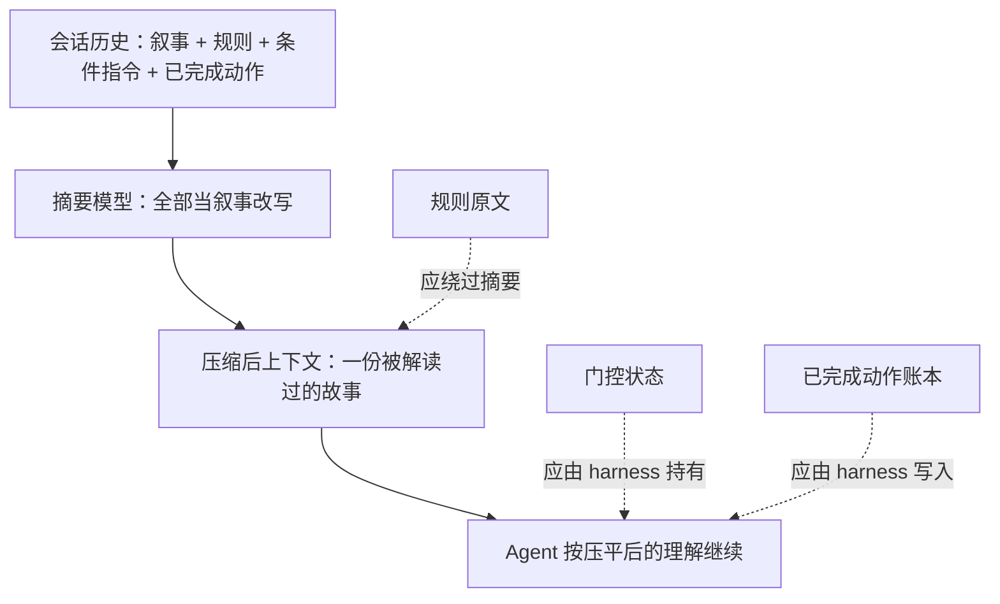

## 1. 问题现象 (Problem Symptoms)

结论先行：**compaction 是有损摘要，适合保存叙事（做过什么的大意），不适合保存约束，也不适合保存账本。** 约束指项目规则、条件指令和承诺；账本指已经完成的副作用。把这三类内容一起交给摘要模型改写，压缩后 Agent 看到的就是一份被「解读」过的会话：条件被压成无条件，规则被压成一句大意，已完成的步骤不见了。Agent 并没有「不听话」，它忠实地执行了压平之后的理解。

本文钉的是 **Agent Host 的上下文压缩层**：压缩边界前后，哪些内容必须原样保留、由谁保留。这是专题 **Agent Session-State Integrity** 的 #2（语义保真）。#1 [一次中断，整个会话永久 400](posts/orphan_tool_call_session_wedge.md) 讲的是结构不变量：历史里有没有半对 tool_use / tool_result。本文假设历史**结构完全合法**，丢的是**语义**。

与相邻文划界（本文不复述它们的机制）：

| 文章 | 层 | 问的是 / 和本文的交点 |
| --- | --- | --- |
| [一次中断，整个会话永久 400](posts/orphan_tool_call_session_wedge.md) | 会话转录的**结构** | 那篇：compaction 切点落在 call 和 result 之间，请求被 provider 拒绝（400）。本文：切点没问题、请求合法，摘要把意思改了，错误只会表现为 Agent 行为不对，没有任何报错 |
| [Agent 记得太久：Session Summarization 把间接注入写成跨会话「系统指令」](posts/agent_memory_poisoning.md) | 跨会话长期记忆（LTM） | 同一个机制（summarizer 改写内容），方向相反：那篇是**不可信**内容被写进 LTM 并抬权；本文是**可信**约束在单会话内被降级或丢失。只用这一句对照 |
| [静默截断](posts/silent_tool_result_truncation.md) | 单次工具结果被裁 | 那篇裁的是一次结果；本文是历史整体被重写之后，约束和门控丢失 |
| [Checkpoint 不等于 Durable Execution](posts/durable_agent_execution.md) / [Agent 写操作的幂等](posts/agent_write_idempotency.md) | 进程死后的重放 / 重试安全 | 「重做已完成步骤」只是本文 §4 BAD v3 的后果，幂等键怎么设计看后者，不在这里展开 |
| [长程 Agent：第一个错 ≠ 决定性错误](posts/long_horizon_decisive_error.md) | 归因方法 | 压缩丢约束可以是某次「决定性错误」的成因，但本文不讲归因 |
| **本文**（Session-State Integrity #2） | 压缩边界上的约束 / 门控 / 账本 | 压缩之后，Agent 按什么理解继续行动 |

下面三个现象都来自公开 issue。**多数根因是报告者的推断，不是维护者确认**，我会逐条标出。

### 现象 A：条件指令被压成了动作

**A1：Claude Code [#23776](https://github.com/anthropics/claude-code/issues/23776)。** 报告者在长会话里和 Agent 迭代一份修复方案，明确要求「**修订计划并给我审阅，再实现**」。会话触发 compaction 之后，Agent 直接改代码、新建测试文件、跑构建，跳过了审阅。报告者的描述是：摘要里技术细节保留得很好，但「先审再实现」这个条件丢了，摘要写的是 "Implement two changes"。报告者对根因的推断是摘要里的「Pending Tasks」反映的是模型对意图的解读，而不是用户的原话（**这是报告者的推断，不是维护者确认**）。两点要说清：

- 场景是 `--dangerously-skip-permissions`（bypass permissions）下的对话式迭代，**不是** Claude Code 的正式 plan mode。issue 里明说了这一点。
- 这条 issue 是报告者自己以「重复」为由关掉的（2026-02-06，关闭为 #14941 的 duplicate）。GitHub 上显示 `completed`，只是报告者自关，**不代表修复**。

**A2：Claude Code [#14941](https://github.com/anthropics/claude-code/issues/14941)。** 症状相近，**但不是同一个 bug**。这里压缩前的最后一条用户消息是一个问句（「目录结构选 A 还是 B」），自动 compaction 恰好在 Agent 回答之前触发。压缩后 Agent 收到的 continuation 提示里有这样一句：“Continue with the last task that you were asked to work on.”（issue 引用的原文），然后直接开始实现，改了 5 个以上的文件。报告者的推断是：这句话把「用户在征求意见」解读成了「继续编码」（**同样是报告者的推断**）。

两个 issue 的共同点只有一条：**压缩之后，一个「等用户」的状态变成了「去执行」的状态。** 差异也同样重要：A1 是用户给出的条件被摘要改写，A2 是待回答的问句加上 continuation 提示被当成任务。#14941 于 2026-03-09 被 github-actions 机器人以长期不活跃为由关闭（`not planned`），**未修复**。两条都没有修复。

### 现象 B：规则来源被压缩吞掉的报告，多数是旧版本

- Codex [#2927](https://github.com/openai/codex/issues/2927)（版本 0.27.0）和 [#5772](https://github.com/openai/codex/issues/5772)（版本 0.49）都报告：`/compact` 或自动 compaction 之后，`AGENTS.md` 不再被注入，Agent 像忘了里面的规则。两条后来都被 contributor 以「过期 / 旧 issue」关闭（关闭理由是过期，没有说明修复了什么）。**这是旧版本的报告，不能据此说 Codex 现在会丢 AGENTS.md。**
- Codex [#25792](https://github.com/openai/codex/issues/25792)（open）是证据最弱的一条：有用户报告压缩后模型自报的任务进度从大约 97% 掉到大约 42%，并怀疑 AGENTS.md 里的进度规则丢失，已完成的工作「可能被重开」（原文是 “appeared to restart or regress”、“may repeat”，都是怀疑，不是已证实）。issue 下有 contributor 评论认为：自报进度本身就是任意的，要可靠就得让 Agent 写到持久文件里（比如 ExecPlan）。所以这个数字只能当症状，不能当量化证据。
- Claude Code [#24460](https://github.com/anthropics/claude-code/issues/24460) 是一个 **enhancement 请求**：请求 `/compact` 之后重新注入完整的 CLAUDE.md。它描述的是风险（“may be partially or fully lost”）和手工 workaround，**不是对丢失的复现**（后被机器人以不活跃关闭，`not planned`）。

B 组告诉我们的不是「某个产品有 bug」，而是同一个设计问题在多个产品的 issue 里反复出现：**规则文件被当成历史的一部分，进入了摘要的输入。**

### 现象 C：压缩之后，Agent 找不到自己早先的动作

Claude Code [#75759](https://github.com/anthropics/claude-code/issues/75759)（open）：同一个活跃会话里，compaction 之后 Agent 否认或找不到自己早先写过的备份文件，用户把更早的对话贴回去才让它承认。报告里的原话是它 “denies doing it, or says it cannot find evidence”。**这条 issue 报告的是「否认 / 找不到」，没有报告「重新执行」。** 「忘了动作 → 重做一遍 → 非幂等副作用重复」是**我们自己的推论**：issue 下有一条评论称 Agent 会重试已完成的步骤，但没有给数据。本文 §4 BAD v3 用的就是这个推论，会再标一次。



---

## 2. 根因分析 (Root Cause Analysis)

以下是**我们的分析**，是从上面的公开报告里归纳的，不是任何一家的官方实现原理。多数产品的压缩实现只能从 issue 和文档里推断，我们没有读到它们的内部代码，所以不下结论。

三个现象的共同根因：**压缩把三种性质不同的内容当成了同一种东西，一律交给摘要处理。**

| 内容类型 | 例子 | 摘要之后会发生什么 | 保留方式需要什么 |
| --- | --- | --- | --- |
| **叙事** | 我们调查了什么、讨论了哪些方案 | 允许丢细节，保留大意就够 | 摘要本身就合适 |
| **约束** | `AGENTS.md` / `CLAUDE.md` 规则；「先修订计划给我审，再实现」这类条件指令；承诺 | 被改写成一句大意，条件被压成无条件，或者整条消失。Agent 看不到差异，因为摘要读起来完全通顺 | 原文，不能经过改写 |
| **账本** | 已执行的非幂等步骤、写过的文件、已发出的请求 | 摘要按「重要性」取舍，「做过什么」往往比「要做什么」权重低，Agent 之后会把没记录的当成没做过 | 由写入动作的一方（harness）记录，不依赖模型回忆 |

最常见的误判有三个，对应「再加一遍规则」这类处理：

1. **把它当成模型不听话。** 症状是「违反规则」「直接实现」，容易误判成指令写得不够大声，于是在规则文件里加 IMPORTANT、加粗、重复写三遍。但压缩后规则根本没有以原文出现在上下文里（或者以被改写的形式出现），再大声也没有用。
2. **把条件指令当成普通消息。** 「先给我看，再实现」不是一个事实，而是一个**状态**：当前处于「等待审阅」。摘要模型只会把它写成一句话，而下一轮 Agent 读到的是「Pending Tasks」里的一行，读起来和用户的原话已经是两回事。
3. **把已完成的动作当成历史，而不是账本。** 历史可以被摘要，账本不行。

还有一个容易被忽略的因素，来自 #14941：**压缩后 harness 自己追加的 continuation 提示**也会改变 Agent 对状态的理解。「继续上一个任务」对「等待用户回答」这个状态是错的。这是报告者的推断，但它指出了一个设计点：continuation 提示本身也属于压缩边界上需要审查的内容。

---

## 3. 机制要点：三类内容三种保留方式 (Mechanism)

先给出范围：下面的做法是**设计建议**，来源是上面的 issue 和各家文档里公开的接口，不是任何产品的内部实现。

### 3.1 约束：原文快照，每个压缩边界恰好重注入一次

规则文件（`AGENTS.md`、`CLAUDE.md`）在会话开始时加载，之后**以快照形式保存在会话状态里，和对话历史分开存放**，压缩时不进入摘要的输入，而是在压缩结果里原文追加一份。要点有四个：

- **原文，不是解读。** 摘要里允许写「项目有若干规则」，但规则本身必须逐字出现。
- **恰好一次。** 每个压缩边界只重注入一份，反复压缩不会累积旧副本；也不要每个 turn 都追加一遍，那只是换一种方式污染上下文。
- **文件变化时替换，不叠加。** 会话中途规则文件被改，resume / fork 后应该用新版本替换旧快照一次。
- **放不下就显式报错。** 快照总量超过预算时，要报告这个状况，而不是悄悄截断或让摘要模型去缩写。

公开资料里有对应的东西，但都要按各自的边界读：

- Codex [PR #29810](https://github.com/openai/codex/pull/29810)（已合并，2026-06-25）把 AGENTS.md 表示成持久化的 WorldState 的一段，初始上下文、每次请求的更新和 compaction 上下文由**同一个值**构建；resume / fork 时把当前指令和恢复出来的基线比较，不同就**恰好注入一次**替换。**注意这个 PR 的主要动机是 deferred executor 的环境变化**（环境晚于 turn 附着时，AGENTS.md 要能刷新），compaction 同源只是其中一项，不能把它写成「专门修复压缩丢规则」。
- Codex [#46186](https://github.com/openai/codex/issues/46186)（open，是一个提案）要求的契约几乎就是上面四条：快照原文、每个压缩边界恰好恢复一次、放不下要显式报告。该 issue 的正文自己声明了两点：它**并不证明**压缩移除了原始指令，而且当前实现的 `compact.rs` 里**已经有**初始上下文的重注入路径。它还写明保证的是**指令文本的保留和可用**，不是模型一定遵守。这一条很重要，见 §3.4。

### 3.2 门控：状态由 harness 的状态机持有，不交给摘要去「解释」

「先出计划等审」是一个门控。门控的正确位置是 harness 里的显式状态，例如 `task.state = awaiting_plan_review`，并且**写工具在这个状态下被拒绝**，而不是写在摘要里的某一句话。具体做法：

- 状态由 harness 的动作创建，比如 Agent 调用 `submit_plan_for_review` 工具时转入 `awaiting_plan_review`。
- **只有显式的用户批准事件**（界面按钮，或结构化的批准消息）能转出这个状态，不由模型对自然语言的解读来决定。
- 压缩只能改变模型看到的文字，改不了这个状态；压缩后的第一轮 Agent 如果想调用写工具，会被状态机直接拦下。

取舍要说明：用户在自由文本里随口说的「先让我看看」，harness 不一定能识别成状态转换。对这类指令，退一步的做法是**把最近一条用户消息原文放进压缩结果，作为单独的一块，而不是让摘要去转述**，同时让 continuation 提示不要说「继续上一个任务」，而是说「根据最近的用户消息和当前状态决定下一步」。这是我们的建议，不是已经验证的方案。

### 3.3 账本：已完成的副作用由 harness 写，压缩后先读账本

已完成的非幂等步骤，由**执行它的一方**在成功返回时写入外部账本（例如 `progress.jsonl`），每条带步骤名、结果和幂等键。压缩之后：

- Agent 在执行任何写步骤之前，先读账本；账本里有的步骤直接跳过。
- 即使 Agent 仍然重复调用，**工具侧用幂等键拦截**。幂等键怎么设计、超时之后能不能重试，见 [Agent 写操作的幂等](posts/agent_write_idempotency.md)。这里只强调：压缩让「Agent 以为没做过」这件事变得更常见，所以拦截不能只靠 Agent 自觉。
- 进度百分比由账本**算出来**，不让模型自报。#25792 里那个 97% → 42% 的数字，就是一个模型自报的数。

### 3.4 压缩边界可观测：抓实际发出的 prompt，并分清「可用」和「遵守」

两件事要在发版前做到：

- **对压缩后实际发给模型的请求做断言**，而不是对配置做断言。要看到的是：规则原文出现且只出现一次；门控状态没有变；账本在场。
- **分清「文本可用」和「模型遵守」。** 重注入只能保证指令文本在上下文里，不能保证模型一定照做，这也是 #46186 自己写明的边界。所以 §3.2 的状态机和 §3.3 的工具侧拦截才是兜底，重注入是第一道，不是唯一一道。

可用的钩子要读准它的能力边界。以 [Claude Code hooks 文档](https://code.claude.com/docs/en/hooks)（我们 2026-10-16 读取的版本）为准：

- `SessionStart` 的 matcher 支持 `compact`，压缩后会触发；hook 可以通过 `additionalContext` 往上下文里补内容，因此可以用来**重注入**。
- `PreCompact` 可以阻止压缩（matcher 区分 `manual` / `auto`），`PostCompact` 在压缩完成后触发，**没有 decision control**。
- `InstructionsLoaded` 在指令文件被（重新）加载时触发，`load_reason` 为 `compact` 时表示压缩后的重新加载。**它没有 decision control，只能用来观测和审计，不能用来重注入。** 文档还写明，通过「Project instructions」设置直接读取 `AGENTS.md` 时这个事件不会触发。

Codex 一侧的 `SessionStart` `compact` hook 要谨慎。#46186 下有非维护者评论称眼下就能用它重放指令（**社区说法**）。而 Codex [#28736](https://github.com/openai/codex/issues/28736) 曾报告：turn 中途的自动压缩之后，这个 hook 被推迟到后续 turn 才执行，所以压缩后的续跑可能先没有恢复内容。#28736 在 2026-07-20 被关闭为 `completed`，报告者留言感谢修复，但时间线里**没有关联的 PR**，我们没有核到修复的具体内容。结论是：**用 hook 重注入之前，在你用的版本上抓一次真实请求验证时序**（§5 注入 2）。

---

## 4. 同一个迁移任务 `MIG-318`：怎么接、错在哪、改完怎么走

业务线固定为一个数据库迁移任务 `MIG-318`：把 `billing` 表迁到新 schema，分三步：`snapshot` → `backfill` → `swap`。`AGENTS.md` 里有一条规则：**「禁止直连 prod DB；迁移只能先在 staging 上执行」**。下面四个版本里，**任务、AGENTS.md 和压缩触发时机都不变**，每个版本只改一处。以下场景和代码都是我们构造的**示意**，不是任何真实事故，也不是任何开源项目的实现；它把 §1 的三类症状串到同一条业务线上。

### 4.1 BAD v1：压缩 = 把全部历史交给摘要

第 3 轮，用户说：「**把回滚方案改好再给我看**」。这时上下文接近上限，自动 compaction 触发。

```python
# 示意：MIG-318 v1 —— 压缩就是把整段历史交给摘要模型
def compact(history):
    summary = llm.summarize(history)   # 规则、条件指令、已完成步骤都被当成叙事
    return [system_prompt, user(summary), user("Continue with the last task.")]
```

摘要写得很通顺，其中一条是「下一步：实施 `MIG-318` 迁移」。「改好回滚方案再给我看」这个条件被压成了无条件；`AGENTS.md` 里「禁止直连 prod」被改写成「项目有若干数据库安全规则」。压缩后的第一轮，Agent 直接运行迁移脚本，而且连的是 **prod**。日志里每一步都「合理」：它在执行摘要里写的下一步。值班的人第一反应是「再把规则写大声一点」。

修复方向：规则要原文回来（§3.1），门控要由状态机持有（§3.2）。先改规则这一处。

### 4.2 BAD v2：规则原文回来了，但门控还在摘要里

v2 只改了一处：压缩时把 `AGENTS.md` 的快照**原文**追加到压缩结果里。

```python
# 示意：MIG-318 v2 —— 相对 v1 只改了 compact()
def compact(history, session):
    summary = llm.summarize(strip_pinned(history))      # 规则不再进摘要输入
    return [system_prompt,
            pinned_block(session.rules_snapshot),        # 原文，每个压缩边界一次（§3.1）
            user(summary),
            user("Continue with the last task.")]         # continuation 提示不变
```

再次压缩后，Agent 不再连 prod，直接在 staging 上跑迁移，规则看起来被遵守了。但「改好回滚方案再给我看」仍然只存在于摘要的一句话里，摘要仍然写成「下一步：实施迁移」，用户要求的审阅仍被跳过：回滚方案还没改好，迁移已经在 staging 上开始了。**规则是静态的约束，这个门控是会话内的状态，两者要用不同的办法保留。**

修复方向：§3.2，门控交给 harness 的状态机。

### 4.3 BAD v3：门控修好了，但账本还在摘要里

v3 在 v2 基础上只加了一处：门控状态机。

```python
# 示意：MIG-318 v3 —— 相对 v2 增加门控状态机
WRITE_TOOLS = {"run_migration_step", "edit_file"}

def call_tool(task, name, args):
    if task.state == "awaiting_plan_review" and name in WRITE_TOOLS:
        return deny(f"{task.id} 正在等待计划审阅，写工具被门控")   # §3.2
    return tools[name](**args)

def on_user_event(task, event):
    if task.state == "awaiting_plan_review" and event.kind == "plan_approved":
        task.state = "approved"        # 只有显式批准事件能转出
```

压缩之后，Agent 想跑迁移，被门控拦下，先交出修订后的回滚方案。用户批准，`state` 转为 `approved`，迁移开始：`snapshot` 和 `backfill` 都执行完了。再一次压缩触发，摘要写的是「`MIG-318` 迁移进行中」，没有记录 `backfill` 已经跑完。压缩后的第一轮，Agent 从 `backfill` 重新开始，把回填再执行一遍，`billing` 的新表里出现重复行。

**注意：这一步是我们的推论。** #75759 实际报告的是 Agent 否认或找不到自己早先的动作，没有报告「重新执行」；「找不到 → 重做 → 副作用重复」是把这个现象接到非幂等步骤上的结果。它之所以值得写进发版清单，是因为只要工具不是幂等的，这个推论的代价就很大。

修复方向：§3.3，账本由 harness 写，工具侧用幂等键拦截。

### 4.4 GOOD：规则原文 + 状态机门控 + 外部账本 + 边界断言

GOOD 沿用 v3 的接线，新增的是账本和对压缩边界的断言。

```python
# 示意：MIG-318 GOOD —— 在 v3 基础上增加账本和边界断言
def run_step(task, step):
    key = f"{task.id}:{step}:v1"                       # 幂等键
    if ledger.done(key):                               # §3.3：账本里有，直接跳过
        return ledger.result(key)
    result = tools["run_migration_step"](step=step, idempotency_key=key)  # 工具侧也按键拦截
    ledger.append(key=key, step=step, result=result)   # 由 harness 写，成功才写
    return result

def compact(history, session, task):
    summary = llm.summarize(strip_pinned(history))
    ctx = [system_prompt,
           pinned_block(session.rules_snapshot),                    # §3.1
           state_block(task),                                       # §3.2：状态原文
           ledger_block(ledger.tail(task.id)),                      # §3.3：账本，不是摘要
           user(last_user_message_verbatim(history)),               # 最近一条用户消息原文
           user(summary),
           user("根据最近的用户消息和当前状态决定下一步。")]
    assert count_pinned(ctx, session.rules_snapshot) == 1           # §3.4：恰好一次
    return ctx
```

压缩后第一轮发出去的请求里，规则原文出现一次，`MIG-318.state` 保持原样，账本里 `snapshot`、`backfill` 已经完成。Agent 即使仍然想重跑 `backfill`，`ledger.done` 先拦一次，工具侧的幂等键再拦一次。

v1 → GOOD 的每处改动回扣 §3：

| 版本 | 失败表现 | 改动 | 对应 §3 |
| --- | --- | --- | --- |
| v1 → v2 | 规则被改写，Agent 直连 prod | 规则快照原文追加，不进摘要输入 | §3.1 |
| v2 → v3 | 「先给我看回滚方案」被压成「实施迁移」，staging 上被提前执行 | 门控由状态机持有；写工具在 `awaiting_plan_review` 下被拒；只有显式批准能转出 | §3.2 |
| v3 → GOOD | 压缩后没记录 `backfill` 已完成，重复执行（推论，见 §4.3） | `ledger` 由 harness 写，先读账本；工具侧幂等键拦截；进度由账本算出 | §3.3 |
| GOOD | 防止退化 | 抓取压缩后实际发出的请求，断言规则恰好一次、状态不变、账本在场；continuation 提示改为按状态决定 | §3.4 |

一句话回顾这条线：v1 的问题是**规则被改写**，v2 是**门控被当成叙事**，v3 是**账本被当成叙事**，GOOD 让三类内容各走各的保留方式，并且能在压缩边界上被检查。

---

## 5. 发版前清单：对准可注入的失败点 (Pre-Ship Checklist)

不要靠「手动压一次，看起来没事」判断。下面三个注入点各对应 §3 的一条，第四个对应 §3.1 的预算边界，都可以在 CI 里用调低阈值的压缩加 mock 模型跑。

**注入 1：在「等待审阅」状态下强制触发 compaction（调低阈值，或手动 `/compact`）（对应 §3.2）**

- [ ] 压缩后的下一轮**不调用任何写工具**，先输出修订后的计划
- [ ] `task.state` 仍然是 `awaiting_plan_review`，不因压缩而改变
- [ ] 模型被诱导调用写工具时，返回的是门控拒绝，而不是执行
- [ ] continuation 提示没有「继续上一个任务」这类会把等待状态变成动作的措辞

**注入 2：压缩后抓取实际发给模型的请求；会话中途修改规则文件后再 resume（对应 §3.1 / §3.4）**

- [ ] `AGENTS.md` / `CLAUDE.md` 原文出现，**且只出现一次**，连续压缩多次不累积旧副本
- [ ] 规则文件在会话中途被改后，resume / fork 之后是**替换**一次，不重复、不丢失
- [ ] 如果靠 `SessionStart` `compact` hook 重注入：在**当前使用的版本**上确认，turn 中途的自动压缩之后，恢复内容在下一次模型调用**之前**就位（#28736 的教训）

**注入 3：完成一个非幂等步骤后立刻压缩（对应 §3.3）**

- [ ] Agent 先读账本，跳过已完成的步骤
- [ ] 即使 Agent 仍然重复调用，也被工具侧的幂等键拦截，副作用只发生一次
- [ ] 进度数字来自账本，不是模型自报

**注入 4：规则快照总量超过预算（对应 §3.1）**

- [ ] 压缩**显式报错或告警**，而不是悄悄截断规则，或者让摘要模型去缩写

**发版评审口头否决**

- [ ] 「模型不听话，规则里再加一遍 IMPORTANT」
- [ ] 靠压缩 prompt 里写一句「请保留项目规则」作为唯一保证
- [ ] 把门控状态写成摘要里的一句话（「Pending Tasks」）
- [ ] 每个 turn 都追加一份规则副本来「保险」（造成重复累积，不是恰好一次）
- [ ] 用观测型事件（如 `InstructionsLoaded`）当重注入手段
- [ ] 用模型自报的进度百分比判断某一步是否做完
- [ ] 没在目标版本上抓过压缩后的实际请求，就相信 hook 的时序

---

## 6. 小结 (Takeaways)

**压缩后 Agent 违反规则、直接实现、重做步骤，先别怪模型不听话：问三件事：规则是以原文出现的，还是被改写成大意；门控是一个状态，还是摘要里的一句话；已完成的动作是账本，还是被摘要的历史。**

- 根因：压缩把叙事、约束、账本三种内容一律交给摘要。摘要适合叙事，改写约束和丢掉账本都不会报错，Agent 只是按压平后的理解继续（§1–§2）。
- 修法：规则原文快照，每个压缩边界恰好重注入一次；门控状态由 harness 状态机持有；已完成动作由 harness 写账本，工具侧幂等兜底；发版时抓压缩后的实际请求断言（§3）。
- `MIG-318` 从 v1 → v2 → v3 → GOOD，每次只改一处，分别回扣 §3.1 / §3.2 / §3.3 / §3.4（§4）；发版靠四个注入点把关（§5）。
- 证据边界：本文引用的 issue 里，A 组的根因是报告者的推断，两条都未修复；B 组 Codex 的是旧版本报告，不能当成现状；C 组报告的是「否认 / 找不到」，「重做」是我们的推论。Codex 的 [PR #29810](https://github.com/openai/codex/pull/29810) 已合并，但它的主要动机是 deferred executor 环境变化，不是专门修复压缩丢约束。

系列位置：**Agent Session-State Integrity** 专题 #2，管压缩边界上的**语义**保真。#1 [一次中断，整个会话永久 400](posts/orphan_tool_call_session_wedge.md) 管历史的结构配对，两篇的分工是：结构合法不等于语义完整。下一篇 #3 接着讲：有些 call 在进入历史之前就已经坏了。同一机制在跨会话方向上的对照见 [Agent 记得太久](posts/agent_memory_poisoning.md)；重复执行的幂等兜底见 [Agent 写操作的幂等](posts/agent_write_idempotency.md)。

---

## 参考 (References)

1. Claude Code — [Issue #23776：Session compaction loses user's most recent instructions, causing agent to misinterpret intent](https://github.com/anthropics/claude-code/issues/23776)（closed，报告者自关为 #14941 的 duplicate，不代表修复；场景是 bypass permissions，非 plan mode；根因为报告者推断）。
2. Claude Code — [Issue #14941：Post-compaction behavior aggressively resumes implementation without assessing conversational context](https://github.com/anthropics/claude-code/issues/14941)（closed `not planned`，2026-03-09 由机器人因不活跃关闭，未修复；症状与 #23776 不完全相同；根因为报告者推断）。
3. Claude Code — [Issue #24460：CLAUDE.md context lost after /compact — re-inject project instructions](https://github.com/anthropics/claude-code/issues/24460)（enhancement 请求，非复现；closed `not planned`，机器人因不活跃关闭）。
4. Claude Code — [Issue #75759：Context compaction loses intra-session work memory — agent forgets actions performed earlier in the same active session](https://github.com/anthropics/claude-code/issues/75759)（open；报告的是否认 / 找不到早先动作，未报告重跑）。
5. Codex — [Issue #2927：AGENTS.md is ignored after a /compact](https://github.com/openai/codex/issues/2927)（0.27.0 的报告；closed，contributor 以过时关闭）与 [Issue #5772：Codex CLI is not rereading agents.md after auto /compact](https://github.com/openai/codex/issues/5772)（0.49 的报告；closed，contributor 以旧 issue 关闭）。均为旧版本报告，不代表当前行为。
6. Codex — [Issue #25792：Context compaction forgets AGENTS rules: task progress can jump from 97% back to 42%](https://github.com/openai/codex/issues/25792)（open；报告者怀疑 + 模型自报进度；评论里有 contributor 质疑进度数字本身的意义）。
7. Codex — [PR #29810：core: make AGENTS.md react to environment changes](https://github.com/openai/codex/pull/29810)（merged 2026-06-25 UTC；AGENTS.md 作为持久 WorldState，compaction 上下文同源，resume / fork 恰好注入一次；主要动机是 deferred executor 的环境变化）。
8. Codex — [Issue #46186：Persist AGENTS.md snapshots and restore them verbatim once per compaction](https://github.com/openai/codex/issues/46186)（open，提案；正文自述不证明压缩移除了原始指令；`SessionStart` `compact` hook 方案来自社区评论）。
9. Codex — [Issue #28736：SessionStart "compact" hooks are deferred to later turns…](https://github.com/openai/codex/issues/28736)（closed `completed`，2026-07-20；报告者留言感谢修复，但未核到关联 PR）。
10. Claude Code 文档 — [Hooks reference](https://code.claude.com/docs/en/hooks)（`SessionStart` `compact` matcher、`PreCompact` / `PostCompact`、`InstructionsLoaded` 的 `load_reason` = `compact` 且无 decision control；2026-10-16 读取）。
11. 本站 — [一次中断，整个会话永久 400：tool_use / tool_result 配对不变量要在写入侧闭合](posts/orphan_tool_call_session_wedge.md)（系列 #1，结构不变量，划界）。
12. 本站 — [Agent 记得太久：Session Summarization 把间接注入写成跨会话「系统指令」](posts/agent_memory_poisoning.md)（摘要写入 LTM，方向相反，划界）。
13. 本站 — [静默截断：工具「成功返回」了半截，模型却自信答完](posts/silent_tool_result_truncation.md)（单次结果被裁，划界）。
14. 本站 — [Agent 写操作的幂等：超时之后凭什么敢重试](posts/agent_write_idempotency.md) 与 [长跑 Agent 挂了：Checkpoint 不等于 Durable Execution](posts/durable_agent_execution.md)（重复执行的兜底，划界）。
15. 本站 — [长程 Agent：第一个错 ≠ 决定性错误](posts/long_horizon_decisive_error.md)（归因方法，划界）。
