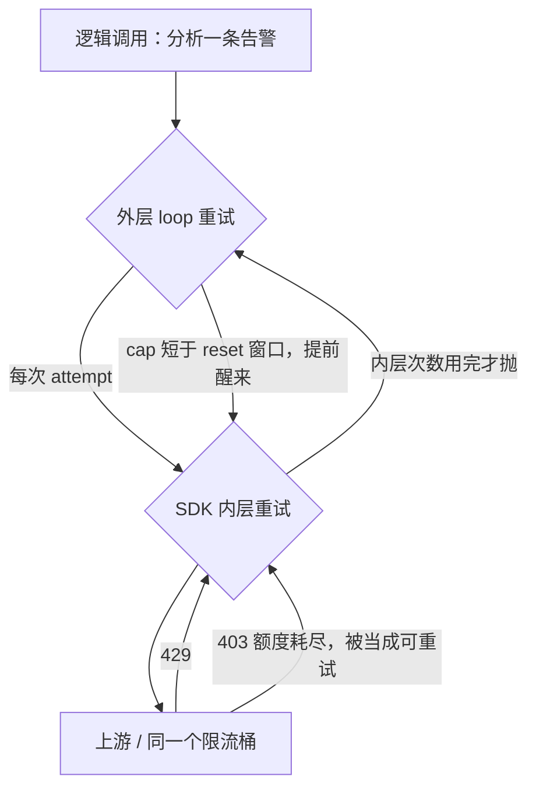

## 1. 问题现象 (Problem Symptoms)

结论先行：**重试的放大是乘法，不是加法。** Agent loop 里的重试单独看是合理的，provider SDK 默认的自动重试单独看也合理，两层叠在同一条调用链上，每个逻辑调用打出去的上游请求数就是两层次数的乘积，而且全部消耗同一个限流桶。限流本来是「等一会就好」的软错误，被这样放大后会升级成配额耗尽，Agent 看起来像卡死了。真正要修的是**这条调用链由谁负责重试**，以及**这个错误该不该重试**，把次数调小解决不了问题。

本文聚焦 **Agent Host 的 provider client / agent loop 重试策略层**：一次 LLM 调用失败后，有几层在重试，各按什么规则，消耗谁的预算。这是新专题 **Agent Runtime Failure Handling** 的 #1（重试所有权与错误分类）。

与相邻文划界（本文不复述它们的机制）：

| 文章 | 层 | 问的是 / 和本文的交点 |
| --- | --- | --- |
| [Agent 写操作的幂等](posts/agent_write_idempotency.md) | 写工具的重试**安全性** | 重试一次会不会双写；本文问的是重试**有几层、谁拥有、按什么分类**，不讨论幂等键 |
| [Checkpoint 不等于 Durable Execution](posts/durable_agent_execution.md) | 进程死后的恢复 | 进程重启后副作用会不会被重放；本文讨论的是进程**活着**时，同一个请求被重复发给上游 |
| [无终止谓词的 Handoff 环](posts/multi_agent_closed_loop_handoff.md) | 多 Agent 路由 | 专员之间来回转交，缺少终止条件；本文是**单条调用链内部**的重试乘法。两篇的共同点只有一个：等费用上限触发时钱已经花出去了 |
| [一次中断，整个会话永久 400](posts/orphan_tool_call_session_wedge.md) | 会话转录结构 | 那篇已经说明配对类 `400 invalid_request` 是历史损坏、不可重试；本文只把它归进 STOP 类，不复述毒历史的成因 |
| **本文**（Runtime Failure Handling #1） | provider client + agent loop 的重试策略 | 一个调用失败后打出几个上游请求；谁决定要不要重试、等多久 |

一句话分工：幂等篇问「**这一次**重试安不安全」，本文问「**到底有几次**重试，是谁发起的」。

### 现象 A：mock 恒定返回 429，外层只重试几次，上游却收到它的三倍

nanobot 的 [issue #2760](https://github.com/HKUDS/nanobot/issues/2760) 和修复 [PR #2759](https://github.com/HKUDS/nanobot/pull/2759) 是最干净的复现。应用层由 `LLMProvider._run_with_retry` 负责重试（`retry_mode="standard"`，1 次初始请求 + 3 次重试，共 4 次）；底下的 `AsyncOpenAI` / `AsyncAnthropic` 构造时没有传 `max_retries`，用的是 SDK 默认的 `max_retries=2`。PR 作者把一个本地 mock 端点设成永远返回 429，结果 OpenAI 兼容路径和 Anthropic 路径上都是 **SDK 默认时 12 个上游请求，关掉 SDK 重试后 4 个（3.0x）**。注意这是 mock 端点上的实测，不是生产数据。

单看任何一层都挑不出毛病：外层有上限、有 backoff，SDK 的默认值也是官方给的。问题出在两层乘在一起，而且没有任何一层知道对方存在。PR 描述里把这点讲得很直白：重试原本会叠加（"retry policy could stack"），叠加后在限流或出错场景下会成倍放大上游请求。

### 现象 B：外层「尊重 Retry-After」，Agent 照样挂住

hermes-agent 的 [issue #26293](https://github.com/NousResearch/hermes-agent/issues/26293) 更像生产事故。两个默认值互相作用：

1. Anthropic 客户端构造时没有设 `max_retries`，SDK 默认重试生效。issue 原话是 SDK 以 1–2s 的指数退避重试 429/5xx，并且 "**ignores `Retry-After`**"（这是 hermes 对其当时所用 SDK 版本的描述，不是本文对各家 SDK 的判断）。
2. 外层 loop 读取了 `Retry-After`，但把它截到 120s：`_retry_after = min(float(_ra_raw), 120)  # Cap at 2 minutes`。报告者的 Anthropic Tier-1 账户里，input-token 桶大约 171s 才 reset（报告者账户的观测值，不是官方限额）。

结果是外层睡 120s，在桶 reset 之前醒来，再发一次；这一次请求里 SDK 又静默连发了几次。issue 对后果的描述是 "Soft per-minute throttle escalates into hard request-count exhaustion; the agent appears hung"。所以外层虽然名义上尊重 `Retry-After`，只要 cap 比 reset 窗口短，就等于没有尊重。

### 现象 C：额度已经耗尽，SDK 还在原地反复重发

gh-aw 的修复 [PR #47237](https://github.com/github/gh-aw/pull/47237)（对应自动生成的分析报告 [issue #47217](https://github.com/github/gh-aw/issues/47217)）记录了第三种形态：Claude Code CLI 内部的 Anthropic SDK 遇到终态错误 `403 ai_credits_limit_exceeded` 时，在 harness 看到任何输出之前就已经在进程内重试了很多次。PR 描述说这样做 "burning wall-clock time and amplifying rate-limit pressure on other workflows"。额度耗尽时，再等多久也不会恢复，这类错误本就不该进入任何一层重试。



---

## 2. 根因分析 (Root Cause Analysis)

三个现象的共同根因是：**一条调用链上有多个重试层，每层都以为只有自己在重试，但它们消耗的是同一个上游配额。** 常见的误判是把这些层合成一句「我们有重试」，然后在限流时把重试次数调大或者加并发，这只会让放大更严重。

| 层 | 典型位置 | 次数 / 等待由谁决定 | 看得到 `Retry-After` 吗 | 知道这个错误是终态吗 |
| --- | --- | --- | --- | --- |
| 作业 / 编排层 | 批处理调度、harness、workflow runner | 作业配置 | 通常看不到 | 只能靠匹配输出文本 |
| Agent loop 层 | `_run_with_retry` 一类的外层循环 | Host 代码 | 能看到，但可能被 cap 截断 | 取决于有没有做分类 |
| Provider SDK 层 | 客户端构造参数 `max_retries`、环境变量 | SDK 默认值 | 取决于 SDK 版本 | 一般只按状态码 |
| 上游 | provider 限流桶 | provider | 由它下发 | 由它决定 |

这张表里有三处断裂，分别对应 §1 的 A/B/C：

1. **次数相乘（A）。** 设外层每个逻辑调用最多 `1+R` 次 attempt，SDK 每次 attempt 最多 `1+S` 次请求，最坏情况就是 `(1+R)×(1+S)` 个上游请求。再乘上并发 worker 数，这些请求全部落在同一个桶上。每层的配置单独审都会通过，因为没人把它们乘在一起看。
2. **两层的 backoff 语义不同，却共用一个桶（B）。** 外层按 `Retry-After` 等，内层按自己的短 backoff 立刻再打。即使外层等够了时间，它醒来后的那一次 attempt 也会被内层放大成一小串请求。外层的 cap 再比 reset 窗口短，每一轮都会提前触发限流，桶永远回不满。
3. **缺少错误分类（C）。** 「429 / 5xx 就重试」这类按状态码一刀切的规则，把至少三种语义合成了一种。nanobot #2760 下一位社区评论者把它们叫做 **WAIT**（暂时的限流压力，按延迟等）、**CAP**（并发压力，先降 worker 再试）和 **STOP**（额度耗尽，不要重试）。他还指出两个状态码相同的 429 可能需要相反的处理。额度耗尽、鉴权失败、请求本身不合法都属于 STOP；它们进入任何一层重试，都只会白白消耗时间和别的作业的配额。

所以修法的核心不是调次数，而是**所有权 + 分类**：每条调用链只指定一层负责重试，分类也在这一层做。

---

## 3. 机制要点：唯一 owner、cap、分类、共享预算 (Mechanism)

### 3.1 唯一 retry owner：在客户端构造处显式关掉内层，并写进测试

一条调用链只能有一层负责重试。在 Agent Host 里，这一层通常应该是外层 loop，因为只有它能看到作业上下文、`Retry-After` 和预算。做法就是在 **SDK 客户端构造处显式传 `max_retries=0`**，再用回归测试锁住这个默认值，防止哪天有人新增一个构造点又漏掉。

三个一手修复都是这么做的，但覆盖面各有讲究：

- nanobot PR #2759 在 `OpenAICompatProvider` 和 `AnthropicProvider` 构造客户端时设了 `max_retries=0`，并加了回归测试；合入的改动还包括 `azure_openai_provider.py`。PR 自己写明了代价：不再依赖 SDK 的错误分类和 backoff，换来可预测的单层重试语义。
- hermes PR #53918 给三个 Anthropic SDK 构造器（`Anthropic`、`AnthropicBedrock`、bearer-hook client）都设了 `max_retries=0`，OpenAI / aggregator 路径则在唯一的 `create_openai_client` 收口处用 `setdefault` 设 `max_retries=0`，调用方以后仍可以显式改回来。**唯一 owner 不等于所有地方都设成 0**：`auxiliary_client` 为压缩、视觉等辅助任务单独构造客户端，这些调用没有外层 loop 包裹，所以 PR 刻意保留了 SDK 重试，作为它们唯一的重试层。
- gh-aw PR #47237 用 `ANTHROPIC_MAX_RETRIES` 环境变量关闭或限制 agent 阶段的 SDK 内层重试，让 harness 当 owner。评审中有人指出 external threat-detection 路径没有 harness 重试包裹，于是最终只对 agent 阶段生效，detection 路径保留 SDK 默认。

三个修复归结成同一条规则：**对每个客户端构造点，回答「谁包裹了它」。** 有外层 owner 包裹的，关掉内层；没有包裹的，内层就是 owner，保留它。必须二选一，并把选择写进代码注释和测试。

### 3.2 WAIT 的上限：cap 不能低于观测到的 reset 窗口

外层 owner 按 `Retry-After` 等待时，cap 用来挡住离谱的值（比如几小时）。但**只要 cap 低于真实的 reset 窗口，每次重试都会落在 reset 之前**，这个 cap 就变成制造限流的机关。hermes 把 cap 从 120s 提到了 600s，PR 的说法是这能覆盖实际的 provider reset 窗口，同时仍能拒绝病态值。

可复用的规则：

- cap 按你们实际观测到的最长 reset 窗口来定，并留出余量，不要凭感觉写 2 分钟。
- `Retry-After` 超过 cap 时，**不要截短后照样重试**。要么把这个调用归入 STOP / 推迟（预算不够等就放弃并上报），要么把作业挂起到 reset 之后。截短重试是最糟的选择。
- 等待期间，这个 key 下的其他 worker 也该一起等，不能一个 worker 在睡、其他 worker 继续打同一个桶。

### 3.3 owner 处做错误分类：WAIT / CAP / STOP

分类必须放在 owner 那一层做，因为只有它的决定会生效。分类的输入不能只看状态码：

| 类 | 典型信号 | 动作 |
| --- | --- | --- |
| WAIT | 429 带合理的 `Retry-After`；5xx 瞬时错误 | 按 §3.2 等待后重试，消耗预算 |
| CAP | 并发相关的 429，同一时间窗内大量 worker 同时失败 | 先降并发，再按 WAIT 处理 |
| STOP | 额度 / 账单耗尽（如 `403 ai_credits_limit_exceeded`）、鉴权失败、`400 invalid_request` 这类请求本身不合法的错误 | **0 次重试**，首个 attempt 就上报；作业停止派发新调用 |

两点边界：

- 状态码相同不代表语义相同。nanobot #2760 的讨论里，社区评论者举的例子是：一个 429 只带短 `Retry-After`，属于 WAIT；另一个 429 的响应体写着配额用尽，属于 STOP。分类器要能读取响应体或者 provider 的结构化错误类型，不能只看 `status_code`。
- STOP 要**在作业层面生效**。一个 worker 发现额度耗尽后，其他 worker 也不该继续派发新调用。gh-aw 的 harness 已经能识别额度耗尽，但 SDK 在它之前就已经在进程内反复重发；PR 合入时只给这个识别补了回归测试，因为现有的宽泛匹配已经能匹配到该错误串。这说明识别出终态只是一半，**还要保证没有更内层的重试抢在识别之前发生**，这又回到 §3.1。

### 3.4 共享 retry budget + 放大比指标

即使只有一层 owner，单个调用各自计数也会出问题：几百个调用同时进入 WAIT，每个都觉得自己只重试了 3 次，合起来就是一场重试风暴。

- **预算按作业 / 会话共享**：每次重试都从同一个池子里扣，子调用（包括子代理发起的调用）不能各自重新开始计数。预算用完就停止重试，把剩余失败交给上层处理。
- **指标 `upstream_requests / logical_calls`（放大比）**：在 owner 处数逻辑调用，在 HTTP 传输层（而不是 SDK 之上）数实际请求。放大比超过 owner 自己的上限，说明某处有一层没关掉的内层重试；这个指标就是 §3.1 的线上回归测试。
- 打点时保留原始状态码和错误类型，不要把它们包装成笼统的「连接错误」。否则 §3.3 的分类器拿不到输入。

---

## 4. 同一个夜间作业 `NIGHTLY-OPS-0917`：怎么接、错在哪、改完怎么走

业务线固定为一个夜间批处理作业 `NIGHTLY-OPS-0917`：Agent 逐条分析前一天的告警，每条告警一次 LLM 调用，用固定数量的 worker 并发执行。下面四个版本里，**并发数、告警量和上游 provider 都不变**，每次只改一处，改了什么都会写明。以下代码是我们自己 Host 的示意代码，不是任何开源项目的实现；`max_retries` 是 OpenAI / Anthropic Python SDK 客户端构造的公开参数。

### 4.1 BAD v1：外层 loop 重试，SDK 用默认值，两层相乘

```python
# 示意：NIGHTLY-OPS-0917 v1
client = AsyncAnthropic()            # 没传 max_retries → SDK 默认自动重试

async def analyze(alert):
    for attempt in range(1 + OUTER_RETRIES):
        try:
            return await client.messages.create(**build_req(alert))
        except (RateLimitError, APIStatusError) as e:
            if attempt == OUTER_RETRIES:
                raise
            await asyncio.sleep(retry_after_or_backoff(e, cap=120))
```

限流一开始，`NIGHTLY-OPS-0917` 的每个逻辑调用最多会打出 `(1+OUTER_RETRIES)×(1+SDK 默认次数)` 个上游请求，再乘上并发 worker 数。外层每次醒来，SDK 都会先连打一串请求，所以桶始终回不满。日志里只有外层 attempt 的记录，看起来「只重试了几次」，SDK 的内层请求没有任何记录。值班的人看到的是「provider 一直 429」，第一反应往往是加大重试次数。

修复方向：§3.1，确定唯一 owner。

### 4.2 BAD v2：关掉 SDK 重试，外层也读 `Retry-After`，但 cap 截在 120s

v2 只改了一处：客户端构造处显式传 `max_retries=0`，外层 loop 成为唯一 owner。放大比降到了外层上限，§3.1 的问题解决了。外层的等待逻辑和 v1 完全一样，cap 仍然是 120s。

```python
# 示意：NIGHTLY-OPS-0917 v2 —— 相对 v1 只改了这一行
client = AsyncAnthropic(max_retries=0)   # 外层 loop 是唯一 owner（§3.1）
# analyze() 不变：仍是 retry_after_or_backoff(e, cap=120)
```

问题在于这个账户的桶 reset 窗口比 120s 长。provider 下发的 `Retry-After` 被截短，`NIGHTLY-OPS-0917` 的每一次重试都落在 reset 之前，于是继续 429，直到外层次数用完。和 v1 比，请求数少了，但作业的结果没有变：一批告警全部失败，日志里每一行都写着「已按 Retry-After 等待」。

修复方向：§3.2，cap 不低于 reset 窗口，超出 cap 就放弃或挂起，不截短重试。

### 4.3 BAD v3：等待修好了，但额度耗尽的 403 仍被当成可重试

v3 在 v2 基础上只改了等待策略：cap 提到覆盖观测到的 reset 窗口，`Retry-After` 超过 cap 时直接放弃该调用并上报。客户端仍是 `max_retries=0`，外层仍是唯一 owner。限流场景这下能跑通了。

某天夜里账户额度耗尽，上游开始返回 403 额度错误。v3 的 except 分支沿用 v1 的写法，把 `APIStatusError` 整个当成可重试，403 也就进了 backoff：

```python
# 示意：NIGHTLY-OPS-0917 v3 —— 等待已修，分类仍缺
        except (RateLimitError, APIStatusError) as e:   # 403 额度耗尽也进来了
            if attempt == OUTER_RETRIES:
                raise
            delay = retry_after_or_backoff(e, cap=OBSERVED_RESET_CAP)
            if delay is None:          # Retry-After 超出 cap：放弃并上报（§3.2）
                raise
            await asyncio.sleep(delay)
```

每个告警都把外层重试跑满才失败，所有 worker 还在继续派发新告警。作业跑完了整个时间窗，产出为零；而第一个 403 出现时其实就可以停下。

修复方向：§3.3，在 owner 处做 STOP 分类，并在作业层面生效。

### 4.4 GOOD：唯一 owner + 分类 + 作业级预算 + 放大比

GOOD 沿用 v3 的接线：客户端 `max_retries=0`，外层 loop 是唯一 owner，cap 覆盖 reset 窗口。新增的是 owner 处的分类、作业级共享预算，以及放大比打点。

```python
# 示意：NIGHTLY-OPS-0917 GOOD
# 唯一 owner = 下面的 analyze()；SDK 内层关闭，有测试锁定（§3.1）
client = AsyncAnthropic(max_retries=0, http_client=counting_http_client(job_id))

budget = RetryBudget(job_id="NIGHTLY-OPS-0917", max_retries=JOB_RETRY_BUDGET)  # §3.4
stop = asyncio.Event()

async def analyze(alert):
    metrics.logical_call("NIGHTLY-OPS-0917")                 # 每个 alert 只记一次，在循环外
    for attempt in range(1 + OUTER_RETRIES):                 # 单调用上限，与 v1–v3 对齐
        if stop.is_set():
            raise JobStopped(alert)
        try:
            return await client.messages.create(**build_req(alert))
        except APIStatusError as e:
            kind = classify(e)                       # 读状态码 + 错误类型 + 响应体（§3.3）
            if kind is STOP:                         # 额度 / 鉴权 / invalid_request
                stop.set()                           # 作业停止派发新调用
                alert_oncall("NIGHTLY-OPS-0917", e)  # 保留原始 status 与 body
                raise
            if kind is CAP:
                await pool.reduce_concurrency()
            if attempt == OUTER_RETRIES:
                raise GiveUp(alert, e)               # 单调用上限用完，不再占共享预算
            delay = wait_for(e, cap=OBSERVED_RESET_CAP)   # §3.2：超出 cap 返回 None
            if delay is None or not budget.try_take():    # §3.4：共享预算
                raise GiveUp(alert, e)
            await rate_gate.sleep_all(delay)         # 同一个桶上的 worker 一起等
```

`counting_http_client` 在传输层统计实际请求数，`metrics.logical_call` 在 owner 处统计逻辑调用数，两者相除就是每次运行的放大比。放大比超过外层上限会触发告警，说明某处又出现了一层内层重试。

v1 → GOOD 的每处改动回扣 §3：

| 版本 | 失败表现 | 改动 | 对应 §3 |
| --- | --- | --- | --- |
| v1 → v2 | 每个逻辑调用打出两层次数之积个请求 | 构造处 `max_retries=0`，外层成为唯一 owner | §3.1 |
| v2 → v3 | 截短的 `Retry-After` 让每次重试都落在 reset 之前 | cap 覆盖 reset 窗口；超出 cap 就放弃，不截短重试 | §3.2 |
| v3 → GOOD | 403 额度耗尽被重试跑满，作业零产出 | owner 处分 WAIT / CAP / STOP；STOP 停止整个作业的派发 | §3.3 |
| GOOD | 防止退化 | 作业级共享预算 + `upstream_requests / logical_calls` 指标 | §3.4 |

一句话回顾这条线：v1 的问题是**层数**，v2 是**等多久**，v3 是**该不该等**，GOOD 让这三件事都只由一个 owner 决定，并且可以观测。

---

## 5. 发版前清单：对准可注入的失败点 (Pre-Ship Checklist)

不要靠「限流时日志看起来正常」判断。下面三个注入点各对应 §3 的一条，都可以在 CI 里用 mock provider 跑。

**注入 1：mock provider 恒定返回 429（对应 §3.1 / §3.4）**

- [ ] 每个逻辑调用的上游请求数等于外层上限，而不是两层次数的乘积
- [ ] 放大比指标 `upstream_requests / logical_calls` ≤ 外层上限；传输层计数与 owner 计数对得上
- [ ] 每个 SDK 客户端构造点都有测试，断言 `max_retries` 的值，以及该构造点是否被 owner 包裹

**注入 2：429 带 `Retry-After: 180`（对应 §3.2）**

- [ ] 下一次请求与上一次的间隔 ≥180s；或者超出 cap / 预算时直接放弃并上报，绝不截短后重试
- [ ] 等待期间，同一个桶上的其他 worker 不发请求

**注入 3：返回 `403` 额度耗尽 / `400 invalid_request`（对应 §3.3）**

- [ ] 0 次重试：首个 attempt 就上报终态错误，原始状态码和错误类型被保留
- [ ] 作业停止派发新调用，已经在飞的调用不再重试
- [ ] 内层（SDK、CLI、子进程）在 owner 识别到 STOP 之前没有重发

**发版评审口头否决**

- [ ] 「限流就把重试次数调大 / 加并发」
- [ ] 新的客户端构造点不传 `max_retries`，依赖 SDK 默认值
- [ ] `Retry-After` 写死一个 cap 之后截短重试
- [ ] 所有地方一律设 `max_retries=0`，却没检查哪些调用根本没有外层 owner

---

## 6. 小结 (Takeaways)

**限流时 Agent 卡住，先问三件事：这条调用链上有几层在重试；等待时间有没有被截短；这个错误到底该不该重试。**

- 根因：多个重试层各自合理，叠在一起是乘法，而且消耗同一个限流桶；按状态码一刀切把 WAIT / CAP / STOP 混成了一类（§1–§2）。
- 修法：每条调用链一个 retry owner，未被包裹的调用保留内层重试；cap 不低于 reset 窗口；在 owner 处分类，STOP 在作业层面生效；共享预算并监控放大比（§3）。
- `NIGHTLY-OPS-0917` 从 v1 → v2 → v3 → GOOD，每次只改一处，分别对应 §3.1–§3.4（§4）；发版靠三个注入点把关（§5）。

系列位置：**Agent Runtime Failure Handling** 专题 #1，讨论「调用失败之后，谁来重试、按什么分类」。后续可以接着写 retry budget 如何跨子代理传递，以及 circuit breaker。重试本身是否安全见 [Agent 写操作的幂等](posts/agent_write_idempotency.md)；进程死后的重放见 [Checkpoint 不等于 Durable Execution](posts/durable_agent_execution.md)；不可重试的历史损坏见 [一次中断，整个会话永久 400](posts/orphan_tool_call_session_wedge.md)。

---

## 参考 (References)

1. nanobot — [PR #2759：fix: stop retry amplification (12→4 requests) by disabling SDK auto-retries](https://github.com/HKUDS/nanobot/pull/2759)（merged 2026-04-04 UTC；`OpenAICompatProvider` / `AnthropicProvider` 构造处设 `max_retries=0`，改动也覆盖 Azure OpenAI provider；12 vs 4 是 mock 恒 429 端点上的实测）。
2. nanobot — [Issue #2760：Retry amplification risk: stacked app+SDK retries can triple upstream load](https://github.com/HKUDS/nanobot/issues/2760)（closed completed；评论中有社区成员提出 WAIT / CAP / STOP 的 429 分类，非维护者结论；分类加固另见已合并的 [PR #2762](https://github.com/HKUDS/nanobot/pull/2762)）。
3. hermes-agent — [PR #53918：fix(retry): stop SDK auto-retry double-firing inside the rate-limit loop (Anthropic + OpenAI), raise Retry-After cap to 600s](https://github.com/NousResearch/hermes-agent/pull/53918)（merged 2026-06-28 UTC；Fixes #26293；保留 `auxiliary_client` 的 SDK 重试）。
4. hermes-agent — [Issue #26293：fix(anthropic): SDK auto-retry + Retry-After 120s cap deadlock rate-limited Anthropic accounts](https://github.com/NousResearch/hermes-agent/issues/26293)（closed completed；约 171s 是报告者账户的观测值；"ignores `Retry-After`" 是该 issue 对当时 SDK 行为的描述）。
5. gh-aw — [PR #47237：fix(claude): disable Anthropic SDK inner retries to prevent terminal-error storm](https://github.com/github/gh-aw/pull/47237)（merged 2026-07-22 UTC；agent 阶段关闭或限制 SDK 内层重试，detection 路径保留默认）与 [Issue #47217](https://github.com/github/gh-aw/issues/47217)（自动化失败分析报告，closed completed）。
6. 本站 — [Agent 写操作的幂等：超时之后凭什么敢重试](posts/agent_write_idempotency.md)（重试安全性，划界）。
7. 本站 — [长跑 Agent 挂了：Checkpoint 不等于 Durable Execution](posts/durable_agent_execution.md)（进程死后的重放，划界）。
8. 本站 — [专员互相转交都「成功」：无终止谓词的 Handoff 环](posts/multi_agent_closed_loop_handoff.md)（路由环，划界）。
9. 本站 — [一次中断，整个会话永久 400：tool_use / tool_result 配对不变量要在写入侧闭合](posts/orphan_tool_call_session_wedge.md)（不可重试的历史损坏，划界）。
