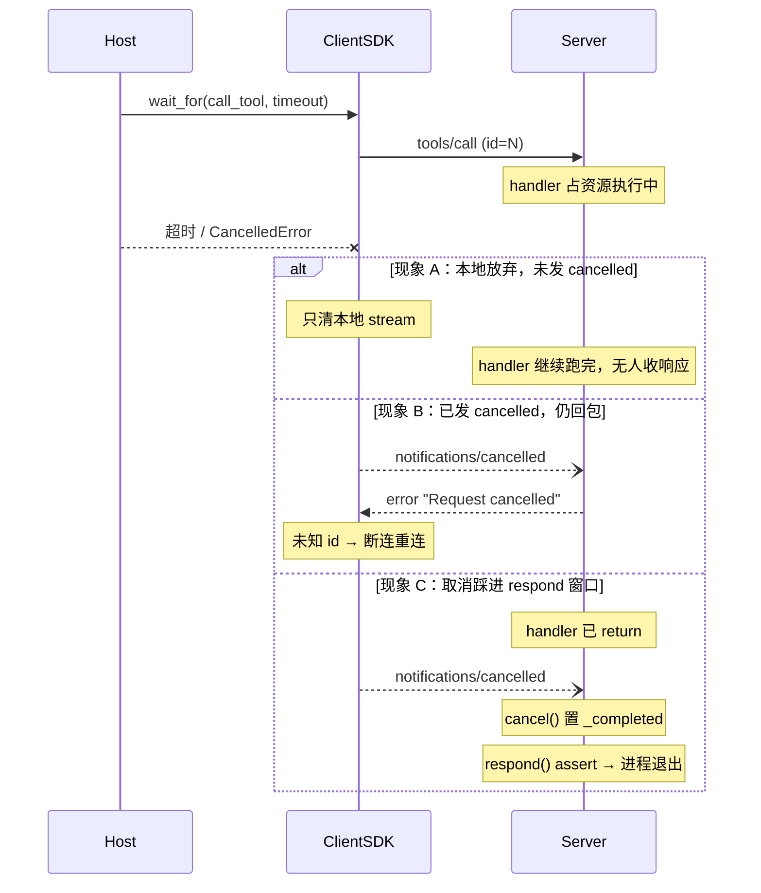

## 1. 问题现象 (Problem Symptoms)

结论先行：**在 MCP 里，Host 本地放弃一次工具调用，不等于对端已经停下。** 超时、用户中断、外层 `asyncio.wait_for` 打断 `await`——只要线上没有发出 `notifications/cancelled`，server 端的 handler 会继续跑完，期间一直占着 DB 连接、锁、文件句柄；结果送回时客户端已经没人收。反过来，取消**已经发出去了**，server 仍回一个响应，或取消踩进「handler 已返回、`respond()` 未写」的窗口，也会把连接打断甚至把整个 server 进程打崩。真正要修的是**取消作为一条协议消息，有没有把「调用方放弃等待」和「被调方停止执行」对齐**，不是把超时调大。

本文是 **Agent Runtime Failure Handling** 专题的 #2（取消传播）。#1 [一个 429 打出成倍的上游请求](posts/layered_retry_amplification.md) 问的是：调用失败之后谁来重试、按什么分类。本篇问的是：放弃那一次调用时，对端是否真的停下、线上是否还会冒出响应。两篇只在「泄漏的调用让后续重试排在后面」处交一句。

与相邻文划界（本文不复述它们的机制）：

| 文章 | 层 | 问的是 / 和本文的交点 |
| --- | --- | --- |
| [一个 429 打出成倍的上游请求](posts/layered_retry_amplification.md)（Runtime Failure Handling #1） | 重试所有权与错误分类 | 那篇：有几层在重试。本文：被放弃的那次调用在远端的生命周期 |
| [Agent 写操作的幂等](posts/agent_write_idempotency.md) | 写工具的重试安全性 | 那篇：超时后重试是否安全。本文只把幂等键当作「取消后结果未知」的落地手段 |
| [一次中断，整个会话永久 400](posts/orphan_tool_call_session_wedge.md) | 会话历史配对 | 那篇：中断后历史缺 output → 永久 400。本文：中断后 server 执行与传输连接的状态；`outcome_unknown` 语义直接引用那篇 |
| [Checkpoint 不等于 Durable Execution](posts/durable_agent_execution.md) | 进程死后的重放 | 那篇：进程死后从 checkpoint 重放副作用。本文：进程活着时的取消竞态；BAD v3 的崩溃只当后果，不讲恢复 |
| [MCP Server 实例复用](posts/mcp_server_instance_reuse_cross_client_leak.md) | 连接实例作用域 | 同属 MCP 运行时。那篇：实例复用造成错路由。本文：单个请求的取消生命周期。「未知 id 的响应」两篇都会出现，本文只讲它如何触发断连 |
| **本文**（Runtime Failure Handling #2） | MCP 请求生命周期 / 取消语义 | 本地放弃有没有过线；取消后还回不回包；响应边界是否单一终态 |

证据范围先说清：下面机制主线来自 python-sdk [issue #2507](https://github.com/modelcontextprotocol/python-sdk/issues/2507)（closed completed，经已合 [PR #2838](https://github.com/modelcontextprotocol/python-sdk/pull/2838)）、[issue #2416](https://github.com/modelcontextprotocol/python-sdk/issues/2416)（仍 open；fix [PR #2417](https://github.com/modelcontextprotocol/python-sdk/pull/2417) closed **未合**），以及旁证 [issue #2480](https://github.com/modelcontextprotocol/python-sdk/issues/2480) / [PR #3188](https://github.com/modelcontextprotocol/python-sdk/pull/3188)。**只讲 python-sdk**；TypeScript 只用 [#2018](https://github.com/modelcontextprotocol/typescript-sdk/issues/2018) 一条旁证，不推断 TS / C# / Go SDK 的取消行为。**v1 与 v2 必须分开写**：#2507 / #2480 相关修复都在 v2 主线，1.x 仍是旧行为——不要读成「Python SDK 已修复」。

三个现象必须分开看：**是否发出了 `notifications/cancelled`**，决定你面对的是哪一类坏。

### 现象 A：本地放弃了，线上没有 `notifications/cancelled`——handler 继续占资源

Agent Host 给 `call_tool` 包一层 `asyncio.wait_for(..., timeout=30)`，或依赖 SDK 自己的 `anyio.fail_after`。超时一到，Host 本地抛错、把这次调用当失败。**关键：这条路径上没有发出 `notifications/cancelled`。** 这不是「取消已经正确传播」，只是调用方自己不等人了。

python-sdk [#2507](https://github.com/modelcontextprotocol/python-sdk/issues/2507)（报告环境 mcp 1.29.0）把两条放弃路径写得很清楚：

1. **SDK 内部超时**（`anyio.fail_after`）：`except TimeoutError` 只抛 `McpError`，落入 `finally` 关掉客户端本地的 response stream。
2. **外部取消**（调用方 `asyncio.wait_for` / `CancelledError`）：没有对应的 `except`，异常穿过 `finally`，同样只清理本地 stream。

两条路径都不发 `notifications/cancelled`。server 侧其实已经有收到取消就取消协程的逻辑；缺的是客户端发送。报告者对一个 `await asyncio.sleep(300)` 的工具做 50 次 0.1s 超时调用，server 端任务数从 4 涨到 54（stdio 与 streamable_http 相同）。同一份报告里，作者在自己的 Databricks 面向 server 上观察到：连接池 10 + 10 次取消 = 池耗尽。**这两个数字都是报告者探针 / 自有 server 上的观察，不是基准。**

### 现象 B：取消已经发出去了，server 仍回一个响应——严格客户端断连重连

这条和 A 相反：**线上已经有 `notifications/cancelled`。** 坏在 receiver 端。

[#2480](https://github.com/modelcontextprotocol/python-sdk/issues/2480)（报告环境 mcp 1.27.0）：`RequestResponder.cancel` 收到取消后，仍发回 `{"code": 0, "message": "Request cancelled"}`。规范要求 receiver SHOULD「Not send a response for the cancelled request」；sender SHOULD ignore 之后到达的响应。server 不守这一侧时，严格客户端会把迟到响应当成未知 id。报告称 Claude Code 日志出现 `Received a response for an unknown message ID`，关闭 stdio transport 并重连——长工具每取消一次就重连一次。**Claude Code 的断连行为出自该 issue 报告者描述，本文未独立复现。**

症状是：**取消传播本身发生了，但取消之后的响应语义坏了**——不要和现象 A 的「根本没发取消」混成同一种失败。

### 现象 C：取消踩进响应边界窗口——`AssertionError: Request already responded to`，server 进程退出

[#2416](https://github.com/modelcontextprotocol/python-sdk/issues/2416)（**仍 open**，label `fix proposed`；fix [PR #2417](https://github.com/modelcontextprotocol/python-sdk/pull/2417) closed **未合**）：取消在 handler 已经 `return`、但 `_handle_request` 尚未调用 `respond()` 的间隙到达。`cancel()` 先把 `_completed` 置真并发错误响应；随后 `respond()` 里 `assert not self._completed` 触发：

```text
AssertionError: Request already responded to
```

报告环境 mcp 1.27.0 + Claude Code 2.1.92（stdio）。断言穿过 TaskGroup，整个 server 进程退出，所有在途请求一起丢。社区评论称 sync（`def`）handler 下这是确定性触发而非竞态，并在 1.30.0 上复现——**均为社区评论，非维护者确认**；v2 主线上该竞态是否仍在，本轮未核。



---

## 2. 根因分析 (Root Cause Analysis)

三个现象的共同误判是：把「本地抛了超时 / CancelledError」「发了取消通知」「server 停了 / 连接还活着」叠成一句「已经取消了」。它们是三个独立终态视角，取消协议的工作是把它们对齐——每一侧都可能漏。

| 视角 | 正常时应对齐到 | 漏了会怎样 |
| --- | --- | --- |
| 调用方放弃等待 | 本地不再等；best-effort 发 `notifications/cancelled` | 现象 A：server 不知情，handler 泄漏 |
| 被调方停止执行 | 停处理、释放资源、**不再应答** | 现象 B：仍回包 → 未知 id / 断连 |
| 线上响应边界 | 同一 request id **至多一个终态** | 现象 C：双写终态 → 断言崩溃 |

（「一个 request id 至多一个终态」是**本文主张**，不是 SDK 现有保证；#2416 评论区有社区提议把 `respond()` 改成对已终态幂等，fix PR 未合。）

根因可以拆成三层：

1. **本地放弃 ≠ 远端停止（对应 A）。** SDK 超时分支和外部 `CancelledError` 分支都只清理客户端自己的 response stream（#2507）。规范写：超时未收到成功或错误响应时，sender SHOULD issue a cancellation notification。缺的是这条协议消息，不是「超时数值不够大」。
2. **取消之后不该再有响应（对应 B）。** 规范对 receiver 的三条 SHOULD 是：Stop processing / Free associated resources / Not send a response；对 sender：ignore any response that arrives afterward。任一侧不守，就变成「未知 id」→ 断连。#2480 是 receiver 侧违规；sender 侧若把迟到响应当致命错误，也会放大成重连风暴。
3. **取消与完成的竞态要在响应边界收口（对应 C）。** handler 返回与 `respond()` 之间若没有异步检查点，`CancelledError` 送不进去；`cancel()` 与 `respond()` 并发置位 `_completed`，断言把竞态升级成进程故障。PR #2334 修过 `ClosedResourceError` 路径，但留下了这个窗口（#2416 正文）。

还有第四刀，常被「取消成功了」的日志藏住：**取消是 advisory 的。** 规范允许 receiver 在请求已完成、不可取消、或 id 未知时忽略取消。所以写工具被取消后，结果是**未知**，不是「没做」——要和幂等键 / `outcome_unknown` 联动（见 [写操作幂等](posts/agent_write_idempotency.md)、[orphan 配对](posts/orphan_tool_call_session_wedge.md)），不能假设「取消 = 无副作用」。

---

## 3. 机制要点：放弃即发、取消不应答、单一终态、结果未知 (Mechanism)

### 3.1 调用方放弃时 best-effort 发 `notifications/cancelled`，发送限时

本地超时或外部取消，在清理本地 stream **之前**，向对端发 `notifications/cancelled`（带 `requestId` 与可选 `reason`）。发送是 best-effort：传输已断就记日志，不让发送失败掩盖原始的超时 / 取消。发送本身要有上限，避免 wedged write 挂住调用方退出路径。

python-sdk v2 主线 [PR #2838](https://github.com/modelcontextprotocol/python-sdk/pull/2838)（merged 2026-06-15 UTC；Fixes #2489 / #2507）把 `ClientSession` 改到 `JSONRPCDispatcher` 上，删除 `BaseSession`：被放弃的请求发 courtesy `notifications/cancelled`（`initialize` 与带 resumption hints 的请求除外——前者规范禁止取消，后者对端工作须为 resume 存活）；取消路径上的 shielded 写入限时 5s。PR 自述解决了 `protocol:timeout:sends-cancellation`、`protocol:cancel:late-response-ignored` 等 divergence。**#2838 合入早于 v2.0.0 发布，本轮没有逐 commit 核它进了哪个版本标签；1.x 仍是旧行为。**

Host 自己包 `wait_for` 时，同样适用：放弃等待的那一层负责发取消，不能假设「抛了 TimeoutError 就算取消过线」。

### 3.2 收到取消：停止、释放、不再应答；调用方忽略迟到响应

Receiver 侧对照规范 2025-11-25 Cancellation 页的逐字要求（本文只引 SHOULD，不引其他页的 MUST NOT）：

- Stop processing the cancelled request
- Free associated resources
- Not send a response for the cancelled request

Sender 侧：ignore any response to the request that arrives afterward；未知 id 不当作致命传输错误去拆连接。

[#2480](https://github.com/modelcontextprotocol/python-sdk/issues/2480) 于 2026-08-14 以 completed 关闭。关闭评论（维护者 maxisbey，CONTRIBUTOR）写明：v2 由 [PR #3188](https://github.com/modelcontextprotocol/python-sdk/pull/3188)（merged 2026-07-27）改成「收到 `notifications/cancelled` 的请求不再应答」，并称已随 v2.0.0 发布；**1.x 仍是旧 `RequestResponder.cancel` 行为**，issue 正文的 monkey-patch 可作过渡。**证据分歧写清：关闭评论把修复归因于 #3188，但 GitHub API 的 `closed_by_pull_requests` 只列出未合入的 #2481 / #2493，并不包含 #3188——因此本文不写「#2480 closed by #3188」，只写「关闭评论归因于 #3188；API 关闭关联 PR 列表为未合的 #2481/#2493」。** PR #3188 本身已合入、行为变更以其 PR 正文与 migration 为准。

### 3.3 响应边界：同一 request id 至多一个终态

`respond()` 与 `cancel()` 对已终态的请求都应幂等：后到的那一侧静默返回，而不是断言。这是把现象 C 从「程序错误」降回「竞态已处理」的最小收口。

#2416 仍 open；#2417 把 `assert not self._completed` 改成 `if self._completed: return`，**已关未合**。在 SDK 未合入前，Host / server 包装层至少要做到：取消路径与完成路径不要共用会炸进程的断言；同步 handler 尤其要把「返回值 → 写响应」缩进同一段可取消作用域，或在写之前检查已终态标志。**「单一终态」是本文设计主张，不是当前 1.x / 未核 v2 的承诺。**

### 3.4 写工具取消后记 `outcome_unknown`；server 侧超时兜底；可观测

- 写工具（调账、下单、发通知）在取消、断连、超时后，调用方记 `outcome_unknown`，下一轮先查状态再决定，不带新幂等键盲重试——机制见 [写操作幂等](posts/agent_write_idempotency.md)，配对损坏见 [orphan 篇](posts/orphan_tool_call_session_wedge.md)。
- Server 侧每工具超时 / abort signal 检查是兜底，不应成为「客户端不发取消」时的唯一防线（#2507 原文同此判断）。
- 指标：server 在途 handler 数 vs 客户端 pending 请求数。差值持续拉大，就是现象 A 在线上的形状；取消后仍出现该 id 的响应，就是现象 B；server 因断言退出，就是现象 C。

旁证（不展开）：TypeScript SDK [#2018](https://github.com/modelcontextprotocol/typescript-sdk/issues/2018)（open）报告 `handleAutomaticTaskPolling` 轮询不检查 abort signal——同一类「取消没传到执行体」。不据此推断 TS SDK 其他路径。

---

## 4. 同一夜间对账作业 `RECON-2210`：怎么接、错在哪、改完怎么走

业务线固定为夜间对账作业 `RECON-2210`：Agent 逐个商户调用 MCP 工具 `run_ledger_query`（server 从 10 连接的池取 DB 连接）和 `post_adjustment`（写调账单）。下面四个版本里，**商户集合、池大小、工具实现都不变**，每次只改取消语义的一处。代码是我们自己 Host / 包装层的示意，不是 python-sdk 源码拷贝；版本标签（v1 客户端行为等）按 §1 已核实的 issue 描述对齐。

### 4.1 BAD v1：Host 超时只在本地放弃——不发 `notifications/cancelled`

```python
# 示意：RECON-2210 v1 —— 本地放弃，线上无 cancelled（现象 A）
async def query_merchant(session, merchant_id: str):
    try:
        return await asyncio.wait_for(
            session.call_tool(
                "run_ledger_query",
                {"job": "RECON-2210", "merchant": merchant_id},
            ),
            timeout=30,
        )
    except asyncio.TimeoutError:
        # 只把超时当失败；v1 ClientSession 两条放弃路径都不发
        # notifications/cancelled（#2507）
        raise
```

`RECON-2210` 遇到慢查询时，Host 30s 放弃并重试下一个商户；server 端慢查询继续占着池里的连接。累计约 10 次这类「本地放弃、未过线」的超时后，池被占满，之后所有商户的查询都在排队，直到作业整体超时。日志里只有客户端 TimeoutError，没有任何 `notifications/cancelled` 出站记录——这是判断「属于现象 A 而非 B/C」的关键信号。

修复方向：§3.1，放弃即发取消。

### 4.2 BAD v2：补上了取消通知，server 仍回错误响应——断连带走同连接在途调用

v2 只改客户端：放弃时发出 `notifications/cancelled`。现象 A 的泄漏收敛了。server 仍是 1.x「取消后回 `Request cancelled`」的实现（#2480 描述的行为）。

```python
# 示意：RECON-2210 v2 —— 已发 cancelled，但 server 仍应答（现象 B）
async def call_with_cancel(session, name: str, args: dict, timeout: float):
    req_id = session.peek_next_id()  # 示意：能拿到将发出的 request id
    try:
        return await asyncio.wait_for(session.call_tool(name, args), timeout)
    except asyncio.TimeoutError:
        await session.send_notification(  # §3.1：放弃过线
            cancelled_notification(req_id, reason="host timeout")
        )
        raise
    # server 1.x 仍可能回 {"code": 0, "message": "Request cancelled"}
    # 严格客户端按未知 id 拆 transport（#2480 报告者描述）
```

`RECON-2210` 同一 stdio / 长连接上，一次取消触发重连，其他商户的在途 `run_ledger_query` 一起丢。这里**取消已经传播**；坏的是「取消后不应答 / 忽略迟到响应」（§3.2），不要误判回 v1 去「关掉取消发送」。

修复方向：§3.2，receiver 不应答；sender 忽略迟到与未知 id，不断连。

### 4.3 BAD v3：响应边界未收口——`post_adjustment` 取消晚到，server 断言崩溃

v3 假定客户端已发取消、server 也不再为取消合成错误响应。剩现象 C：`post_adjustment` 在 handler 返回之后、响应写出之前收到取消。

```python
# 示意：RECON-2210 v3 —— 取消踩进 respond 窗口（现象 C）
# server 侧伪代码，对应 #2416 描述的竞态窗口
async def _handle_request(...):
    response = await handler(req)          # post_adjustment 已写入调账单
    # ← 间隙：无 await；CancelledNotification 可先走 cancel()
    await message.respond(response)        # assert not _completed → 进程退出
```

server 进程重启；调账其实已写入。Agent 只看到连接断开，按失败带着新参数重做 → **重复调账**（设计示例：用来说明「取消后结果未知」若不落 `outcome_unknown` + 幂等键会怎样，不是某一笔真实事故复盘）。崩溃本身不在本文讲如何用 checkpoint 恢复（见 [durable 篇](posts/durable_agent_execution.md)）；本文只要求响应边界不要用断言把竞态升级成全员出局。

修复方向：§3.3 单一终态 + §3.4 `outcome_unknown`。

### 4.4 GOOD：放弃过线、取消不应答、单一终态、写路径按未知收敛

GOOD 沿用「Host 放弃时发取消」的接线，并补齐 server 不应答、响应边界幂等、写工具未知态。

```python
# 示意：RECON-2210 GOOD
CANCEL_SEND_BUDGET = 5.0  # 与 #2838 取消路径写入限时同量级的示意上限

async def call_tool_owned(session, name: str, args: dict, *, timeout: float, idem_key: str | None):
    req_id = session.allocate_request_id()
    metrics.client_pending.inc()
    try:
        return await asyncio.wait_for(session.call_tool(name, args, request_id=req_id), timeout)
    except (asyncio.TimeoutError, asyncio.CancelledError) as e:
        # §3.1：本地放弃必须过线；发送失败不掩盖原始错误
        with anyio.move_on_after(CANCEL_SEND_BUDGET):
            await session.send_notification(cancelled_notification(req_id, reason=type(e).__name__))
        if idem_key:
            await outbox.mark(idem_key, "outcome_unknown")  # §3.4
        raise
    finally:
        metrics.client_pending.dec()

async def post_adjustment_safe(session, merchant_id: str):
    key = f"RECON-2210-adj-{merchant_id}"
    status = await session.call_tool("get_adjustment_status", {"key": key})
    if status.already_applied:
        return status
    return await call_tool_owned(
        session,
        "post_adjustment",
        {"job": "RECON-2210", "merchant": merchant_id, "idempotency_key": key},
        timeout=30,
        idem_key=key,
    )

# server 包装示意：§3.2 取消后不 _send_response；§3.3 respond/cancel 对已终态幂等
async def respond_or_skip(responder, response):
    if responder.already_completed:   # 本文主张的边界收口
        return
    await responder.respond(response)
```

监控 `server_in_flight_handlers - client_pending`：差值持续 >0 且无对应 `notifications/cancelled` 出站，告警为现象 A；取消后仍捕获到同 id 响应，告警为现象 B；server 进程因 `Request already responded to` 退出，告警为现象 C。

v1 → GOOD 的每处改动回扣 §3：

| 版本 | 失败表现 | 是否已发 `notifications/cancelled` | 改动 | 对应 §3 |
| --- | --- | --- | --- | --- |
| v1 → v2 | 慢查询占满连接池；任务数随本地超时累积 | **否**（本地放弃 only） | 放弃路径发 `notifications/cancelled`，发送限时 | §3.1 |
| v2 → v3 | 取消后回包 → 未知 id → 断连，同连接在途丢光 | **是**（传播发生了，应答语义坏） | receiver 不应答；sender 忽略迟到 / 未知 id | §3.2 |
| v3 → GOOD | 取消晚到断言崩溃；已写入的调账被盲重做 | **是**（竞态在响应边界） | `respond`/`cancel` 对已终态幂等；写工具 `outcome_unknown` + 幂等键先查再写 | §3.3 / §3.4 |
| GOOD | 防止退化 | — | 在途 handler 数 vs pending 差；取消后同 id 响应计数 | §3.4 |

一句话回顾：v1 的问题是**取消没过线**，v2 是**过线后还回包**，v3 是**回包边界把竞态升级成崩溃**；GOOD 让「放弃 / 停止 / 线上终态」三个视角对齐，并把写路径的未知显式落盘。

---

## 5. 发版前清单：对准可注入的失败点 (Pre-Ship Checklist)

不要靠「取消时日志看起来正常」判断。先问一句：**这次失败的路径上，`notifications/cancelled` 发出去了没有？** 没有 → 测现象 A；有 → 再分答应答（B）还是竞态（C）。下面三个注入点对应条目 §5，可在 CI 里用自己的 MCP server 跑（不是攻击脚本）。

**注入 1：对永不返回的工具做 N 次短超时，再读 server 任务数（对应 §3.1 / 现象 A）**

- [ ] 每次 Host 放弃，出站都能抓到一条 `notifications/cancelled`（同 request id）
- [ ] N 次短超时后，server 在途任务数回到基线（对照 #2507 探针形状：缺取消时任务数随 N 上涨）
- [ ] 差值指标 `server_in_flight - client_pending` 在放弃后收敛到 0

**注入 2：handler 执行中发 `notifications/cancelled`（对应 §3.2 / 现象 B）**

- [ ] 线上**不出现**该 id 的任何结果或错误响应
- [ ] 客户端连接不断；同连接上其他在途调用正常返回
- [ ] 未知 id / 迟到响应被忽略，不触发 transport 重连

**注入 3：在 handler 返回与写响应之间注入延迟（或用 sync handler），期间发取消（对应 §3.3–§3.4 / 现象 C）**

- [ ] server **不崩**；该 id 至多一个终态（响应或取消，二者其一）
- [ ] 被取消的写工具在调用方落为 `outcome_unknown`；下一轮先 `get_*_status`，不带新键重复写
- [ ] 进程级断言 `Request already responded to` 零出现

**发版评审口头否决**

- [ ] 「超时了就把 timeout 调大 / 多加几层 wait_for」——不回答有没有发 `notifications/cancelled`
- [ ] 把「本地 TimeoutError」写成「取消已传播」
- [ ] 取消后仍合成 `Request cancelled` 错误响应（1.x 旧行为当正确语义）
- [ ] 用 `assert` 处理「请求已终态」的竞态
- [ ] 写工具取消或断连后直接盲重试，不经 `outcome_unknown` / 幂等键查询
- [ ] 宣称「Python SDK 已修复」而不区分 1.x / v2（#2507/#2480 相关修复在 v2 线；#2416 仍 open）

---

## 6. 小结 (Takeaways)

**工具调用「取消了」却仍占资源、仍回包、甚至把 server 打崩时，先问：`notifications/cancelled` 发出去了没有；发出去之后还有没有响应；响应边界是否允许同一 id 两个终态。**

- 根因：本地放弃、远端停止、线上响应是三个视角；缺协议消息 → 泄漏（A）；取消后仍应答 → 断连（B）；竞态用断言收口 → 进程退出（C）（§1–§2）。
- 修法：放弃即发取消且发送限时；收到取消停止、释放、不应答，调用方忽略迟到响应；`respond`/`cancel` 对已终态幂等；写路径按 `outcome_unknown` + 幂等键收敛，并监控在途差（§3）。
- `RECON-2210` 从 v1 → v2 → v3 → GOOD，每次只改一处，并显式标注该步是否已发取消（§4）；发版靠三个注入点按 A/B/C 分测（§5）。

系列位置：**Agent Runtime Failure Handling** 专题 #2（取消传播）。#1 是 [重试放大](posts/layered_retry_amplification.md)。写路径未知态见 [幂等文](posts/agent_write_idempotency.md)；中断后历史配对见 [orphan 文](posts/orphan_tool_call_session_wedge.md)；进程死后的恢复见 [durable 文](posts/durable_agent_execution.md)；MCP 连接实例边界见 [实例复用文](posts/mcp_server_instance_reuse_cross_client_leak.md)。

---

## 参考 (References)

1. python-sdk — [Issue #2507：`ClientSession` never sends `notifications/cancelled` when `call_tool` is cancelled — server-side coroutines leak](https://github.com/modelcontextprotocol/python-sdk/issues/2507)（closed completed 2026-06-15 UTC；`state_reason=completed`；`closed_by_pull_requests` 含已合 #2838 与未合 #2514/#2518；两条放弃路径、4→54 探针与池耗尽观察均来自报告正文）。
2. python-sdk — [PR #2838：`[v2] ClientSession` runs on JSONRPCDispatcher; BaseSession removed](https://github.com/modelcontextprotocol/python-sdk/pull/2838)（merged 2026-06-15 UTC；Fixes #2489 / #2507；courtesy `notifications/cancelled`、取消路径写入限时 5s；合入早于 v2.0.0，本轮未核版本标签）。
3. python-sdk — [Issue #2416：AssertionError: Request already responded to — cancellation race](https://github.com/modelcontextprotocol/python-sdk/issues/2416)（**open**；label `fix proposed`；fix [PR #2417](https://github.com/modelcontextprotocol/python-sdk/pull/2417) closed 2026-05-18 **未合**）。
4. python-sdk — [Issue #2480：RequestResponder.cancel sends JSON-RPC response, violating cancellation spec](https://github.com/modelcontextprotocol/python-sdk/issues/2480)（closed completed 2026-08-14 UTC）。**关闭评论**（maxisbey）归因 v2 修复于 [PR #3188](https://github.com/modelcontextprotocol/python-sdk/pull/3188)（merged 2026-07-27；cancelled requests no longer answered；1.x 仍旧行为）。**API `closed_by_pull_requests` 仅列出未合的 #2481 / #2493，不含 #3188**——故不写「closed by #3188」。
5. python-sdk — [Issue #1458：Missing Cancellation Notifications on Request Timeout](https://github.com/modelcontextprotocol/python-sdk/issues/1458)（closed duplicate 2025-10-10；非修复；duplicate 目标为规范侧 SEP 追踪，详见 backlog 备注）。
6. TypeScript SDK — [Issue #2018](https://github.com/modelcontextprotocol/typescript-sdk/issues/2018)（open；旁证：轮询不检查 abort signal；不推断 TS 其余取消路径）。
7. MCP Spec — [Cancellation (2025-11-25)](https://modelcontextprotocol.io/specification/2025-11-25/basic/utilities/cancellation)（逐字引 SHOULD：Stop processing / Free associated resources / Not send a response；sender ignore afterward；双方 MUST handle race conditions gracefully）。
8. 本站 — [一个 429 打出成倍的上游请求](posts/layered_retry_amplification.md)（Runtime Failure Handling #1，划界）。
9. 本站 — [Agent 写操作的幂等：超时之后凭什么敢重试](posts/agent_write_idempotency.md)（`outcome_unknown` / 幂等键，划界）。
10. 本站 — [一次中断，整个会话永久 400](posts/orphan_tool_call_session_wedge.md)（会话配对，划界）。
11. 本站 — [Checkpoint 不等于 Durable Execution](posts/durable_agent_execution.md)（进程死后恢复，划界）。
12. 本站 — [MCP Server 实例复用：跨客户端错路由](posts/mcp_server_instance_reuse_cross_client_leak.md)（连接实例边界；未知 id 断连只在此交一句）。
