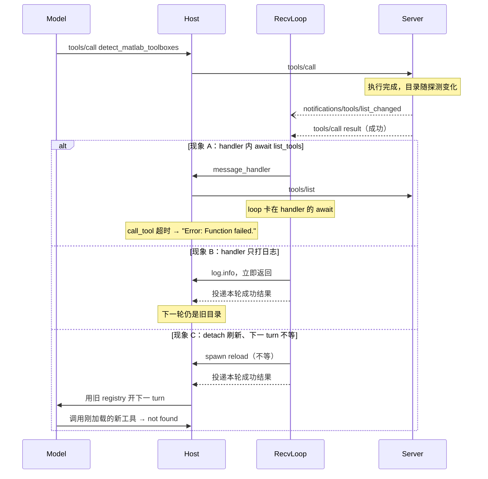

## 1. 问题现象 (Problem Symptoms)

结论先行：**订阅了 `notifications/tools/list_changed`，不等于可以在 SDK 的 receive 回调里再发一条需要响应的 RPC。** Server 在 `tools/call` 执行中或刚返回前后发出目录变更通知——MATLAB、MongoDB 一类动态工具目录很常见——Host 的 `message_handler` 在同一条单线程 `_receive_loop` 里 `await load_tools()` / `session.list_tools()`。`list_tools` 的响应永远进不了这条已经被 handler 占住的 loop，同连接上的在途 `call_tool` 超时；Agent 把已经成功的真实结果丢掉，给模型塞 `"Error: Function failed."`。真正要修的是**通知 handler 与 receive loop 的重入**，不是「MATLAB / Mongo 工具坏了」或「把超时调大」。

本文是 **Agent Runtime Failure Handling** 专题的 #4（list_changed 重入）。#1 [一个 429 打出成倍的上游请求](posts/layered_retry_amplification.md) 问的是：失败之后谁来重试。#2 [客户端超时了，工具还在跑](posts/mcp_cancellation_not_propagated.md) 问的是：放弃那次调用时对端是否停下。#3 [进度通知和结果同一包到了](posts/mcp_progress_same_chunk_unknown_token.md) 问的是：成功路径上 progress 与 result 的派发顺序。本篇问的是：成功路径上，**list_changed 通知的处理方式**会不会把已经成功的 `tools/call` 卡成超时假失败，或把下一轮推理钉在陈旧目录上。

与相邻文划界（本文不复述它们的机制）：

| 文章 | 层 | 问的是 / 和本文的交点 |
| --- | --- | --- |
| [Host 渐进发现](posts/mcp_progressive_disclosure.md) | Host 发现 / 缓存 | 那篇现象 E = `list_changed` 到了 Host **不刷 / 只打日志** → 目录陈旧、召回 miss。本文 = Host **刷了，但刷在 receive 回调里 await** → 本轮 call 死锁。互链一句「通知 ≠ 刷新」后立刻转到重入 |
| [进度与 result 同 chunk](posts/mcp_progress_same_chunk_unknown_token.md)（Runtime Failure Handling #3） | 协议分发 / progress | 那篇 = progress 通知与成功响应的微任务顺序。本文 = list_changed handler 里再发 RPC。同属分发层，失败信号不同（unknown token / 断连 vs call 超时假失败） |
| [取消未过线](posts/mcp_cancellation_not_propagated.md)（#2） | 取消生命周期 | 那篇：有没有发 `notifications/cancelled`。本文：单连接 receive loop 重入 |
| [MCP Server 实例复用](posts/mcp_server_instance_reuse_cross_client_leak.md) | 连接实例作用域 | 那篇：多客户端共享实例错路由。本文：单连接内 handler 重入 |
| [outputSchema 校验吞掉工具错误](posts/mcp_output_schema_validation_swallows_tool_errors.md) | 结果内容保真 | 那篇：结果被校验换掉。本文：结果根本没回到 Host |
| **本文**（Runtime Failure Handling #4） | Host / Client 通知 handler 与 receive loop | handler 里能不能 await RPC；刷新能否既不卡本轮、又赶上下一轮 |

证据范围先说清：机制主线来自 Microsoft Agent Framework Python [issue #4828](https://github.com/microsoft/agent-framework/issues/4828)（closed completed，2026-05-13 20:24 UTC）与已合 [PR #4866](https://github.com/microsoft/agent-framework/pull/4866)（merged 2026-05-13 20:24 UTC，merge `7d23582e`，base `main`；PR 正文写 “Fixes #4828 and #4896”）。旁证 [issue #4896](https://github.com/microsoft/agent-framework/issues/4896)（closed completed，2026-05-14 03:34 UTC）与未合 [PR #4898](https://github.com/microsoft/agent-framework/pull/4898)（closed **未合**，2026-03-25 21:52 UTC）。对称坏法来自 Zed [issue #57473](https://github.com/zed-industries/zed/issues/57473)（closed **not_planned**，`github-actions` stale bot，2026-09-25 02:13 UTC，带 **needs-repro**）。下文只复述该报告描述的竞态（handler `detach` 刷新、下一 turn 前未 await）；**未对照当前 Zed 源码核实修复状态**，因此不断言「当前仍未修复」，也不把窗口写成现树上必定触发。

**版本边界：** 这不是「凡是 MCP 客户端都会死锁」——#4828 / #4896 里直连 `mcp.ClientSession.call_tool` 都成功，问题出在 Host 把 `await` RPC 放进 SDK `message_handler` 的封装。Agent Framework 侧 [#4866](https://github.com/microsoft/agent-framework/pull/4866) 已合 `main`；GitHub release [`python-1.4.0`](https://github.com/microsoft/agent-framework/releases/tag/python-1.4.0) changelog（标题日期 2026-05-14；`published_at` 2026-05-15 00:37 UTC）列出 “Prevent MCP message_handler deadlock on notification reload (#4866)”。公开复现写在报告里的 `agent-framework-core==1.0.0rc5`。#4896 的 `resources/updated` 症状与 #4866 的合入 diff / 回归测试不是同一条——后者针对的是 `list_changed` / `load_tools`。#4898 未合，不能当作已落地修法。

三个现象必须分开看：**handler 内 await RPC → 本轮死锁**、**只打日志消死锁 → 目录不刷**、**detach 刷新但下一 turn 不等待 → 首轮调新工具失败**。它们同属 list_changed 生命周期，失败面不同。

### 现象 A：handler 里 `await load_tools()` —— 在途 `call_tool` 超时，模型只看到假失败

[#4828](https://github.com/microsoft/agent-framework/issues/4828)（报告环境 `agent-framework-core` v1.0.0rc5，mcp v1.26.0，Python 3.13；官方 [`matlab-mcp-core-server`](https://github.com/matlab/matlab-mcp-core-server)）：

- 直连 `mcp.ClientSession.call_tool("detect_matlab_toolboxes", {})` 成功：`isError=False`，约 13.25s，正文含 MATLAB 安装 / toolbox 信息。
- 经 `agent_framework.MCPStdioTool.call_tool("detect_matlab_toolboxes")` 超时，抛 `ToolExecutionException`，detail 逐字：

```text
Timed out while waiting for response to ClientRequest. Waited 30.0 seconds.
```

报告里 wrapper 耗时约 30.53s。MATLAB 在本机成功启动，server 日志显示 `detect_matlab_toolboxes` **执行到完成**。把真实成功结果手工作为 `function_call_output` 送回时，provider 也能消化——所以不是「模型吃不下 MATLAB 输出」。Agent 第二轮请求里，真实结果被替换成 verbatim：

```text
Error: Function failed.
```

[#4866](https://github.com/microsoft/agent-framework/pull/4866) 把机制钉死：`MCPTool.message_handler()` 跑在 MCP SDK 单线程 `_receive_loop` 上；收到 `notifications/tools/list_changed`（或 `notifications/prompts/list_changed`）时直接 `await load_tools()` / `load_prompts()` → `session.list_tools()` 发出请求并等待响应 → 响应无法投递，因为 loop 卡在 handler 里。超时之后，Host 把假错误喂给模型。值班会去重装 MATLAB，而不是看 Host 的 handler。

### 现象 B：同类死锁的竞争修复曾想「改成只打日志」——死锁没了，目录也不刷了

[#4896](https://github.com/microsoft/agent-framework/issues/4896)（报告环境同样是 `agent-framework-core` 1.0.0rc5；`mongodb-mcp-server@1.9.0`）：`list-collections` 经 `MCPStdioTool` 挂死，直连 SDK 成功。日志形状是 server 已响应，并打出 `Resource updated: debug://mongodb`（`resources/updated`），然后框架不再返回。报告者把根因写在「交错通知到达时 `call_tool` / 解析管线不完成」。

未合的竞争 [PR #4898](https://github.com/microsoft/agent-framework/pull/4898) 把死锁定在 `message_handler` 内联 `await load_tools()` / `load_prompts()`，并写：`load_tools()` 会走 `_ensure_connected()` → `send_ping()`，session 在等待在途 `call_tool` 响应时处理不了 ping。它的修法是：**把内联 reload 改成 debug log**，工具 / prompt 等到下次 `connect(reset=True)` 或显式 `load_tools()` 再刷。维护者关闭该 PR 时指向正在进行的 #4866。

这条能消死锁，但立刻退回 [渐进发现](posts/mcp_progressive_disclosure.md) 现象 E：**通知到了，目录不刷。** #4866 走的是后台 Task 路线，不是「只打日志」。#4896 于 2026-05-14 03:34 UTC 关闭，时间紧随 #4866，但合入 diff 与测试针对的是 list_changed / load_tools，因此不能把 `resources/updated` 症状当成同一条已被回归测试覆盖的修复。

### 现象 C：另一极——detach 刷新、不等待 → 首轮调新工具失败

Zed [#57473](https://github.com/zed-industries/zed/issues/57473)（报告环境 Zed Preview v1.4.1+preview…；closed **not_planned**，stale bot，带 **needs-repro**）：按该报告，meta-tool 加载新工具后，server 先发 `notifications/tools/list_changed`，再在同一条 SSE 上流回 `tools/call` result。Host 的 list_changed handler `cx.spawn(...).detach()` 刷目录；`reload_tools_for_server` 再 spawn 一次去发 `tools/list`，等响应到了才写入 `registered_server.tools`。与此同时 `Client::handle_input` 在 handler `detach()` 返回后立刻把 `tools/call` 响应交给等待方，agent loop 用**旧 registry** 拼下一轮推理 → 新工具 `tool not found`，模型重试才成功。issue 指出 `RegisteredContextServer` 上已有 `load_tools: Task<Result<()>>` 字段，只是下一 turn 之前没有人 await 它。以上是报告所述竞态；**当前 Zed 树是否仍如此，未经源码核实**。

这与现象 A 同属 list_changed 生命周期：A 坏的是**本轮 call 完成**，C 坏的是**下一轮发现**。stale bot 以 `not_planned` 关闭不等于维护者拒绝修复，也不等于已经修复——只说明公开工单停在 needs-repro，现树状态未知。



旁证（不展开）：[editor-code-assistant/eca@8746ab0](https://github.com/editor-code-assistant/eca/commit/8746ab0c56485f697e31cb8d47cac61bed47c4d4)（2026-03-11 22:12 UTC）——plumcp 默认 list_changed handler 在 initialize 完成前就 `fetch-tools`，server 忽略握手前的请求，handler 永久等待，客户端无法完成握手（pre-initialize 死锁变体）。[livekit/agents #5378](https://github.com/livekit/agents/issues/5378)（open）与 [PR #5604](https://github.com/livekit/agents/pull/5604)（open **未合**）是完全忽略 list_changed，更靠近渐进发现篇，只作「Host 常见三种坏法」对照，不当事主线复现。

---

## 2. 根因分析 (Root Cause Analysis)

三个现象的共同误判是：把「订了 `list_changed`」「handler 里刷新了目录」「下一轮能看见新工具」叠成一句「热更新已经做了」。它们是三个独立视角——**本轮 call 能否完成、目录会不会变、下一轮拼 tools 时刷新是否已经落地**——每一侧都可能漏。

| 视角 | 正常时应对齐到 | 漏了会怎样 |
| --- | --- | --- |
| 本轮 `tools/call` 完成 | receive loop 持续可读，在途响应能投递 | 现象 A：handler 内 await RPC → 死锁 / 超时假失败 |
| 目录新鲜度 | 通知驱动一次不会占用 loop 的刷新 | 现象 B：只打日志 → 下一轮仍用旧目录 |
| 下一 turn 的工具表 | 拼 LLM tools 之前 await 在途 refresh | 现象 C：detach 过早放行 → 首轮 tool not found |

根因可以拆成三层：

1. **重入死锁：通知 handler 与 in-flight request 共享同一条 receive loop（对应 A）。** SDK 用一条 loop 既派发通知、又投递响应。handler 一旦 `await` 任何需要响应的 RPC——`list_tools` / `list_prompts`，甚至 #4898 正文写的 `_ensure_connected()` → `ping`——就把投递通道堵死。规范 2025-11-25 Tools 页只要求声明了 `listChanged` 的 server SHOULD 发 `notifications/tools/list_changed`，随后客户端再 `tools/list`；它**没有**授权「在投递 `tools/call` 结果的那条 loop 里同步把这次 `tools/list` await 完」。
2. **失败伪装：SDK 直连成功，Host 封装超时后把假错误喂给模型（对应 A 的值班误判）。** #4828 的对照实验已经把这条切开：同一 server、同一工具，`ClientSession` 成功、`MCPStdioTool` 30s 超时。Host 再把 `ToolExecutionException` 译成 `"Error: Function failed."`，模型侧看不到「Host 的 receive loop 卡住了」，只看到函数失败——重试、换参、重装工具，全部打偏。
3. **与「不刷新」对称的另一极（对应 B / C）。** 从 loop 里撤走 `await` 是必要的，但撤走之后刷新仍要有主人：只 log（#4898 路线 / 渐进发现现象 E）会回到陈旧目录；只 `detach`、下一 turn 前不 await（#57473 报告所述）会让「通知已经处理」和「registry 已经更新」之间出现窗口。GOOD 不是二选一，而是 **按 server 调度，并在 turn 边界用 generation / dirty 循环汇合到目标版本**；刷新失败则明确 fail closed，不得静默端出旧目录。

还有第四刀，常被「我们订阅了 list_changed」藏住：**订阅是事件，刷新是另一次 RPC。** 事件到达只说明 server 认为目录变了；权威目录仍要靠随后的 `tools/list`。把这次 RPC 放进错误的执行上下文（receive 回调），或放对了上下文却不等它完成再推理，都会以「热更新已接」的名义失败。

---

## 3. 机制要点：handler 只调度、本轮先完成、下一 turn 再汇合 (Mechanism)

### 3.1 通知 handler 只调度、不 await RPC

目标：`message_handler`（或等价 receive 回调）必须在不发、不等待任何需要响应的 RPC 的前提下返回，让 loop 去投递已经在路上的 `tools/call` 结果。

[#4866](https://github.com/microsoft/agent-framework/pull/4866) 的做法（已合 `main`，并写入 `python-1.4.0` changelog；**不是**「所有 Host 默认如此」）：新增 `_schedule_reload()`，把 `load_tools()` / `load_prompts()` 排成后台 `asyncio.Task`；`_pending_reload_tasks` 持有强引用，防止 GC 在完成前回收任务；错误记日志，不传播回 receive loop。合入过程中的后续提交还做了：按 reload kind **cancel-and-replace**（避免通知风暴堆出无界任务）、关闭 session 前取消并等待在途 reload、失败路径清理任务集。回归测试验证：即使 `load_tools` 阻塞，`message_handler` 也立即返回。通知风暴下确实需要 coalesce；#4866 用的是 cancel-and-replace。本文后面的 GOOD 合同改成每个 `(server_id, kind)` 一条长驻 worker + dirty 循环：新通知只置脏并唤醒，不在中途取消正在跑的 `list_*`，也就不必把「刷新被替换」和「调用方取消了本轮 turn」写进同一个 `except CancelledError`。

自研 Host 的最小合同与这一条相同：回调里只 `create_task` / `spawn`，禁止 `await session.list_tools()`、`await ping()`、或任何会再进同一条 loop 的 round-trip。

### 3.2 超时先标「结果未知」；有 handler 阻塞证据再分成 receive-loop stall

目标：调用超时本身不等于「工具业务错误」，也**不等于**已经证实的 receive-loop stall。慢工具、网络抖动、对端卡住，都会在同一条 `TimeoutError` 上呈现。没有进一步证据时，只标成 **结果未知的调用超时**——不要译成 verbatim `"Error: Function failed."` 交给模型「换参纠错」，也不要一律记成 Host receive-loop stall。

对照 #4828：那次有 handler 阻塞证据（`message_handler` 内 `await load_tools()` / `list_tools` 的模式），再加上同一探测调用上直连 `ClientSession` 成功、封装路径 30s 超时。**这一类**才细分成 Host / receive-loop / handler-blocking stall，让值班去看 handler 是否在 loop 里 await RPC。它和 [outputSchema 篇](posts/mcp_output_schema_validation_swallows_tool_errors.md) 方向相反——那篇是结果到了但内容被换掉；本篇是结果没回到 Host——但都会把错误分类打偏，并触发 [分层重试](posts/layered_retry_amplification.md) 不该进的桶。

直连 `ClientSession` 对照可以当探针，但必须限定在**无副作用的测试工具**上（例如只读探测、专门用于对照的 ping-like tool）。禁止把生产写操作、计费操作或不可重放的变更再跑一遍来「证明是不是 stall」。

### 3.3 按 server 管理刷新；generation / dirty 循环汇合；失败不沿用旧目录

目标：从 loop 里撤走 `await` 之后，刷新仍要在「下一轮推理用到工具表」之前汇合。合并通知用每个 `(server_id, kind)` **一条长驻 worker + dirty / generation**：通知只抬高目标代数、置脏并唤醒 worker，**不**为了 coalesce 而中途取消正在跑的 `list_tools` / `list_prompts`。汇合点跟的是「目标代数是否完成」，不是某一个稍后会被替换的临时 task。

三条互补，缺一就会滑向 B、C，或在等待 / 关闭时把生命周期搅乱：

- **按 server 调度，而不是按 kind 全局一条任务：** 每个 server（以及该 server 上的 tools / prompts 一类资源）各自持有 generation、完成代数、dirty 标记和至多一条 worker。通知到达只把该 server 的缓存标脏并 `+1` 目标 generation，再唤醒（或按需 spawn 一次）该 slot 的 worker。权威目录仍来自随后的 `tools/list`，不是通知 payload 本身（规范里的 `notifications/tools/list_changed` 没有携带新目录）。
- **turn 边界用 generation / dirty 循环汇合：** 下一轮把工具表交给模型之前，等待 `completed >= generation`，或关闭 / 刷新失败。等待用 `Event` / `Condition`。若**调用方**取消了本轮 agent turn，`asyncio.CancelledError` 必须立刻重新抛出——不要把「刷新被替换」和「turn 被取消」当成同一种取消去吞掉；后者吞掉之后会反复等待已经取消的 task，事件循环忙转。关闭或 `closing` 时，等待者必须以明确错误退出（如 `CatalogRefreshAborted` / session closing），而不是空转。这对应 [#57473](https://github.com/zed-industries/zed/issues/57473) 报告里的建议（issue 以 stale bot `not_planned` 关闭，且带 needs-repro；**不是对当前 Zed 行为的断言**）：报告称 `RegisteredContextServer.load_tools` 字段已在，缺的是 agent loop 在组装工具列表前等它。备选（同报告）：`handle_input` 在抽下一条消息之前先把 `tools/list` 登记为在途任务，这样 `tools/call` 响应归来时，refresh 至少已经可 await。
- **失败与关闭都要有主人：** worker 持有 RPC；失败记在 slot 上（`last_error` / `catalog_unknown`），等待者能看见，不得静默端出旧目录。若仍使用临时 `create_task`，每个任务都要有收取 `task.exception()` 的 done callback（或 `gather(..., return_exceptions=True)`），不能只 `discard` 引用。关闭的作用域是 **server / session，不是某一个已存在的 slot**：在 slot 字典之外维护 `_closed_servers` 与 `_session_closing`；`shutdown_reloads('A')` 先把 `A` 记入已关闭集合，无参的全局 `shutdown_reloads()` 先把 `_session_closing=True`，**然后**再给已有 slot 打上 `closing`、唤醒等待者，再取消并 await **这些 slot 拥有的全部任务**（单 worker 即那一条），用 `return_exceptions` 一类收集异常。创建 slot、`setdefault`、或 `create_task` 开工之前必须先查这两处标记——只标已有 slot 会漏掉「关闭 A 之后第一次收到 `(A, prompts)`」或「全局关闭后第一次收到全新 server」：那时还没有 slot，旧写法会新建 `closing=False` 的 worker。已关闭 server / session 上再到的 `list_changed` 不得新建 slot，也不得再启动刷新。

只调度不等待 = 现象 C；只等待却把等待放进 handler = 现象 A；等待时无条件吞掉 `CancelledError` = 把真正的 turn 取消也吞掉，并可能忙等死任务。正确的等待点是 **turn 边界 / 显式 `connect(reset=True)` / 应用自己的 reload API**，不是 receive 回调。

### 3.4 指标：超时、已证实的 stall、以及「通知后首轮 miss」分开数

- `call_tool` 超时、结果未知的次数（默认桶）——慢工具和网络故障也进这里。
- 其中有 handler 阻塞证据的子集（例如同连接上观察到 list_changed + `await list_tools` 模式；或对**无副作用测试工具**的直连 `ClientSession` 对照成功）→ 现象 A 的形状（Host 封装 / receive-loop stall，不是工具实现）。
- `list_changed` 之后、下一 turn 首次调用新工具就 not found / unknown tool 的次数 → 现象 C。
- 通知到达后 N 秒内缓存仍与 `tools/list` 权威目录不一致的次数 → 现象 B（只 log / 刷新丢失）。
- 刷新失败后仍端出旧目录的次数，以及关闭时未 await 在途 refresh、异常未被收取的次数。

不要用「演示里点一次 MATLAB 工具看起来绿了」代替这些计数。`python-1.4.0` 之后的 Agent Framework 主线已走 §3.1 的后台调度；自研 Host、旧版 `1.0.0rc5` 封装、以及报告所述 detach-and-forget 路径（#57473；现树是否仍如此未经源码核实），仍要按汇合与失败策略验收。

---

## 4. 同一台工程计算会话 `ENG-4410`：怎么接、错在哪、改完怎么走

业务线固定为工程计算会话 `ENG-4410`：Host 挂 MATLAB MCP，工具 `detect_matlab_toolboxes` 跑完会发 `notifications/tools/list_changed`（工具目录随 toolbox 探测变化）；随后模型希望立刻调用刚出现的 `run_simulation`。下面四个版本里**工具实现与会话 ID 都不变**，每次只改通知处理。代码是 Host / 包装层示意，不是 Agent Framework 源码拷贝；版本标签按 §1 已核实的 issue / PR 描述对齐。`ENG-4410` 是设计示例。

### 4.1 BAD v1：`message_handler` 里 `await load_tools()` —— 本轮成功变成 `"Error: Function failed."`

```python
# 示意：ENG-4410 v1 —— handler 内 await RPC（现象 A / #4828、#4866 描述的旧行为）
async def message_handler(message):
    if is_tools_list_changed(message):
        await load_tools()  # 内部 session.list_tools()；跑在 SDK _receive_loop 上
    elif is_prompts_list_changed(message):
        await load_prompts()

# Agent 路径
result = await mcp_stdio.call_tool("detect_matlab_toolboxes")
# server 已执行完并写出 list_changed + 成功 result
# Host：list_tools 响应进不了 loop →
# ToolExecutionException: Timed out while waiting for response to ClientRequest. Waited 30.0 seconds.
# 第二轮 function_call_output = "Error: Function failed."
```

`ENG-4410` 的值班看到假失败，去重装 MATLAB；直连同一 server 的 `ClientSession.call_tool` 却是绿的。修复方向：§3.1 只调度；§3.2 不要把这类超时译成工具失败。

### 4.2 BAD v2：改成只打日志 —— 死锁没了，`run_simulation` 永远不进目录

v2 只改 handler：收到通知不再 `await load_tools()`（#4898 路线）。本轮 `detect_matlab_toolboxes` 的成功结果终于能投递。

```python
# 示意：ENG-4410 v2 —— 只打日志消死锁（现象 B / #4898，未合，不能当 GOOD）
async def message_handler(message):
    if is_tools_list_changed(message):
        log.debug("tools/list_changed received; refresh on next connect(reset=True)")
        return  # loop 得以投递在途 call_tool 结果
```

`ENG-4410` 不再超时，但后续 `run_simulation` 不在 Host 目录里。模型坚持「没有仿真工具」——这正是渐进发现篇的「通知 ≠ 刷新」，不要误判回 v1 去「再把 await 加回 handler」。

修复方向：§3.1 后台调度 + §3.3 真正执行 `tools/list`（只是不在回调里等）。

### 4.3 BAD v3：后台 detach 了，下一 turn 不等 —— 第一次调 `run_simulation` not found

v3 假定已经按 §3.1 调度了后台 reload，但 agent loop 在拼下一轮 tools 时不等待（按 #57473 报告所述；现树未核实）。

```python
# 示意：ENG-4410 v3 —— detach 刷新、turn 边界不汇合（现象 C / #57473）
async def message_handler(message):
    if is_tools_list_changed(message):
        spawn(reload_tools_for_server(server_id)).detach()  # 立即返回，loop 畅通

# handle_input 随即把 tools/call 成功结果交给等待方
# agent 立刻开下一 turn，registry 仍是旧的
await llm_complete(tools=stale_registry)  # 模型发出 run_simulation
# → tool not found；重试后 reload 已完成，第二次才成功
```

本轮探测结果是对的；失败换到了「刚加载的工具第一次调用」。按该报告，`load_tools` 任务字段若已经存在却无人 await，就会在「通知已处理」与「registry 已更新」之间留出窗口——这是报告描述的竞态形状，不是把现树写成必定触发，也不是「偶发网络抖」四个字可以概括的。

修复方向：§3.3 按 server 管理，并在 turn 边界用 generation / dirty 循环汇合。

### 4.4 GOOD：按 server 单 worker + dirty 循环汇合；超时先标未知；失败不沿用旧目录

```python
# 示意：ENG-4410 GOOD —— 对齐 §3.1–§3.4
# handler 只调度（对照 #4866 的「回调里不 await RPC」）。
# 刷新按 (server_id, kind) 隔离：每槽一条长驻 worker，通知只置脏 / 抬代数。
# turn 边界等到 completed >= generation；调用方 CancelledError 必须传播；
# 关闭先在 slot 之外标 server/session closing（禁止再创建 slot / 开工），
# 再标已有 slot.closing，等待者以 CatalogRefreshAborted 退出。

from dataclasses import dataclass, field

@dataclass
class ReloadSlot:
    generation: int = 0          # 已调度到的目标代数（dirty）
    completed: int = 0           # 已成功落地的代数
    dirty: bool = False
    closing: bool = False
    catalog_unknown: bool = False  # 刷新失败：禁止静默端出旧目录
    last_error: BaseException | None = None
    changed: asyncio.Event = field(default_factory=asyncio.Event)
    worker: asyncio.Task | None = None

_slots: dict[tuple[str, str], ReloadSlot] = {}  # (server_id, kind)
_closed_servers: set[str] = set()  # per-server 关闭：slot 之外
_session_closing: bool = False     # 全局 shutdown：禁止任何新 server 开工


def _server_is_closed(server_id: str) -> bool:
    return _session_closing or server_id in _closed_servers


def _slot(server_id: str, kind: str) -> ReloadSlot | None:
    key = (server_id, kind)
    existing = _slots.get(key)
    if existing is not None:
        return existing
    if _server_is_closed(server_id):
        return None  # 已关闭的 server / session：禁止 setdefault 出新 slot
    st = ReloadSlot()
    _slots[key] = st
    return st


def _wake(st: ReloadSlot):
    st.changed.set()  # 同步路径也可唤醒 worker / 等待者；生产代码可用 Condition


def _on_worker_done(task: asyncio.Task):
    # 每个被 create_task 的任务都必须有收取者，不能只 discard 引用
    if task.cancelled():
        return
    exc = task.exception()
    if exc is not None:
        _collect_reload_exceptions([exc])


def _ensure_worker(server_id: str, kind: str):
    if _server_is_closed(server_id):
        return  # 关闭后禁止新调度，也不创建 slot
    st = _slot(server_id, kind)
    if st is None or st.closing:
        return
    if st.worker is None or st.worker.done():
        st.worker = asyncio.create_task(_reload_worker(server_id, kind))
        st.worker.add_done_callback(_on_worker_done)


def _schedule_reload(server_id: str, kind: str):
    if _server_is_closed(server_id):
        return  # 已关闭 server / 全局 session：不 setdefault、不开工
    st = _slot(server_id, kind)
    if st is None or st.closing:
        return
    st.generation += 1
    st.dirty = True
    _wake(st)
    _ensure_worker(server_id, kind)


async def _reload_worker(server_id: str, kind: str):
    # 长驻：while dirty and not closing → 清 dirty → 跑 list_* → 记完成或失败
    st = _slot(server_id, kind)
    if st is None:
        return
    try:
        while not st.closing:
            if not st.dirty:
                st.changed.clear()
                if st.dirty or st.closing:
                    continue
                await st.changed.wait()
                continue
            st.dirty = False
            target = st.generation
            try:
                await (load_tools(server_id) if kind == "tools" else load_prompts(server_id))
                if not st.closing and target >= st.completed:
                    st.completed = target
                    st.catalog_unknown = False
                    st.last_error = None
            except asyncio.CancelledError:
                raise  # shutdown 取消 worker；不是「刷新被替换」
            except Exception as e:
                st.catalog_unknown = True  # §3.3：失败不得静默沿用旧目录
                st.last_error = e
                # 不把异常甩给无人收取的临时 task；若期间又 dirty 则下一圈再跑
            finally:
                _wake(st)  # 让 next_turn_tools 重新检查 completed / closing / 失败
    finally:
        _wake(st)


async def message_handler(message):
    # §3.1：回调里不 await RPC
    sid = message.server_id
    if is_tools_list_changed(message):
        _schedule_reload(sid, "tools")
    elif is_prompts_list_changed(message):
        _schedule_reload(sid, "prompts")
    # 立即返回，让 _receive_loop 投递在途 tools/call 结果


async def call_tool_owned(session, name: str, args: dict):
    try:
        return await session.call_tool(name, args)
    except TimeoutError as e:
        # §3.2：默认是「结果未知的调用超时」。慢工具、网络故障也会走这里。
        # 有 handler 阻塞证据（同连接 list_changed + await list_tools，
        # 或无副作用测试工具的直连 ClientSession 对照成功）后再细分为
        # receive-loop / handler-blocking stall。
        # 禁止把生产写操作重跑当探针。
        metrics.call_timeout_unknown_outcome.inc()
        raise ToolCallTimeoutUnknownOutcome(str(e)) from e


async def next_turn_tools(server_id: str):
    # §3.3：等到该 server 的 tools 目标 generation 完成，或关闭 / 失败。
    # 新通知只抬 generation + dirty，不 cancel 在途 RPC；此处跟代数，不跟某个临时 task。
    if _server_is_closed(server_id):
        raise CatalogRefreshAborted(server_id)  # 不因查询而新建 slot
    st = _slot(server_id, "tools")
    while True:
        if st.closing or _server_is_closed(server_id):
            raise CatalogRefreshAborted(server_id)  # 关闭：等待者明确退出，不空转
        if st.completed >= st.generation:
            break
        if st.catalog_unknown and not st.dirty:
            raise CatalogRefreshFailed(server_id) from st.last_error
        st.changed.clear()
        # clear 后再读一遍，避免丢失 wake
        if st.closing or _server_is_closed(server_id) or st.completed >= st.generation or (
            st.catalog_unknown and not st.dirty
        ):
            continue
        try:
            await st.changed.wait()
        except asyncio.CancelledError:
            raise  # 调用方取消了本轮 agent turn：必须传播，不当成「刷新被替换」
    if st.catalog_unknown:
        raise CatalogUnknown(server_id) from st.last_error  # fail closed：不端出陈旧目录
    return current_registry(server_id)


async def shutdown_reloads(*server_ids: str):
    # 关闭：先在 slot 之外标记 server / session（禁止再创建 slot / 开工），
    # 再给已有 slot 打 closing → 唤醒等待者 → 取消并 await 全部所属任务。
    global _session_closing
    if not server_ids:
        _session_closing = True  # 全局：之后任何新 server 的通知都不得开工
    else:
        _closed_servers.update(server_ids)  # per-server：A 关闭后 (A, prompts) 也不得新建
    selected = [
        st
        for (sid, _kind), st in list(_slots.items())
        if not server_ids or sid in server_ids
    ]
    for st in selected:
        st.closing = True
        _wake(st)
    owned = [st.worker for st in selected if st.worker is not None]
    for t in owned:
        t.cancel()
    results = await asyncio.gather(*owned, return_exceptions=True)
    _collect_reload_exceptions(results)  # 记录非预期异常，不丢在后台

# ENG-4410 路径：
# 1) detect_matlab_toolboxes 本轮拿到真实 toolbox 列表（不是假失败）
# 2) 下一 turn 等待目标 generation 后，tools 含 run_simulation
# 3) 监控：未知结果超时 vs 有证据的 stall；刷新失败 / 关闭未汇合
```

v1 → GOOD 的每处改动回扣 §3：

| 版本 | 失败表现 | 改动 | 对应 §3 |
| --- | --- | --- | --- |
| v1 → v2 | 本轮超时；模型看到 `"Error: Function failed."` | handler 不再 await RPC，loop 能投递成功结果 | §3.1 / §3.2 |
| v2 → v3 | 死锁没了，新工具不进目录 | 通知调度后台 `tools/list`，而不只打日志 | §3.1 + §3.3 的「要刷新」半边 |
| v3 → GOOD | 首轮 `run_simulation` not found；等待 / 关闭时生命周期不清 | 按 server 单 worker + dirty / generation 汇合；调用方 `CancelledError` 必须传播；关闭时 waiter 以 `CatalogRefreshAborted` 退出；刷新失败 fail closed；关闭先在 slot 之外标 server/session closing，再标已有 slot 并 cancel / await 全部所属任务 | §3.3 的汇合 / 失败 / 关闭 |
| GOOD | 防止退化 | 超时默认「结果未知」；有证据再记 stall；通知后首轮 miss；刷新失败仍端旧目录 | §3.2 / §3.4 |

一句话回顾：v1 的问题是**在错误的执行上下文里刷新**，v2 是**为了让出 loop 而放弃刷新**，v3 是**刷新了却不在推理前汇合**（若等待时无条件吞掉 `CancelledError`，还会把真正的 turn 取消吞掉并忙等；若关闭只标已有 slot 的 `closing`、不在 slot 之外记下 server/session 已关，等待者会空转，对另一 kind 或全新 server 的通知还会新建 `closing=False` 的 worker）；GOOD 让「本轮完成 / 按 server 单 worker 刷新到目标 generation / 调用方取消要传播 / 失败不沿用旧目录 / 关闭作用域覆盖整个 server 与 session」对齐。

---

## 5. 发版前清单：对准可注入的失败点 (Pre-Ship Checklist)

不要靠「接了 list_changed、演示里工具列表偶尔会变」判断。先问一句：**这次失败的路径上，handler 有没有在 receive loop 里 await RPC？本轮结果回来了没有？下一 turn 用的是不是刷新后的目录？**

**注入 1：mock server 在 `tools/call` 返回前同步发出 `notifications/tools/list_changed`；Host 使用「handler 内 await list_tools」路径（对应 §3.1–§3.2 / 现象 A）**

- [ ] `call_tool` 在超时前返回真实结果（对照 #4828：直连 SDK 成功、封装路径不应再 30s 超时）
- [ ] 模型侧 / Agent 历史里**没有** `"Error: Function failed."` 这类对真实成功的替换
- [ ] 该路径若仍超时：默认记为「结果未知的调用超时」，而不是「工具执行失败」；仅当同时具备 handler 阻塞证据（list_changed + await `list_tools` 模式，或无副作用测试工具的直连对照）时，再细分为 receive-loop / handler-blocking stall
- [ ] 直连 `ClientSession` 对照只跑无副作用测试工具，不把生产写操作重跑当探针

**注入 2：同 1，但 handler 改为后台 Task reload（对应 §3.1 / §3.3）**

- [ ] 本轮结果正确
- [ ] 随后 `list_tools` 缓存更新，或脏标记后下一次拉取为新目录
- [ ] 通知风暴下在途 reload 有上界（同一 `(server_id, kind)` 单 worker + dirty 合并，同时只有一条在途 `list_*` RPC；新通知只置脏，不 cancel 在途 RPC 来 coalesce）

**注入 3：meta-tool 加载新工具后，list_changed 与 call result 同流到达，立即开下一 agent turn 调新工具（对应 §3.3 / 现象 C）**

- [ ] 首轮即命中新工具，或明确等待 refresh 到目标 generation，而不是 tool not found 后再撞大运重试
- [ ] 拼 LLM tools 之前能观察到对目标 generation 的 await（或等价 Event / Condition 栅栏），而不是绑死某一个瞬时 task

**注入 4：turn 边界正在等待刷新时，注入调用方取消或开始关闭（对应 §3.3 等待合同）**

- [ ] 等待刷新时取消本轮 agent turn：`asyncio.CancelledError` 必须传播给调用方；事件循环能继续，不得对着已取消的 task 忙等（旧合同在 `next_turn_tools` 里无条件 `except CancelledError: continue` 会踩这个坑）
- [ ] 等待者仍阻塞时注入 shutdown：等待者以 `CatalogRefreshAborted`（或等价的 session closing 错误）退出，而不是空转
- [ ] 等待期间再次收到 `list_changed`：只抬高 dirty / generation，在途 RPC 不被为了 coalesce 而取消；循环等到新的目标 generation 完成，再把工具表交给模型

**注入 5：后台 refresh 失败（对应 §3.3 fail closed）**

- [ ] 不静默端出旧目录
- [ ] 明确策略落地：fail closed、上抛，或把该 server 的 catalog 标为 unknown
- [ ] 刷新失败后再收到一条 `list_changed`：失败已记在 slot（`last_error` / `catalog_unknown`）并被收取，不会变成 “Task exception was never retrieved”；worker 因 dirty 再跑下一圈；等待者不会挂在一条丢失的异常上

**注入 6：刷新进行中关闭 session（对应 §3.3 shutdown）**

- [ ] 先在 slot 之外标记关闭作用域：`shutdown_reloads('A')` 把 `A` 写入 `_closed_servers`；无参 `shutdown_reloads()` 置 `_session_closing=True`。然后再给已有 slot 打 `closing`，禁止 `_schedule_reload` / `_slot` 的 `setdefault` / 新的唤醒去开工
- [ ] 再 cancel 并 await **这些 slot 拥有的全部任务**（单 worker；不是只等「最新临时 task」而漏掉旧任务），而不是只 cancel 就返回
- [ ] 异常被收取（含 `CancelledError` 与刷新失败），不丢在 “Task exception was never retrieved”

**注入 7：标记关闭之后又收到同一 slot 的 `list_changed`（对应 §3.3 shutdown）**

- [ ] 不得再调度新的 reload，也不得新开 worker
- [ ] shutdown 仍然能正常结束

**注入 8：关闭作用域必须覆盖尚未建过的 slot / server（对应 §3.3 server/session closing）**

- [ ] 先创建 `(A, tools)` 并 `shutdown_reloads('A')`，再对 `A` 首次投递另一 kind 的 `list_changed`（例如 prompts）：不得新建 `(A, prompts)` slot，也不得启动 worker（只打已有 slot 的 `closing` 会漏掉这条路径）
- [ ] 无参 `shutdown_reloads()` 全局关闭后，再对一个从未出现过的新 server 首次 `list_changed`：不得创建 slot / 开工（`_session_closing` 必须拦在 `_slot` / `_schedule_reload` / `_ensure_worker` 之前）

**发版评审口头否决**

- [ ] 「订阅了 list_changed = 已经热更新」——不回答刷新发生在哪一个执行上下文、下一 turn 有没有汇合到目标 generation
- [ ] 在 `message_handler` / `_receive_loop` 回调里 `await list_tools` / `ping` / 任何需要响应的 RPC
- [ ] 用「只打日志」当修法（#4898 未合；会退回渐进发现现象 E）
- [ ] 把任意超时统一译成 `"Error: Function failed."`，或在没有 handler 阻塞证据时一律标成 receive-loop stall
- [ ] 把已合 #4866 / 已发布 `python-1.4.0` 的 Agent Framework 说成当前版本仍必现本死锁——公开复现写在报告中的 1.0.0rc5；同类风险仍存在于把 await 放进 handler 的封装
- [ ] 把 #4896 的 `resources/updated` 挂死写成 #4866 测试覆盖的同一条
- [ ] 把 #57473 写成维护者拒绝修复，或写成「当前源码仍未修复 / 窗口确定性触发」——它是 stale bot `not_planned` 且带 needs-repro；只复述报告所述竞态，现树修复状态未经源码核实
- [ ] 把 progress 篇的 unknown-token / 取消篇的未知 id 与本篇的 call 超时混成同一个 bug
- [ ] 用生产写操作做直连对照探针

---

## 6. 小结 (Takeaways)

**`list_changed` 一到，成功的 `tools/call` 却变成 `"Error: Function failed."` 时，先问：handler 是不是在 receive loop 里 await 了 `list_tools`；若已经改成异步刷新，下一 turn 拼工具表之前有没有等到该 server 的目标 generation。**

- 根因：通知 handler 与 in-flight request 共享 loop → 回调内 await RPC 死锁（A）；只 log 消死锁则目录不刷（B）；detach 刷新但 turn 边界不汇合则首轮 miss（C）；等待刷新时若无条件吞掉 `CancelledError`，会把真正的 turn 取消也吞掉并忙等死任务；关闭若只标已有 slot 的 `closing`、不在 slot 之外记下 server/session 已关，等待者会空转，对另一 kind 或全新 server 的通知还能新建 worker（§1–§2）。
- 修法：handler 只调度后台 reload（#4866 已合的「回调不 await RPC」）；超时默认标结果未知，有 handler 阻塞证据再分成 stall；按 server 用单 worker + dirty / generation 循环汇合；调用方 `CancelledError` 必须传播；关闭先在 slot 之外标记 `_closed_servers` / `_session_closing`，再标已有 slot、等待者以明确错误退出，再 cancel 并 await 全部所属任务、收取异常；刷新失败 fail closed（§3）。
- `ENG-4410` 从 v1 → v2 → v3 → GOOD，每次只改一处（§4）；发版按 §5 的注入点分测，含等待期间取消 turn / 关闭、刷新失败后再来通知、关闭后又来 `list_changed`（含对已关 server 的另一 kind、以及全局关闭后的新 server）。
- **版本边界：** Agent Framework 侧 #4828 / #4896 已以 completed 关闭，修复以已合 #4866 与 `python-1.4.0` changelog 为准；公开复现环境是报告里的 `1.0.0rc5`。#4898 未合。Zed #57473 是 stale `not_planned` 且带 needs-repro，上文只复述报告所述竞态，**未对照当前 Zed 源码核实修复状态**。自研 Host 只要把 await RPC 放进 receive 回调，同类死锁仍可能再出现。

系列位置：**Agent Runtime Failure Handling** 专题 #4（list_changed 重入）。#1 是 [重试放大](posts/layered_retry_amplification.md)；#2 是 [取消传播](posts/mcp_cancellation_not_propagated.md)；#3 是 [progress / result 分发顺序](posts/mcp_progress_same_chunk_unknown_token.md)。「通知 ≠ 刷新」的发现层见 [渐进发现](posts/mcp_progressive_disclosure.md)。

---

## 参考 (References)

1. Microsoft Agent Framework — [Issue #4828：MCPStdioTool drops successful MATLAB MCP results and sends "Error: Function failed." instead](https://github.com/microsoft/agent-framework/issues/4828)（closed completed，2026-05-13 20:24 UTC；`state_reason=completed`；直连 SDK 成功 vs `MCPStdioTool` 超时；超时原文 `Timed out while waiting for response to ClientRequest. Waited 30.0 seconds.`；模型侧 verbatim `"Error: Function failed."`；报告环境 `agent-framework-core` v1.0.0rc5 / mcp v1.26.0）。
2. Microsoft Agent Framework — [PR #4866：fix: prevent MCP message_handler deadlock on notification reload](https://github.com/microsoft/agent-framework/pull/4866)（merged 2026-05-13 20:24 UTC，base `main`，merge `7d23582e`；机制原文 + `_schedule_reload` + `_pending_reload_tasks`；含回归测试；PR 正文写 “Fixes #4828 and #4896”）。
3. Microsoft Agent Framework — [Release python-1.4.0](https://github.com/microsoft/agent-framework/releases/tag/python-1.4.0)（changelog 标题日期 2026-05-14；`published_at` 2026-05-15 00:37 UTC；Fixed 条列出 “Prevent MCP message_handler deadlock on notification reload (#4866)”）。
4. Zed — [Issue #57473：Race condition: list_changed refresh not awaited before next agent turn](https://github.com/zed-industries/zed/issues/57473)（closed **not_planned**，`github-actions` stale bot，2026-09-25 02:13 UTC，带 **needs-repro**；报告所述：detach 刷新 → 首轮 tool not found，建议在下一 turn 前 await 在途 `load_tools`；**未对照当前 Zed 源码核实修复状态**）。
5. Microsoft Agent Framework — [Issue #4896：MCPStdioTool.call_tool hangs when MCP server sends resource notifications](https://github.com/microsoft/agent-framework/issues/4896)（closed completed，2026-05-14 03:34 UTC；`resources/updated` + `list-collections` 挂死，直连 SDK 成功；关闭紧随 #4866，合入测试针对的是 list_changed / load_tools，不能当成同一条回归覆盖）。
6. Microsoft Agent Framework — [PR #4898：Fix deadlock in MCPTool.message_handler](https://github.com/microsoft/agent-framework/pull/4898)（closed **未合**，2026-03-25 21:52 UTC；提议用 debug log 替换内联 reload；分析中提到 `_ensure_connected()` → `send_ping()`；不能当 GOOD）。
7. editor-code-assistant/eca — [commit 8746ab0：Guard plumcp notification handlers to prevent pre-initialize deadlock](https://github.com/editor-code-assistant/eca/commit/8746ab0c56485f697e31cb8d47cac61bed47c4d4)（2026-03-11 22:12 UTC；旁证：initialize 前 list_changed handler 死锁）。
8. livekit/agents — [Issue #5378](https://github.com/livekit/agents/issues/5378) / [PR #5604](https://github.com/livekit/agents/pull/5604)（均 open，PR **未合**；旁证：忽略 list_changed，靠近渐进发现，不当事主线）。
9. MCP Spec — [Tools (2025-11-25)](https://modelcontextprotocol.io/specification/2025-11-25/server/tools)（`capabilities.tools.listChanged`；server SHOULD 发 `notifications/tools/list_changed`；随后客户端再 `tools/list`——本文只引该流程，不把「在 receive 回调里 await」写成规范要求）。
10. 本站 — [一个 429 打出成倍的上游请求](posts/layered_retry_amplification.md)（Runtime Failure Handling #1，划界）。
11. 本站 — [客户端超时了，工具还在跑](posts/mcp_cancellation_not_propagated.md)（Runtime Failure Handling #2，划界）。
12. 本站 — [进度通知和结果同一包到了](posts/mcp_progress_same_chunk_unknown_token.md)（Runtime Failure Handling #3，划界）。
13. 本站 — [Host 渐进发现：工具「搜不到」≠「没这个能力」](posts/mcp_progressive_disclosure.md)（发现层「通知 ≠ 刷新」，划界）。
14. 本站 — [工具已返回 isError，校验却把它吞成 -32602](posts/mcp_output_schema_validation_swallows_tool_errors.md)（结果内容被换掉；本文是结果没回来）。
