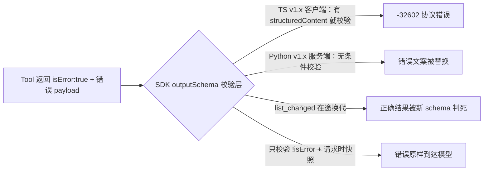

## 1. 问题现象 (Problem Symptoms)

工具明明按 MCP 规范回了 `isError: true` 和可行动错误码，模型侧却只看见 `McpError -32602: Structured content does not match the tool's output schema`。值班第一反应常是「参数又传错了 / 加重试」——错。真正丢的是 **Tool Execution Error 里给语言模型的自我纠错输入**：SDK 的 `outputSchema` 校验层把第二类错误改写成了第一类 Protocol Error。

结论先行：**`outputSchema` 是成功结果的契约，不是错误结果的契约。** 校验层一旦用成功 schema 去卡 `isError: true` 的 payload（或在途换代 schema / 在服务端把错误文案替换成校验信息），模型就失去了「下一步该怎么改」的唯一输入，Host 的重试分类也跟着错。

本文是 **MCP/Host Tool-Result Fidelity 系列第 2 篇**。第 1 篇 [静默截断](posts/silent_tool_result_truncation.md) = Host 按长度 cap 裁成半截，模型自信答完；本篇 = 结果被 SDK 契约校验**整个换成别的错误**，模型丢掉可纠错信息。两者都在「工具已经返回之后、模型可见之前」动手，失败面不同：一个裁长度，一个换语义。

与相邻文划界：

| 文章 | 层 | 问的是 |
| --- | --- | --- |
| [静默截断：工具「成功返回」了半截，模型却自信答完](posts/silent_tool_result_truncation.md) | Host 结果保真 #1 | 完整 payload 被 cap 裁切 |
| [MCP 工具设计：为什么 Agent 总发出「合法但错误」的调用](posts/mcp_tool_design_valid_but_wrong.md) | Server 工具面 | schema 绿灯、业务错选；工具本身报错文案设计 |
| [一个 429 打出成倍的上游请求](posts/layered_retry_amplification.md) | 运行时重试 | -32602 被当成可重试 / 参数错是**本篇后果**，只互链错误分类 |
| [MCP Server 实例复用](posts/mcp_server_instance_reuse_cross_client_leak.md) / [客户端超时了，工具还在跑](posts/mcp_cancellation_not_propagated.md) | MCP SDK 运行时 | 连接路由与请求生命周期；本篇只讲结果内容的校验 |
| **本文** | **Tool-Result Fidelity #2** | 工具正确报错，错误在返回路径上被校验层吞掉 |

划界一句：**valid-but-wrong = 工具设计让调用合法但业务错；本篇 = 工具正确报错，错误在 SDK 路径上被替换。** 静默截断管「看见多少」；本篇管「看见的是不是原来的错」。

### 现象 A：客户端把错误结果当成功结果校验（TS SDK v1.x）

工具 `get_score` 声明 `outputSchema: { score: number }`。业务失败时 handler 按规范返回：

```ts
// 示意：工具正确报错（#2748 复现形态）
return {
  isError: true,
  content: [{ type: "text", text: JSON.stringify({ code: "AUTH_REQUIRED" }) }],
  structuredContent: { code: "AUTH_REQUIRED" },
};
```

同一条 `callTool`：不先 `listTools()` → 拿到 `{"code":"AUTH_REQUIRED"}`；先 `listTools()`（生产客户端几乎都会）→ 抛 `McpError -32602: … data must have required property 'score'`。validator 缓存在 `listTools()` 之后才有；测试客户端常不调 `listTools()`，CI 全绿，生产必炸。

公开主证据：[typescript-sdk#2748](https://github.com/modelcontextprotocol/typescript-sdk/issues/2748)（open，label `v1`）。社区评论（ynohat，非维护者）报告：模型因此始终看不到错误码，同一个无效调用换着参数重试了 8 次——**此为评论观察，非受控复现数据**。同一修复在 v1.x 上被提过多次且未合（#1428 / #1690 / #1945 关闭未合，#1943 `not_planned`）；当前 [PR #2836](https://github.com/modelcontextprotocol/typescript-sdk/pull/2836)（open，base `v1.x`）只改注释与文档，**不改行为**。

### 现象 B：服务端校验替换掉错误信息（Python SDK v1.x）

同一失败面的服务端镜像。low-level server 在 handler 用纯文本 content 报错时，有 `outputSchema` 的工具会被替换成 `Output validation error: outputSchema defined but no structured output returned`；FastMCP 路径返回 `CallToolResult(isError=True)` 时，`convert_result()` 仍拿 output model 校验 `structuredContent`，pydantic 校验错误替换掉原错误（例如 `"Division by zero"`）。

公开主证据：[python-sdk#2429](https://github.com/modelcontextprotocol/python-sdk/issues/2429)（open，`bug` / `ready for work` / `P2` / `fix proposed`）。fix PR [#2466](https://github.com/modelcontextprotocol/python-sdk/pull/2466)（base `main`）/ [#2467](https://github.com/modelcontextprotocol/python-sdk/pull/2467)（base `v1.x` backport）均 **open 未合**。社区 workaround：抛异常走 `ToolError`，而不是返回 `isError=True`——这是绕路，不是契约正确。

### 现象 C：schema 代际错配——在途调用被新 schema 判死

`callTool()` 在 await 响应**之后**才取 validator。期间若 `tools/list_changed` 触发 `listTools()` 清空并替换缓存，按**旧** schema 返回的正确结果会被**新** schema 判成 -32602。

公开主证据：[typescript-sdk#2612](https://github.com/modelcontextprotocol/typescript-sdk/issues/2612)（open，`bug` / `P2` / `v1`，无已合修复）。issue 给出「发请求前取 validator」的补丁，**未合**——属提议，不是现有 SDK 行为。

旁证（server 违反自己发布的 schema）：[python-sdk#3224](https://github.com/modelcontextprotocol/python-sdk/issues/3224)（closed completed 2026-08-20，经已合 [PR #3331](https://github.com/modelcontextprotocol/python-sdk/pull/3331)，base `main`）——`TypedDict` 的 `NotRequired` 键缺省时，`structuredContent` 填 `null`，发布的 schema 里这些属性不可为 null；SDK 自己的客户端拒收，而同一次调用的 text block 仍是 `{"name": "Dave"}`，两份结果不一致。



---

## 2. 根因分析 (Root Cause Analysis)

根因不是「没写 outputSchema」或「模型不听话」，而是把 **三种不同保证** 叠进了同一个口语「结果已经校验过了」：

| 层 | 实际保证 | 不保证什么 | 典型误判 |
| --- | --- | --- | --- |
| (1) 结果类型门控 | 成功结果才对 `outputSchema` 校验 | 错误结果的 `structuredContent` 也必须符合成功 schema | 「有 structuredContent 就该校验」盖过 `isError` |
| (2) 校验失败的呈现 | 抛 Protocol Error（-32602）或替换文案 | 模型仍看得到原 Tool Execution Error | 「-32602 = 参数错，加重试」 |
| (3) schema 代际 | 用「当前缓存」的 validator | 在途调用仍按发出时的代际校验 | 「list_changed 刷新了 = 旧结果也该符合新 schema」 |
| (附) server 自洽 | 发布一份 `outputSchema` | 序列化路径与 schema 生成路径不悄悄分叉 | 「客户端拒收 = 模型传参错了」 |

规范把错误分成两类（[Tools · Error Handling](https://modelcontextprotocol.io/specification/2025-11-25/server/tools)）：

1. **Protocol Errors** — JSON-RPC `error`（未知工具、畸形请求等）
2. **Tool Execution Errors** — `result` 里 `isError: true`；规范原文：*contain actionable feedback that language models can use to self-correct*；*Clients **SHOULD** provide tool execution errors to language models to enable self-correction.*

Output Schema 节：*Servers **MUST** provide structured results that conform to this schema.* / *Clients **SHOULD** validate structured results against this schema.* ——说的是**结构化成功结果**，不是「凡带 `structuredContent` 的错误结果也必须过成功 schema」。规范**没有**规定错误结果能不能带 `structuredContent`（#2748 提到 SEP-2145 仍 open）；本文不把它写成「禁止」或「允许」，只钉：**一旦带了且客户端用成功 schema 去卡，生产路径就会吞错。**

同一 SDK 内部也自相矛盾（TS v1.x）：server 端 `validateToolOutput` 对 `isError` **直接 return**（[PR #655](https://github.com/modelcontextprotocol/typescript-sdk/pull/655) 已合，2025-06-24）；client 端 v1.x 却是 `if (result.structuredContent)`——注释写着 *Only validate structured content if present (not when there's an error)*，条件却不测 `isError`。**自己的 server 发出、自己的 client 拒收。** TS v2 / `main` 客户端条件是 `result.structuredContent !== undefined && !result.isError`；Python v1.x **客户端**是 `if not result.isError:` 才校验——问题限定在 **TS v1.x 客户端**与 **Python v1.x 服务端**，不要写成「MCP 客户端都会这样」。

四句话收束：

1. **校验的是哪种结果**：成功才对 `outputSchema`；错误应走 Tool Execution Error 通道。
2. **校验失败怎么呈现**：抛 -32602 会让 Host / 模型当成协议/参数问题；应降级为模型可见的 tool error（本文主张，非现有 SDK 默认）。
3. **用的是哪一代 schema**：validator 应在发请求时取快照（#2612 提议，未合）。
4. **server 是否自洽**：每个成功结果都应用自己发布的 schema 验一遍（#3224 的教训）。

---

## 3. 机制 / 解法要点 (Mechanism / Solutions)

### 3.1 结果类型门控：只对成功结果做 `outputSchema` 校验

可复用条件（与 TS v2 主线 / TS 服务端 PR #655 / Python v1.x 客户端一致）：

```ts
// 示意：成功路径才校验
if (result.structuredContent !== undefined && !result.isError) {
  validate(result.structuredContent, outputSchema);
}
```

| 线 | 行为（Writer 2026-10-28 核对 API + 条目） |
| --- | --- |
| TS v2 / `main` 客户端 | `!result.isError` 守卫（#2748 报告者称 `@modelcontextprotocol/client@2.0.0` 已带；本轮只核到 `main` 当前源码叙述与条目一致） |
| TS v1.x 客户端 | `if (result.structuredContent)` —— **仍校验错误结果**；PR #2836 不改行为 |
| TS 服务端 | PR #655 已合：`isError` 跳过 |
| Python v1.x 客户端 | `if not result.isError` 才校验 |
| Python v1.x 服务端 | 仍会替换错误文案；#2466 / #2467 open |
| Python `main` | 主线现已带 `not result.is_error` 守卫；#2466 仍 open（勿写成「#2466 已合」） |

跑在 v1.x TS 客户端上的**服务端临时 workaround**（#2748 报告者与评论者）：错误结果**不带** `structuredContent`，错误 payload 放 `content` 文本。Python v1.x FastMCP 上社区用「抛异常」绕过——都是绕路，门控修好后应回到规范的 `isError: true`。

### 3.2 校验失败降级为模型可见的 tool error（本文主张）

即使成功路径校验失败，也不应默认让整个 `callTool` 抛 Protocol Error 并被 Host 当成「参数错」重试。Host 侧主张：

- 保留工具名、原 `content` / `structuredContent`
- 附加「结果不符合 published outputSchema」说明
- 以 **Tool Execution Error** 形态交给模型（可自我纠错或改走别的工具）
- 指标上与真正的 -32602（未知工具 / 畸形请求）分开计数

这是 **本文主张**，不是任何 SDK 的现有默认行为。SEP-2145（#2748 提及，仍 open）方向相近：让 output-validation 失败以 tool execution error 呈现——写稿时不把它写成已落地。

### 3.3 schema 代际：发请求时取 validator 快照

```ts
// 示意：#2612 提议（未合）
const validator = this.getToolOutputValidator(params.name); // 发请求前
const result = await this.request({ method: "tools/call", params }, ...);
if (validator && result.structuredContent && !result.isError) {
  validator(result.structuredContent);
}
```

`tools/list_changed` 只影响**之后**发出的调用；在途调用按发出时的代际校验。不要在 await 之后再查可变缓存。

### 3.4 Server 自检：成功结果必须通过自己发布的 schema

#3224 说明 schema 生成与序列化是两条路径，会悄悄分叉（`NotRequired` → dump 出 `null`）。发版前契约测试：

- 遍历每个工具的成功路径（含可选字段缺省、`null`、嵌套）
- 每个 `structuredContent` 用该工具**当时发布的** `outputSchema` 校验
- text block 与 `structuredContent` 语义一致

#3331 已合入 Python `main`：TypedDict 走 pydantic 原生路径，省略的可选键不再填 `null`。v1.x 是否 backport 不在本篇展开；要点是 **server 自洽是独立杠杆**，与客户端门控正交。

### 3.5 观测：按工具统计 -32602 vs `isError`

- `tools/call` 的 -32602 次数（尤其 message 含 `output schema`）
- 同工具的 `isError: true` 次数
- 二者交叉：大量「schema -32602」而几乎没有模型可见的 `isError` → 本篇失败面在开火

与 [layered-retry](posts/layered_retry_amplification.md) 只交一句：把这类 -32602 从「参数错 / 可重试」桶里挪走，避免放大比被错误分类喂大。

---

## 4. 同一条业务链：应付账款核对 `AP-7302`

贯穿全文的都是这一单（**设计示例**）：应付账款核对 agent，任务 `AP-7302`——逐张核对发票余额后发起付款。MCP 工具 `get_invoice_balance` 声明：

```json
// 示意
"outputSchema": {
  "type": "object",
  "properties": {
    "balance": { "type": "number" },
    "currency": { "type": "string" }
  },
  "required": ["balance", "currency"]
}
```

发票被财务锁定时，工具正确返回：

```ts
// 示意：Tool Execution Error
{
  isError: true,
  content: [{
    type: "text",
    text: JSON.stringify({
      code: "INVOICE_LOCKED",
      invoice_id: "INV-5521",
      unlock_after: "2026-10-28T18:00:00+08:00"
    })
  }],
  structuredContent: {
    code: "INVOICE_LOCKED",
    invoice_id: "INV-5521",
    unlock_after: "2026-10-28T18:00:00+08:00"
  }
}
```

Host 用 **TS SDK v1.x** 客户端，启动时 `listTools()`。

### BAD v1：客户端吞掉 `INVOICE_LOCKED`（现象 A）

```text
# ❌ AP-7302 / INV-5521
# 1) 工具返回 isError:true + structuredContent{code:INVOICE_LOCKED}
# 2) TS v1.x callTool：有 listTools 缓存 → 用成功 schema 校验
# 3) 缺 required property 'balance' → McpError -32602
# 4) Host 当协议/参数错误交给 retry；模型只见「不匹配 schema」
# 5) 换参数反复 get_invoice_balance，始终不知道「已锁定、某时解锁」
# 6) 集成测试客户端不调 listTools() → CI 全绿
```

| 相对正确契约 | 缺了哪条 | 回扣 |
| --- | --- | --- |
| 错误结果被当成功校验 | 结果类型门控 | §3.1 |
| -32602 进 retry / 模型 | 降级方式 | §3.2 |

### BAD v2：服务端「修」成只回 text，Python 路径仍吞错（现象 B）

团队以为「错误别带 `structuredContent`」就能过 TS 客户端——这条 workaround 对 TS v1.x 客户端往往通了。但同一工具的 **Python v1.x** 实现用 FastMCP 返回 `CallToolResult(isError=True)`：

```python
# 示意：BAD — 原错误被 pydantic / Output validation error 替换
return CallToolResult(
    isError=True,
    content=[TextContent(type="text", text="INVOICE_LOCKED …")],
)
# convert_result() 仍校验 → 模型看到的不是 INVOICE_LOCKED
```

| 相对正确契约 | 缺了哪条 | 回扣 |
| --- | --- | --- |
| 服务端替换错误文案 | 结果类型门控（服务端侧） | §3.1 |
| 模型仍无行动码 | 降级 / 保留原 content | §3.2 |

### BAD v3：`list_changed` 在途换代（现象 C）

财务把 schema 升级为 `{ balance, currency, as_of }` 并发 `tools/list_changed`。Host 刷新工具列表时，`INV-5521` 的另一次**成功**查询还在途 → 按旧 schema 返回的正确余额被新 schema 判 -32602，`AP-7302` 这张发票被标成「查询失败」。

| 相对正确契约 | 缺了哪条 | 回扣 |
| --- | --- | --- |
| 在途结果用新 schema 判 | schema 代际快照 | §3.3 |

### GOOD：同一条 `AP-7302` 改完

```ts
// 示意：Host 侧封装（§3.1 + §3.2 + §3.3）
async function callToolFaithful(client, params) {
  const validator = snapshotOutputValidator(params.name); // §3.3 发请求前
  let result;
  try {
    result = await client.callTool(params);
  } catch (err) {
    if (isOutputSchemaMcpError(err)) {
      // §3.2 本文主张：降级为模型可见 tool error，不当协议重试
      return {
        isError: true,
        content: [{
          type: "text",
          text: `tool=${params.name} output failed schema check; ` +
                `original_protocol_message=${err.message}`
        }],
      };
    }
    throw err;
  }
  if (result.isError) {
    return result; // §3.1 错误结果不做成功 schema 校验
  }
  if (validator && result.structuredContent !== undefined) {
    validator(result.structuredContent); // 仅成功路径
  }
  return result;
}
```

服务端（示意）：错误路径保持 `isError: true` + 稳定 `code`；若必须兼容 TS v1.x 客户端，可暂把错误只放 `content` text（workaround），同时跟进 SDK 门控；Python v1.x 在 #2467 合入前避免依赖「返回 `CallToolResult(isError=True)` 且带 output model」的路径被替换。成功路径发版前跑 §3.4 契约测试。

**GOOD 行为**：`INVOICE_LOCKED` 原样到达模型 → 模型跳过 `INV-5521`、记下 `unlock_after`，继续核对其余发票，而不是换参重打同一张锁单。

| BAD → GOOD 改动 | 回扣 §3 |
| --- | --- |
| 客户端 / 封装只校验 `!isError` | §3.1 |
| schema 校验失败 → 模型可见 tool error，不进协议 retry | §3.2 |
| validator 在 `tools/call` 发出时快照 | §3.3 |
| 成功结果契约测试；text ≡ structuredContent | §3.4 |
| -32602(output schema) 与 `isError` 分计数 | §3.5 |

---

## 5. 发版前清单 (Pre-Ship Checklist)

对准可注入失败点，不靠「小工具 demo 全绿」：

**结果类型门控**

- [ ] **注入：** 有 `outputSchema` 的工具返回 `isError: true` + 不符合成功 schema 的 `structuredContent`；分别在调用前**调 / 不调** `listTools()` 各跑一次 → **期望：** 两种顺序结果一致，模型看到原错误内容，没有 -32602
- [ ] 团队口头能区分：TS v1.x 客户端 / Python v1.x 服务端仍可能吞错；TS v2 客户端与 Python v1.x 客户端已对 `isError` 跳过——**不要写「所有 MCP 客户端都会」**

**服务端错误保真**

- [ ] **注入：** Python v1.x server 上同一工具分别用纯文本 content 和 `CallToolResult(isError=True)` 报错 → **期望：** 客户端收到的错误文本与 handler 写的一致，不被 `Output validation error` 或 pydantic 信息替换
- [ ] 跟踪 #2466 / #2467；未合前有明确 workaround 文档（抛 `ToolError` 或错误不走会触发校验的 convert 路径）

**schema 代际**

- [ ] **注入：** 让 `tools/call` 在途时触发 `tools/list_changed` 并换一版 `outputSchema` → **期望：** 在途调用按发出时的 schema 校验；之后的调用按新 schema
- [ ] Host 刷新工具列表与在途 `callTool` 的竞态有单测或混沌注入

**Server 自洽**

- [ ] **注入：** 契约测试遍历每个工具的成功路径（含可选字段缺省、`null`、嵌套）→ **期望：** 每个 `structuredContent` 都通过该工具发布的 `outputSchema`，text 与 `structuredContent` 语义一致
- [ ] TypedDict / 可选字段回归覆盖「省略 ≠ null」（对照 #3224 / #3331）

**观测与重试分类**

- [ ] 按工具统计「output schema -32602」与 `isError` 次数；异常交叉比告警
- [ ] Host retry 策略：**不把**「Structured content does not match the tool's output schema」默认当成可重试参数错误（交叉 [layered-retry](posts/layered_retry_amplification.md)）
- [ ] 与 [静默截断](posts/silent_tool_result_truncation.md) 划界：本清单测的是**语义替换**，不是长度 cap

**写稿 / 评审否决项（避免复述禁令）**

- [ ] 未把「模型重试 8 次」写成受控复现数据（出处：#2748 社区评论 ynohat）
- [ ] 未把 #1428 关闭理由写成亲读原文（据 #2748 所述）
- [ ] 未声称规范禁止或允许错误结果带 `structuredContent`
- [ ] 未把「降级为 tool error」「发请求时快照」写成 SDK 已有行为
- [ ] 未声称 #2466 已合或「Python 客户端不检查 isError」

---

## 6. 小结 (Takeaways)

**工具报了 `isError: true`，模型却只看到 -32602——先查 SDK 校验层，再查模型是否「忽略错误」。** `outputSchema` 约束的是成功结果；用它卡错误结果（或在途换代 / 服务端替换文案），等于拆掉规范给语言模型的自我纠错通道。

- 三类失败面：TS v1.x 客户端校验错误结果的 `structuredContent`（#2748）；Python v1.x 服务端替换错误文案（#2429）；schema 代际 / server 自洽（#2612 / #3224）。
- 四条杠杆：结果类型门控（§3.1）、校验失败降级为模型可见 tool error（§3.2，本文主张）、发请求时 validator 快照（§3.3）、server 契约自检（§3.4）。
- 同一业务线 `AP-7302`：BAD 吞掉 `INVOICE_LOCKED` → 盲重试；GOOD 错误原样到达 → 跳过锁单、记下 `unlock_after`。
- 发版靠「listTools 开/关」「在途 list_changed」「成功路径契约测试」注入，不靠不调 `listTools()` 的假绿 CI。

系列位置：[静默截断（Fidelity #1）](posts/silent_tool_result_truncation.md) → **outputSchema 吞错（本文，Fidelity #2）**。工具面 [合法但错误](posts/mcp_tool_design_valid_but_wrong.md) 管「怎么报错」；本篇管「报错之后还能否送达」。下一坑可转向进度通知与同 chunk 重排（Scout ready：`mcp-progress-same-chunk-unknown-token`）——那是成功路径上的旁路通知，不是结果契约校验。

---

## 参考 (References)

1. Model Context Protocol — [Tools (specification 2025-11-25)](https://modelcontextprotocol.io/specification/2025-11-25/server/tools)（Output Schema：Servers MUST / Clients SHOULD；Error Handling：Protocol Errors vs Tool Execution Errors；Clients SHOULD provide tool execution errors for self-correction）。
2. modelcontextprotocol/typescript-sdk — [Issue #2748](https://github.com/modelcontextprotocol/typescript-sdk/issues/2748)（**主证据**，open，`v1`；错误结果 `structuredContent` → -32602；依赖 `listTools()` 缓存；v1/v2 行为分歧）。
3. modelcontextprotocol/python-sdk — [Issue #2429](https://github.com/modelcontextprotocol/python-sdk/issues/2429)（**主证据**，open，`fix proposed`；服务端校验替换错误信息）。
4. modelcontextprotocol/python-sdk — [PR #2466](https://github.com/modelcontextprotocol/python-sdk/pull/2466) / [PR #2467](https://github.com/modelcontextprotocol/python-sdk/pull/2467)（fix，均 open 未合；base `main` / `v1.x`）。
5. modelcontextprotocol/typescript-sdk — [Issue #2612](https://github.com/modelcontextprotocol/typescript-sdk/issues/2612)（**主证据**，open；在途 `list_changed` 换代 schema → -32602；快照补丁未合）。
6. modelcontextprotocol/python-sdk — [Issue #3224](https://github.com/modelcontextprotocol/python-sdk/issues/3224)（旁证，closed completed；server 产出违反自己发布的 schema）← [PR #3331](https://github.com/modelcontextprotocol/python-sdk/pull/3331)（merged 2026-08-20，`main`）。
7. modelcontextprotocol/typescript-sdk — [PR #655](https://github.com/modelcontextprotocol/typescript-sdk/pull/655)（merged 2025-06-24；服务端对 `isError` 跳过校验）。
8. modelcontextprotocol/typescript-sdk — [PR #2836](https://github.com/modelcontextprotocol/typescript-sdk/pull/2836)（open，base `v1.x`；只改注释/文档/测试，不改校验行为）。
9. 本站 — [静默截断：工具「成功返回」了半截，模型却自信答完](posts/silent_tool_result_truncation.md)（Fidelity 系列第 1 篇；长度裁切 vs 本篇语义替换）。
10. 本站 — [MCP 工具设计：为什么 Agent 总发出「合法但错误」的调用](posts/mcp_tool_design_valid_but_wrong.md)（工具面；Protocol Error vs `isError` 分工；与本篇「正确报错被吞」划界）。
11. 本站 — [一个 429 打出成倍的上游请求](posts/layered_retry_amplification.md)（重试错误分类；本篇 -32602 误分类的后果层）。
12. 本站 — [MCP Server 实例复用：一个 McpServer 连两个客户端…](posts/mcp_server_instance_reuse_cross_client_leak.md) / [客户端超时了，工具还在跑：MCP 取消没过线…](posts/mcp_cancellation_not_propagated.md)（同属 MCP SDK 运行时，不同层）。
