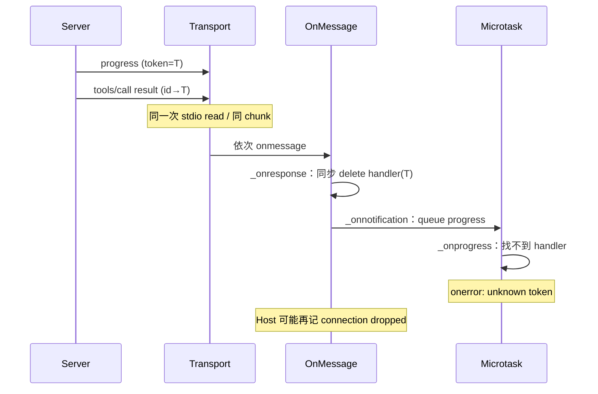

## 1. 问题现象 (Problem Symptoms)

结论先行：**Server 在 wire 上先写了 `notifications/progress`、后写 `tools/call` 结果，客户端仍可能报 `Received a progress notification for an unknown token`。** 根因不是 server「迟到」，而是客户端自己把同一次 transport 读里的通知排到响应之后：`_onresponse` 同步删掉 `_progressHandlers`，`_onnotification` 把 progress 推到 microtask 才跑。Host（如 Claude Code）再把这条协议错误当成 stdio 故障，打出 `STDIO connection dropped` / `Closing transport`，同连接上其它在途调用被截断。真正要修的是**进度 handler 的生命周期与 Host 对未知 token 的过激反应**，不是「进度发少一点」或「再加几毫秒 sleep」。

本文是 **Agent Runtime Failure Handling** 专题的 #3（progress 与 result 分发顺序）。#1 [一个 429 打出成倍的上游请求](posts/layered_retry_amplification.md) 问的是：调用失败之后谁来重试。#2 [客户端超时了，工具还在跑](posts/mcp_cancellation_not_propagated.md) 问的是：放弃那次调用时，对端是否停下。本篇问的是：成功路径上，通知与响应的处理顺序是否把「正常进度」打成协议错误 / 断连。三篇只在「未知 id/token → 断连」处交一句。

与相邻文划界（本文不复述它们的机制）：

| 文章 | 层 | 问的是 / 和本文的交点 |
| --- | --- | --- |
| [取消未过线](posts/mcp_cancellation_not_propagated.md)（Runtime Failure Handling #2） | 取消生命周期 | 那篇：有没有发 `notifications/cancelled`、取消后还回不回包。本文：进度通知与**成功**响应的顺序；交点只有「未知 token/id → 断连」 |
| [MCP Server 实例复用](posts/mcp_server_instance_reuse_cross_client_leak.md) | 连接实例作用域 | 那篇：多客户端共享实例错路由。本文：单连接内 progress handler 生命周期 |
| [outputSchema 校验吞掉工具错误](posts/mcp_output_schema_validation_swallows_tool_errors.md) | 结果内容保真 | 那篇：`isError:true` 被校验换掉。本文：结果往往已成功，坏在旁路通知 |
| **本文**（Runtime Failure Handling #3） | MCP 客户端协议分发 / progress | wire 顺序是否等于处理顺序；未知 progress token 是否拆 transport |

证据范围先说清：机制主线来自 TypeScript SDK [issue #2580](https://github.com/modelcontextprotocol/typescript-sdk/issues/2580)（**仍 open**）、fix [PR #2967](https://github.com/modelcontextprotocol/typescript-sdk/pull/2967)（open，base `main`，**未合**）与 [PR #2586](https://github.com/modelcontextprotocol/typescript-sdk/pull/2586)（open，base `v1.x`，**未合**）；Host 过激反应来自 Claude Code [issue #102831](https://github.com/anthropics/claude-code/issues/102831)（open，有线抓包）与旁证 [#64475](https://github.com/anthropics/claude-code/issues/64475)（closed **not_planned**，stale bot，**未修复**）。**写稿禁令：不要写「SDK 已修复」——#2967 / #2586 均未合。** 下面复现数字均来自 issue / PR 评论中的报告者测量，不是基准。

三个现象必须分开看：**同 chunk 重排**、**真迟到**、**Host 把未知 token 当断连**——它们不是同一种失败。

### 现象 A：同一次 stdio 读里 progress + result —— 终端进度进 `onerror`

Server 连发 N 条 progress，最后一条常是 `progress === total`，然后立刻返回 `tools/call` result。stdio 上两条（或更多）JSON 行可能落进同一次 `read`。客户端却报：

```text
Received a progress notification for an unknown token: {"method":"notifications/progress",...}
```

[#2580](https://github.com/modelcontextprotocol/typescript-sdk/issues/2580)（报告环境 `@modelcontextprotocol/sdk` 1.29.0，stdio）：server 发出 **4** 条 progress（全部在 result 之前），客户端只 `received=1`，另 3 条各进一次 `onerror`。加约 100ms 间距则四条全送达——说明不是协议违规，是时机。

[#2967](https://github.com/modelcontextprotocol/typescript-sdk/pull/2967) 评论给出同版本 50 次调用统计：`received=1` + 3 errors 占 **43/50**；报告者在真实 apple-photos-mcp `export` 上：基线 9/15 丢终端通知，#2967 预览 10/10 送达且零 `onerror`（均为报告者负载测试，非官方基准）。

### 现象 B：Host 把未知 token 记成 `STDIO connection dropped` —— 同连接在途调用被拆

同一条日志线在 Claude Code 上更致命。[#102831](https://github.com/anthropics/claude-code/issues/102831)（open，`has repro`；报告版本 2.1.302）：极简 Python stdio server，progress **紧挨** result 写出 → 每次：

```text
[DEBUG] MCP server "repro": STDIO connection dropped after 6s uptime
[DEBUG] MCP server "repro": Connection error: Received a progress notification for an unknown token: ...
[DEBUG] MCP server "repro": Tool 'slow' completed successfully in 3s
```

线抓包（报告者 `tee` 两侧）显示：OUT 先 progress、后 result；工具仍显示成功。progress 提前 3s 写出则不触发。旁证 [#64475](https://github.com/anthropics/claude-code/issues/64475)（closed not_planned，**未修复**）同日志下报告在途大字段被截成 `body: expected string, received undefined`；对照：同 SDK 独立客户端与 HTTP 直连均稳定。**Claude Code 源码未开源，#64475 的「写被截断」是报告者假设 + 日志相关；独立客户端对照证明非 server bug，但 Host 内部具体 if 本文未核到。**

### 现象 C：真迟到的同 token progress —— 仍走 `_onerror`（与同 chunk 正交）

即便同 tick 重排修了，响应处理完之后才到达的同 token progress，在当前行为下仍进 `_onerror`。[#2967](https://github.com/modelcontextprotocol/typescript-sdk/pull/2967) 正文写明：它**不**覆盖真迟到，仍 discard + `onerror`；需要 [#2586](https://github.com/modelcontextprotocol/typescript-sdk/pull/2586) 的 recently-completed FIFO（刚完成的 token 静默/debug，真未知仍报错）。**两条 PR 都未合**——不要把「开了 PR」读成「线上已修」。



---

## 2. 根因分析 (Root Cause Analysis)

三个现象的共同误判是：把「wire 上 progress 先于 result」「客户端 `onprogress` 收到了」「未知 token = 传输坏了」叠成一句「进度实现写错 / MCP server 不稳」。它们是三个独立视角——**写出顺序、派发顺序、Host 错误分级**——每一侧都可能漏。

| 视角 | 正常时应对齐到 | 漏了会怎样 |
| --- | --- | --- |
| Wire 顺序 | progress 写在 result 之前（批处理自然写法） | 无：server 已正确；问题不在这里 |
| 客户端派发顺序 | 同一次 read 内先到的通知先于响应对应的 handler 删除 | 现象 A：同 chunk 重排 → unknown token |
| Host 错误分级 | 未知 / 迟到 progress token → debug，不断 transport | 现象 B：记 connection dropped → 拆在途调用 |
| 真迟到策略 | 刚完成 token 静默；从未注册的 token 仍报错 | 现象 C：合法晚到也刷 `onerror` |

根因可以拆成三层：

1. **同 chunk 重排：通知走 microtask、响应当场删 handler（对应 A）。** [#2967](https://github.com/modelcontextprotocol/typescript-sdk/pull/2967) / [#2580](https://github.com/modelcontextprotocol/typescript-sdk/issues/2580) 评论钉死：`_onnotification` 经 `Promise.resolve().then(...)` 推迟；`_onresponse` 在 transport `onmessage` 里同步执行并 `this._progressHandlers.delete(messageId)`。同一次 `ReadBuffer` 派发里，result 先处理完 → handler 已删 → 后跑的 progress 变成「未知 token」。**Server 无法用「先 await flush 再 return」躲开**——它控制得了写出顺序，控制不了客户端内部重排。
2. **真迟到仍打协议错误（对应 C，与 #2967 正交）。** 响应之后到达的同 token progress，丢弃合理，升 `onerror` 不合理：刚完成的 token 与从未存在的 token 被当成同一种错误（#2580 报告者原文；#2586 用 recently-completed 集合拆开）。
3. **Host 过激反应：未知 token → 断 stdio（对应 B）。** Progress 在规范里是 advisory。把「找不到 handler」升级成 transport 致命错误，会在工具**已成功**的路径上制造假断连，并波及同连接其它在途 `tools/call`（#102831 线抓包；#64475 报告大参数截断）。这与 #2 取消篇「未知 id 的响应 → 断连」同形，但触发物是 progress，不是取消后的迟到结果。

还有第四刀，常被 UI 进度条藏住：**终端 `progress === total` 不可做完成闸门。** 完成以 `tools/call` result 为准；最后一帧进度在同 chunk 竞态下是 best-effort（在客户端派发未修之前尤其如此）。用「是否看到 100%」决定是否重试，会把已成功写出的副作用再打一遍。

---

## 3. 机制要点：同 tick 先派发、迟到静默、Host 不断连、完成看 result (Mechanism)

### 3.1 同 tick 内先派发已排队的 progress，再删 handler

目标：凡在 `_onresponse` 同步路径之前已经进入通知队列的 progress，必须先送达 `onprogress`，再移除 handler。

[#2967](https://github.com/modelcontextprotocol/typescript-sdk/pull/2967) 的做法（**PR 未合，以下为机制对照，不是「已发布行为」**）：把 `_progressHandlers.delete` 推迟一个 microtask，使同 tick 更早排队的通知先跑完；handler 仍在调用方 `await` 恢复前删掉；真迟到仍 discard。另一条社区路线是 progress 同步派发（#2580 评论 repro）；naive 同步派发会碰 task-progress 既有测试，需额外处理——故本文以 deferred-delete 为 GOOD 主对照。

Host / 自研客户端若暂时钉在未修 SDK：至少不要把「终端 progress 缺失」当失败去重试；完成闸门只看 result（§3.4）。

### 3.2 刚完成 token 的迟到 progress：静默或 debug，真未知仍报错

目标：区分「片刻前还合法的 token」与「从未注册的垃圾 token」。

[#2586](https://github.com/modelcontextprotocol/typescript-sdk/pull/2586)（**未合**，base `v1.x`）：维护有界 FIFO（PR 正文约 64 个）最近完成的 progress token；仅当 token 属于刚结束请求时忽略且不调 `onerror`；从未注册的仍走现有协议错误。#2967 正文写明两条互补：deferred-delete 救同 chunk 送达；recently-completed 救真迟到噪声。**只合其一不够**——#2967 作者评论：单靠 #2586 会让同 chunk 变「静默丢进度」而非「送达 `onprogress`」。

### 3.3 Host：未知 progress token 只打 debug，不断 transport、不中断其它在途调用

目标：progress 是 advisory；协议噪声 ≠ 连接死亡。

对照 #102831 期望行为：接受或静默忽略该通知，**不**报告 connection dropped。对照 #64475 期望：stdio 保持；在途 `tools/call` 参数完整到达 server。与取消篇 §3.2 同一原则：未知 id / 迟到响应不当作致命传输错误去拆连接——本篇把对象换成 progress token。

在 SDK / Host 未改之前，运维侧至少：把 `unknown token` + `STDIO connection dropped` 关联到「紧挨 result 的 progress」而非「server 进程挂了」；真断连另有进程退出 / EOF 证据。

### 3.4 完成以 result 为准；指标分开数

- UI / Agent 状态机：`tools/call` result（含 `isError`）是完成信号；进度条允许丢最后一帧。
- 不以「是否收到 `progress === total`」触发重试或二次 `tools/call`。
- 指标：`unknown_token_onerror` 计数 vs 成功 `tools/call` 计数；二者同时高 = 现象 A/C 在刷噪声。另计 `stdio_connection_dropped` 且紧随 unknown-token = 现象 B。apple-photos 类数字只可作「负载下同 chunk 可复现」的形状参考，不作 SLO。

---

## 4. 同一批影像导出 `EXPORT-8841`：怎么接、错在哪、改完怎么走

业务线固定为相册导出任务 `EXPORT-8841`：MCP 工具 `export_album` 每张图发一条 progress，最后一条 `progress === total` 后立刻返回结果。下面版本里**工具实现与导出张数不变**，每次只改客户端派发或 Host 错误分级。代码是 Host / 包装层示意，不是 typescript-sdk 源码拷贝；版本标签按 §1 已核实的 issue / PR 描述对齐。

### 4.1 BAD v1：TS SDK 同 chunk 重排——终端进度进 `onerror`，UI 当失败重试

```typescript
// 示意：EXPORT-8841 v1 —— 同 chunk 重排（现象 A / #2580）
// Host 使用未含 #2967 的 @modelcontextprotocol/sdk（如 1.29.x）
const progressFrames: number[] = [];
client.onerror = (e) => {
  log.error(e.message); // "Received a progress notification for an unknown token"
  // UI 误判：进度协议出错 → 标记导出失败
  markExportFailed("EXPORT-8841");
};

await client.callTool(
  { name: "export_album", arguments: { job: "EXPORT-8841", album: "trip-2026" } },
  CallToolResultSchema,
  { onprogress: (p) => progressFrames.push(p.progress) },
);

// wire 上：progress 1..N 均在 result 之前
// 客户端：同一次 read 里 result 先删 handler → 终端帧进 onerror
// server 端文件已写出；UI 却因 onerror 触发重试 → 重复导出
```

`EXPORT-8841` 在负载下出现 #2967 评论那种形状：多数调用只收到部分 progress，终端帧变 unknown-token；值班若把 `onerror` 绑到「失败重试」，server 已落盘的导出被再跑一遍。

修复方向：§3.1 同 tick 先派发；§3.4 完成看 result，不因丢终端帧重试。

### 4.2 BAD v2：Claude Code 把未知 token 当断连——下一条大参数 `tools/call` 被截断

v2 假定业务已改成「`onerror` 不触发重试」，但 Host 仍是把 unknown-token 升级为 connection error 的路径（#102831 / #64475 描述）。

```text
# 示意：EXPORT-8841 v2 日志形状（现象 B）
# 1) export_album：progress 紧挨 result
Connection error: Received a progress notification for an unknown token: {progress:50, total:50, ...}
STDIO connection dropped
Tool 'export_album' completed successfully

# 2) 同会话立刻发下一条带长 body 的 tools/call（如 write_caption）
# server Zod：body: expected string, received undefined  （#64475 报告形状）
```

导出本身可能显示成功；紧随其后的写操作却缺字段。值班会去查「MCP server 不稳 / 参数序列化 bug」，而独立 SDK 客户端与 HTTP 对照都稳定——坏在 Host 拆 transport 的时机。

修复方向：§3.3 Host 未知 token 不断连；在途调用参数完整。

### 4.3 BAD v3：只「吞掉」onerror，真迟到与同 chunk 未拆开——进度条永久停在 98%

v3 在应用层 `onerror` 里忽略含 `unknown token` 的消息，不再重试、不再断连。噪声没了，但同 chunk 下终端帧仍未进 `onprogress`；若 UI 用「是否见到 total」关进度条，会永远停在倒数第二帧。真迟到路径上，#2967 未合时 SDK 仍会 `onerror`——应用层吞掉后，与「从未注册的垃圾 token」也无法区分，排障失去信号。

```typescript
// 示意：EXPORT-8841 v3 —— 只吞 onerror，不修派发（半吊子）
client.onerror = (e) => {
  if (String(e.message).includes("unknown token")) return; // 噪声没了
  log.error(e);
};
// progressFrames 仍可能缺最后一帧；完成必须以 result 为准（§3.4）
```

修复方向：§3.1 送达 + §3.2 迟到静默（保留真未知报错）+ §3.4 完成看 result。

### 4.4 GOOD：同 tick 先派发；迟到 token 静默；Host 不断连；完成看 result

```typescript
// 示意：EXPORT-8841 GOOD —— 对齐 §3.1–§3.4
// A. SDK 侧（对照 #2967 机制；PR 未合前可用补丁 / 等待发布，勿宣称「官方已修」）
queueMicrotask(() => {
  progressHandlers.delete(messageId); // 先让同 tick 已排队的 progress 跑完
});

// B. 真迟到（对照 #2586）：recentlyCompleted 命中则 debug，不 onerror
function onProgressNotification(token: string | number, payload: Progress) {
  const handler = progressHandlers.get(token);
  if (handler) {
    handler(payload);
    return;
  }
  if (recentlyCompleted.has(token)) {
    log.debug("late progress for completed token", token);
    return;
  }
  log.error("progress for never-registered token", token); // 真未知仍报错
}

// C. Host：未知 progress token ≠ transport 死亡
function onProtocolError(err: Error) {
  if (isUnknownProgressToken(err)) {
    metrics.unknown_token_onerror.inc();
    return; // 不断 stdio，不 abort 其它 in-flight
  }
  tearDownTransport(err);
}

// D. 业务完成闸门
const result = await client.callTool(
  { name: "export_album", arguments: { job: "EXPORT-8841", album: "trip-2026" } },
  CallToolResultSchema,
  { onprogress: (p) => ui.setProgress(p.progress, p.total) }, // 允许缺最后一帧
);
if (result.isError) {
  markExportFailed("EXPORT-8841", result);
} else {
  markExportDone("EXPORT-8841", result); // §3.4：以 result 为准
}
```

监控：`unknown_token_onerror / successful_tools_call`；`connection_dropped` 且前序 1s 内有 unknown-token 的关联计数。差值在修好派发后应接近 0；Host 修分级后，后者应为 0。

v1 → GOOD 的每处改动回扣 §3：

| 版本 | 失败表现 | 改动 | 对应 §3 |
| --- | --- | --- | --- |
| v1 → v2 | 终端 progress → `onerror`；UI 重试已成功导出 | 完成闸门改看 result；不再因丢帧重试 | §3.4（先止血）+ 目标 §3.1 |
| v2 → v3 | unknown-token → `STDIO connection dropped`；下一条大参数被截 | Host 对未知 progress token 不断 transport | §3.3 |
| v3 → GOOD | 只吞错误 → 进度条卡死 / 真未知失信号 | deferred-delete 送达同 tick progress；recently-completed 静默真迟到；真未知仍报错 | §3.1 / §3.2 |
| GOOD | 防止退化 | 分计数：unknown-token vs 成功 call；dropped 关联 | §3.4 |

一句话回顾：v1 的问题是**客户端重排把先写出的 progress 打成未知 token**，v2 是**Host 把该噪声升级成断连**，v3 是**只消噪声不修送达与分级**；GOOD 让「wire 顺序 / 派发顺序 / 错误分级 / 完成信号」四个视角对齐。

---

## 5. 发版前清单：对准可注入的失败点 (Pre-Ship Checklist)

不要靠「进度条演示看起来绿」判断。先问一句：**这次失败的路径上，progress 与 result 是否可能落进同一次 transport 派发？** 是 → 测现象 A；否但仍见 unknown-token → 测现象 C；伴随 `connection dropped` → 测现象 B。

**注入 1：无延迟地把 N 条 progress 与 result 塞进同一次 transport 派发（对应 §3.1 / 现象 A）**

- [ ] `onprogress` 收到全部 N 条（含终端 `progress === total`）
- [ ] `onerror` 无 unknown-token
- [ ] 请求正常完成（result 可达）

**注入 2：result 处理后再发同 token 的 progress（对应 §3.2 / 现象 C）**

- [ ] 不进 `onerror`（或仅 debug）
- [ ] 连接保持；`onprogress` 可不投递（晚到本可丢）
- [ ] 从未注册的 token 仍报错（真未知信号保留）

**注入 3：Host 路径上紧挨 progress+result 的长工具，随后立刻发第二条大参数 `tools/call`（对应 §3.3 / 现象 B）**

- [ ] 无 `STDIO connection dropped` / `Closing transport` 仅因 unknown-token
- [ ] 第二条参数完整到达 server（无 `body: expected string, received undefined` 这类截断形状）
- [ ] 同连接其它在途调用不被 abort

**发版评审口头否决**

- [ ] 「server 在 progress 和 result 之间 sleep 100ms 就好」——把客户端重排推给每个 server 作者
- [ ] 用「是否收到终端 progress」决定完成 / 重试
- [ ] 把 `unknown token` 一律当 transport 致命错误拆 stdio
- [ ] 宣称「TypeScript SDK 已修复」——#2967 / #2586 **均未合**（本轮 API 复核仍 open）
- [ ] 把 #64475 的参数截断写成已证实的 Host 源码路径（报告者假设；独立客户端对照可引，具体 if 未开源核到）
- [ ] 把取消篇的「未知 id 响应」与本篇「未知 progress token」混成同一个 bug 不拆机制

---

## 6. 小结 (Takeaways)

**进度通知「未知 token」却工具已成功、甚至打出 connection dropped 时，先问：wire 上 progress 是否先于 result；客户端是否把同 chunk 通知排到响应之后；Host 是否把 advisory 噪声升级成断连。**

- 根因：写出顺序 ≠ 派发顺序（同 chunk 重排）→ unknown-token（A）；真迟到仍 `onerror`（C）；Host 过激反应拆 transport（B）（§1–§2）。
- 修法：同 tick 先派发再删 handler；刚完成 token 静默/debug、真未知仍报错；Host 未知 progress token 不断连；完成以 result 为准并分计数（§3）。
- `EXPORT-8841` 从 v1 → v2 → v3 → GOOD，每次只改一处（§4）；发版靠三个注入点按 A/B/C 分测（§5）。
- **现状诚实句：** #2580 / #102831 仍 open；#2967 / #2586 未合；#64475 not_planned 未修——生产仍可能踩，不要写「SDK 已修复」。

系列位置：**Agent Runtime Failure Handling** 专题 #3（progress / result 分发顺序）。#1 是 [重试放大](posts/layered_retry_amplification.md)；#2 是 [取消传播](posts/mcp_cancellation_not_propagated.md)。结果内容被校验换掉见 [outputSchema 文](posts/mcp_output_schema_validation_swallows_tool_errors.md)；连接实例边界见 [实例复用文](posts/mcp_server_instance_reuse_cross_client_leak.md)。系列下一坑预告（backlog ready）：`mcp-list-changed-reload-blocks-receive-loop`（#4，list_changed handler 重入卡死 receive loop）——同属成功路径上的通知处理，失败信号不同。

---

## 参考 (References)

1. TypeScript SDK — [Issue #2580：`_onprogress` raises a protocol error for a race servers cannot avoid](https://github.com/modelcontextprotocol/typescript-sdk/issues/2580)（**open**；`bug` / `ready for work` / `P2` / `v1`+`v2`；unknown-token `onerror`；同 chunk 机制在评论中被钉死；1.29.0 stdio 复现）。
2. TypeScript SDK — [PR #2967：fix(core): deliver progress notifications that arrive before the response](https://github.com/modelcontextprotocol/typescript-sdk/pull/2967)（**open**，base `main`，**未合**；deferred delete；50 次复现表与 apple-photos-mcp 真实 server 验证均在评论；正文写明不覆盖真迟到）。
3. TypeScript SDK — [PR #2586：fix(protocol): ignore late progress for recently completed tokens](https://github.com/modelcontextprotocol/typescript-sdk/pull/2586)（**open**，base `v1.x`，**未合**；recently-completed FIFO ≈64；真未知仍报错）。
4. Claude Code — [Issue #102831：progress just before result → unknown token + STDIO connection dropped](https://github.com/anthropics/claude-code/issues/102831)（**open**，`has repro`；线抓包：OUT progress 先于 result；提前 3s 则不触发；工具仍显示成功）。
5. Claude Code — [Issue #64475：stdio dropped on unrecognized progress token, corrupting in-flight tools/call](https://github.com/anthropics/claude-code/issues/64475)（closed **not_planned**，stale bot，**未修复**；同日志下 `body: expected string, received undefined`；独立 SDK / HTTP 对照稳定；截断机制为报告者假设）。
6. Claude Code — [Issue #47765](https://github.com/anthropics/claude-code/issues/47765)（closed duplicate→#47378；**旁证**：正文是 progress unknown-token 断连，bot 指向的 #47378 是另一症状——引用须注明 bot-dup 目标与正文不符，不以 #47378 当本坑修复追踪）。
7. 本站 — [一个 429 打出成倍的上游请求](posts/layered_retry_amplification.md)（Runtime Failure Handling #1，划界）。
8. 本站 — [客户端超时了，工具还在跑](posts/mcp_cancellation_not_propagated.md)（Runtime Failure Handling #2；未知 id 断连只交一句）。
9. 本站 — [MCP Server 实例复用：跨客户端错路由](posts/mcp_server_instance_reuse_cross_client_leak.md)（连接实例边界，划界）。
10. 本站 — [工具已返回 isError，校验却把它吞成 -32602](posts/mcp_output_schema_validation_swallows_tool_errors.md)（结果内容保真，划界）。
