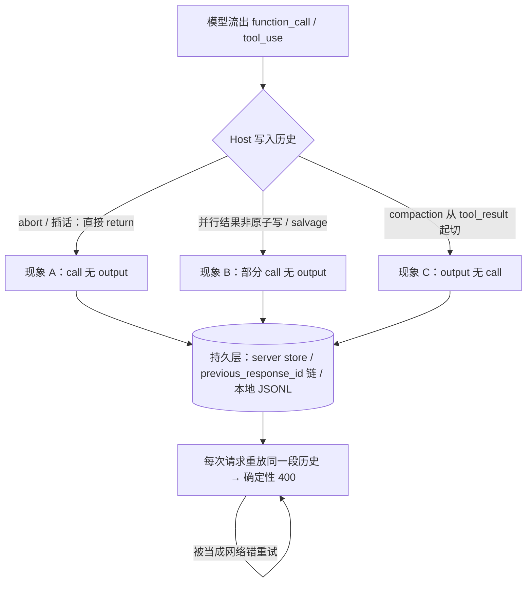

## 1. 问题现象 (Problem Symptoms)

结论先行：**tool call 和它的结果是一对，这个配对不变量必须在写进会话历史的那一刻闭合，不能指望发请求时再碰运气。** provider 把「每个 call 都有 output、每个 output 都有 call」当作请求合法性的硬约束；Host 的中断、流式 salvage、并行写盘、compaction 任何一条路径只写下半对，这半对一旦落盘，之后每一次请求都会带着同一段毒历史，得到同一个 400。这不是瞬时错误，重试多少次、隔几个小时都一样，会话就此卡死（wedged）。

本文钉的是 **Host 的会话转录 / conversation-state 持久化层**：消息历史在结构上是否合法。它是新专题 **Agent Session-State Integrity** 的 #1（结构不变量）。

与相邻文划界（本文不复述它们的机制）：

| 文章 | 层 | 问的是 / 和本文的交点 |
| --- | --- | --- |
| [Checkpoint 不等于 Durable Execution](posts/durable_agent_execution.md) | 进程崩溃后的执行恢复 | 从 checkpoint 重入时副作用会不会被重放；交点只在 §3.4 合成结果的语义诚实，引用不复述 |
| [Agent 写操作的幂等](posts/agent_write_idempotency.md) | 写工具的重试安全 | 超时之后凭什么敢重试；本文只把幂等键当作 `outcome_unknown` 的落地手段 |
| [静默截断](posts/silent_tool_result_truncation.md) | 工具结果的内容保真 | 结果被裁掉一截但结构合法，provider 不报错（静默）；本文是配对断裂，provider 直接拒绝（有声，但不会自愈） |
| [Host 渐进发现](posts/mcp_progressive_disclosure.md) | 工具列表 | 改 `tools` 数组破坏 prompt cache；本文管 `messages` / input 里的配对 |
| **本文**（Session-State Integrity #1） | 会话转录的结构 | 持久化历史里有没有半对；谁负责闭合；400 该不该重试 |

一句话分工：durable execution 问「进程死了，**副作用**会不会重来」；本文问「会话还活着，**历史本身**还能不能被发出去」。

### 现象 A：用户关了 tab，这个会话再也用不了

我们见到最多的形态：SSE 端点把 `req.on('close')` 接到 `AbortController.abort()`，用户关 tab、刷新或者断网时停掉这次 run，这是很合理的省钱做法。偏偏有时候 abort 落在模型已经流出 `function_call`、工具还没执行的窗口里。

公开同构：openai-agents-js [#1190](https://github.com/openai/openai-agents-js/issues/1190)。streamed `run()` 带 `conversationId`，在这个窗口 abort 后，同一 conversation 的后续 run 全部报 `400 No tool output found for function call call_XXX`。issue 里贴出的根因：SDK 的 abort 分支直接 `return`，没有走工具执行，也就没有生成 `function_call_output`；而在 `conversationId` 模式下，OpenAI 在流式过程中已经把 `function_call` 持久化到服务端。报告者只能手动用 Conversations API 清理孤儿 item。该 issue 由已合并的 [PR #1241](https://github.com/openai/openai-agents-js/pull/1241) 修复（见 §3.1）。

语音场景更容易撞上：LiveKit Agents [#5092](https://github.com/livekit/agents/issues/5092) 里，用户在一个约 5 秒的工具调用期间插话，下一次请求的上下文里有 `function_call`、没有对应 output，Responses API 返回 400，**会话余下的每一次请求都失败**。修复 [PR #5094](https://github.com/livekit/agents/pull/5094) 已合并（见 §3.3）。

误判路径在 #5092 的日志里写得很清楚：同一个 400 被重试了 4 次（间隔 0.1s / 2.0s / 2.0s），最后抛出的是 `APIConnectionError: failed to generate LLM completion after 4 attempts`；报告还提到 websocket 模式下解析错误事件失败，400 直接显示成 `Connection error.`。看日志的人第一反应是「网络抖动 / API 不稳定，再加点 retry」。

### 现象 B：并行工具多跑了几次，会话就「坏了」

模型在一条 assistant 消息里并行发出 3 个 `tool_use`，Host 把结果分别写进本地会话文件。Claude Code [#45286](https://github.com/anthropics/claude-code/issues/45286) 的报告：assistant 消息里有 3 个 `tool_use`，后面的 user 消息里只有 2 个 `tool_result`，缺的那条从来没写进 JSONL；报告者推断是并发执行时会话文件非原子写，估计重度使用工具的会话大约十分之一会遇到。（该 issue 被 bot 按 [#31328](https://github.com/anthropics/claude-code/issues/31328) 的 duplicate 自动关闭；#31328 本身以 not planned 关闭。）

另一条路是流式 salvage：microsoft/amplifier [#353](https://github.com/microsoft/amplifier/issues/353) 中，provider 的恢复路径把一次非 `completed` 的流式响应「救回来」继续用，里面一个 call 的参数被截成 `{}`，另一个 `function_call` 一直没有 output。之后会话日志里记了 14 次 `No tool output found for function call`，包括 7 小时后的重试。issue 仍 open，暂无修复。

这类报告在 Claude Code 里多到有一个元 issue：[#6836](https://github.com/anthropics/claude-code/issues/6836)（仍 open）汇总了 150+ 条 `tool_use` / `tool_result` 不匹配的报告，诱因包括网络失败、服务端错误、hook 执行前后、工具调用中断。维护者（COLLABORATOR）在 2025-09-18 的回复说这个问题成因很多，原话是 "it's unlikely we will ever completely eliminate it due to how tricky concurrency problems are in general"。同一 issue 下还有社区成员称逆向分析了 `cli.js`，在 1,571 个会话里统计到 8,007 个孤儿调用（详见 [#33949](https://github.com/anthropics/claude-code/issues/33949)；**这是社区逆向统计，不是官方数字**）。

### 现象 C：会话很长，compaction 之后反而 400

前两种是「有 call 没 output」。反过来也会坏：#6836 下的一条[评论](https://github.com/anthropics/claude-code/issues/6836#issuecomment-3935586683)复现了一个 7000 多行的会话，3 个并行工具的结果在 JSONL 里各自成一条 user 记录，`/compact` 构造请求时窗口从其中一条 `tool_result` 开始，没有带上前面那条含 3 个 `tool_use` 的 assistant 消息，于是：

```text
messages.0.content.0: unexpected `tool_use_id` found in `tool_result` blocks: toolu_01S8...
Each `tool_result` block must have a corresponding `tool_use` block in the previous message.
```

评论者特别指出，#6836 正文给出的那段「反向扫描、删掉没有结果的 `tool_use`」的修复脚本覆盖不了这种**反向孤儿**。



---

## 2. 根因分析 (Root Cause Analysis)

根因不是「某个 SDK 有 bug」，而是：**配对不变量的校验在 provider 侧，破坏它的写入路径却散落在 Host 的五六个分支里，而且没有一个分支自认为要负责闭合。**

| 写入路径 | 写下了什么 | 缺了什么 | 公开同构 |
| --- | --- | --- | --- |
| abort / 用户中断 | 已流出的 `function_call` | 它的 output | openai-agents-js #1190 |
| 语音插话 + 链式续接 | 带着进行中 call 的上下文 / `previous_response_id` | 尚未返回的 output | LiveKit #5092 |
| 流式响应 salvage | 截断的 call、未执行的 call | output（有的参数还不可解析） | amplifier #353 |
| 并行结果写盘 | 3 个 `tool_use` | 其中 1 个 `tool_result` | Claude Code #45286 / #31328 |
| compaction / trim | 窗口里的 `tool_result` | 窗口外的 `tool_use`（反向孤儿） | #6836 评论 |

三句话收束：

1. **配对是请求合法性的一部分，不是内容质量。** provider 每次都校验整段历史，所以半对不会「过一会儿就好」。只要它还在持久层里——服务端 conversation store、`previous_response_id` 链、本地 JSONL 任何一种——之后每次请求都必然失败。这是**毒历史**，不是瞬时错误；对它做指数退避，只会把一次故障放大成一串故障。
2. **持久层不一定归 Host 管。** 在 #1190 里，`function_call` 是服务端在流式过程中自己持久化的，Host 无法把它「撤回」。所以闭合的默认手段是**追加**一条 output，而不是删除 call。只在 Host 完全拥有的本地转录里，删除才是可选项，而且删除有代价（见 §3.2）。
3. **「补一条结果」不是无语义的占位符。** 合成 output 会被模型当成事实读进去。写成「aborted」，模型就认为这个工具没有执行；如果它其实已经执行了（比如退款已经打到支付网关），下一轮就会重做副作用。结构修好了，语义又错了。

还有一个常见的误合并：把 `400 invalid_request` 和网络错误放进同一个 retry 分支。#5092 的日志正是这样：一个确定性的 400 被重试 4 次，最后以 `APIConnectionError` 的名义上报。错误分类一错，告警、看板、值班手册全都指向网络。

---

## 3. 机制要点：在写入侧闭合配对 (Mechanism)

### 3.1 失败点闭合：每个会中断 turn 的分支都要为已流出的 call 写 output

规则只有一条：**任何让 turn 提前结束的分支（abort、消费方取消、插话、salvage、异常），在退出前都要为本 turn 已经流出、还没有 output 的每个 call 写一条结果。**

做法上要跟踪流式事件，而不是事后从响应里猜：

- 维护一个 `pending_calls` 集合：收到完整的 call（Responses API 的 `response.output_item.done` 且 `item.type == "function_call"`）就加入，收到对应 output 就移除，整轮完成就清空。
- abort 分支里，对 `pending_calls` 逐个构造结果并提交到同一条续接路径（`conversationId` 或 `previous_response_id`）。
- 提交这一步不能复用已经被 abort 的那个 signal，否则闭合请求本身也会被取消。

openai-agents-js PR #1241 就是这个形状：新增的 stream-abort reconciliation 跟踪 `response.created` 和 `response.output_item.done`，为 pending function call 构造 `status: 'incomplete'` 的合成 `function_call_result` 项（文本为 `aborted`），在 abort 或消费方取消时提交，且不复用已中止的 signal；`conversationId` 和 `previousResponseId` 两条续接路径都覆盖。

在 #1190 的场景里，abort 发生在工具**执行之前**，`aborted` 是诚实的。一旦 Host 的 abort 可能落在工具已经派发之后，这个文本就不够用了，见 §3.4。

### 3.2 发送前校验与修复：双向扫描 + 切点对齐 + 原子批写

失败点闭合总有漏网的分支，所以发请求前还要一道 **transcript invariant validator**，查两个方向：

```text
正向孤儿：call.id 在历史中出现，但其后没有 output.call_id == call.id
反向孤儿：output.call_id 在历史中出现，但其前没有 call.id == output.call_id
```

修复策略要分方向、分持久层：

- **正向孤儿**：默认追加合成 output（语义按 §3.4 选）。删除 call 只在 Host 自己拥有、且该 call 是只读工具时可以考虑。#6836 正文里那段「删掉没有结果的 `tool_use`」的脚本能让请求过关，但它会把「可能已经执行过的写操作」从模型视野里抹掉。
- **反向孤儿**：output 没有 call 可挂，只能丢弃，或者降级成一段普通文本（「此前某工具返回了……」），不能保留成 `tool_result`。
- 每次修复记一条 `transcript_invariant_repaired`（方向、call id、修复方式）。修复率应接近零；它上升，说明 §3.1 漏了某个分支。

两条写入侧规则让 validator 少干活：

- **compaction / trim 的切点必须落在配对边界上。** 候选切点如果落在一组 call 和它的 output 之间，就往前回退到这组 call 之前。切点算法的输入单位是「turn」或「call 组」，不是「消息条数」或 token 偏移。
- **并行工具结果原子批写。** 一条 assistant 消息里的 N 个 call，要么 N 条结果一起写入（临时文件 + fsync + rename，或数据库事务），要么一条都不写、由 §3.1 统一闭合。#45286 的建议修法也是原子写。

### 3.3 链式复用守卫与错误分类：pending 时不续接，400 不重试

用服务端状态续接（`previous_response_id`、server-side conversation）时，还有第二个时间窗：工具还在跑，用户又说话了。这时如果直接拿上一个 response id 发新请求，服务端看到的历史里就有一个没有 output 的 call。

- **复用守卫**：存在 pending call 时，不复用 `previous_response_id`。要么等 pending call 完成（或按 §3.1 闭合）后再续接，要么改为不带该 id、发送一份经 §3.2 校验过的完整历史。LiveKit PR #5094 的修复就是这一条：只有在 pending tool calls 完成之后才复用 `previous_response_id`。（#5092 里报告的 websocket 错误包装是另一个问题，#5094 并没有声称修复它。）
- **错误分类**：`400 invalid_request` 且错误文本指向配对（`No tool output found for function call`、`unexpected tool_use_id found in tool_result blocks` 之类）时，归类为**不可重试的历史损坏**：不重放同一段历史，转入 §3.2 修复；修不了就明确失败并告诉用户，不退避重试。传输层包装错误时，原始 status 和 body 要一路带到分类器，否则分类器只看到 `Connection error.`。

### 3.4 合成结果的语义诚实：「没执行」和「结果未知」不是一回事

合成 output 至少要区分两种状态（下面是我们自己 Host 的标签，不是任何 SDK 的字段名）：

| 状态 | 何时使用 | 模型应该怎么理解 | 下一轮 Host 做什么 |
| --- | --- | --- | --- |
| `aborted_before_exec` | 中断发生时，该 call 还没派发给工具 | 没执行，可以重新决定要不要调 | 无 |
| `outcome_unknown` | 已经派发，结果还没回来（或回来了但没写进历史） | 可能已执行，**不能直接重调** | 带幂等键先查状态，再决定 |

`outcome_unknown` 的落地靠两件已有的东西：写工具在派发时就带上幂等键，并把键写进合成 output；再提供一个按键查状态的只读工具。幂等键怎么设计、谁来存，见 [Agent 写操作的幂等](posts/agent_write_idempotency.md)；「执行到一半、结果未落盘」与 checkpoint 重入的关系，见 [Checkpoint 不等于 Durable Execution](posts/durable_agent_execution.md)。本文只要求一点：**闭合配对时，不能把「不知道」写成「没做」。**

Tradeoff：Host 得知道每个 call 的派发状态（`streamed` → `dispatched` → `completed`），派发那一刻要同步写一次状态。多一次持久化，换来中断不再变成重复退款。

---

## 4. 同一个退款会话 `conv_RF-7731`：怎么接、错在哪、改完怎么走

贯穿全文的都是退款会话 `conv_RF-7731`。Host 用服务端 conversation 续接（等价于 `conversationId` 模式：call 在流式过程中就被服务端持久化），本地再存一份转录用于 compaction 和审计。用户说「订单 88213 的耳机退掉吧」，模型在同一个 turn 里并行发出：

- `lookup_order(call_3a1, order=88213)`：只读
- `issue_refund(call_9f2, order=88213, amount=399)`：写支付网关

以下代码都是示意，是我们自己 Host 的写法，不是任何 SDK 的实现。

### 4.1 BAD v1：abort 分支直接 return，`call_9f2` 成了孤儿

```ts
// ❌ conv_RF-7731。示意：形状对应 openai-agents-js #1190 描述的 abort 分支
async function runTurn(conv: ConvId, input: Item[], signal: AbortSignal) {
  try {
    const stream = await model.stream({ conversation: conv, input, signal });
    for await (const ev of stream) {
      if (ev.type === "function_call") dispatchTool(ev, signal);   // 并行派发
    }
    await submitToolOutputs(conv);
  } catch (err) {
    if (isAbortError(err)) return;      // 用户关 tab：什么都不写
    throw err;
  }
}
```

```text
# conv_RF-7731
model → function_call call_3a1 lookup_order      (服务端已持久化)
model → function_call call_9f2 issue_refund      (服务端已持久化)
tool  ← call_3a1 ok；call_9f2 已发往支付网关，等待中
user  关闭 tab → abort → return                  # call_3a1 / call_9f2 都没有 output
...
user  回来问「退款好了吗？」
model ✗ 400 No tool output found for function call call_3a1   # 重试 4 次，全挂
运营  只能给用户新开会话，上下文和订单核对过程全部丢失
```

缺的是 §3.1：中断 turn 的分支没有为已流出的 call 写 output。

### 4.2 BAD v2：补上合成结果，但写成了「aborted」，用户被退了两次款

团队按 §3.1 打补丁：abort 时给每个 pending call 写一条 `aborted`。

```ts
// ❌ conv_RF-7731。示意：结构闭合了，语义没有
catch (err) {
  if (isAbortError(err)) {
    const outputs = [...pending.values()].map(c => ({
      type: "function_call_output", call_id: c.callId, output: "aborted",
    }));
    await submit(conv, outputs, { signal: freshSignal() });   // 不复用已中止的 signal
    return;
  }
  throw err;
}
```

```text
# conv_RF-7731
history: call_9f2 issue_refund → output "aborted"
（支付网关侧：call_9f2 的退款其实在 abort 后 300ms 成功了）
user  「退款好了吗？」
model 「上次退款被中断了，我重新为您提交。」 → issue_refund(call_c41, order=88213, amount=399)
支付网关：第二笔 399 退款成功 ❌   # 双退款
```

请求不再 400 了，可是 `call_9f2` 在 abort 时已经派发，「aborted」等于告诉模型「没做」。缺的是 §3.4：没有区分 `aborted_before_exec` 与 `outcome_unknown`，写工具也没有带幂等键。

### 4.3 BAD v3：会话变长，compaction 从 `lookup_order` 的结果处切开

v2 的语义问题修好之后，`conv_RF-7731` 继续跑：用户追问运费、换货、发票，历史越来越长。为了控成本，Host 改为自己管上下文：按 token 预算裁剪本地转录，作为完整 input 发送。

```ts
// ❌ conv_RF-7731。示意：按消息条数 / token 从尾部倒数，切点随便落
function trimForBudget(history: Item[], budget: number): Item[] {
  let start = history.length;
  while (start > 0 && tokens(history.slice(start - 1)) <= budget) start--;
  return history.slice(start);          // 可能从一条 function_call_output 开始
}
```

```text
# conv_RF-7731，第 23 轮
trimmed[0] = function_call_output call_3a1 (lookup_order 的结果)
             # 对应的 function_call call_3a1 在窗口外
model ✗ 400：output 找不到对应的 call      # 反向孤儿
```

缺的是 §3.2：切点没有对齐到配对边界，发送前也没有双向校验。

### 4.4 GOOD：失败点按派发状态闭合，发送前双向校验，切点对齐

续接方式沿用 v3：从 v3 起 `conv_RF-7731` 不再走服务端 conversation 续接，本地转录是唯一持久层，每次请求都把经过 §3.2 裁剪和校验的完整历史作为 input 发出。所以下面的 GOOD 不再传 `conversation` 参数，§3.1 的闭合、§3.2 的切点对齐和 §3.3 的「pending 时不发」都作用在这份本地转录上。v1、v2 那种服务端续接的 Host，§3.1 的结果要提交到同一条服务端续接路径（见 §3.1 对 PR #1241 的描述），§3.3 对应的是不复用 `previous_response_id`。

```ts
// ✅ conv_RF-7731。示意：我们自己 Host 的实现
type CallState = "streamed" | "dispatched" | "completed";
const calls = new Map<string, { name: string; state: CallState; idemKey?: string }>();

async function runTurn(conv: ConvId, input: Item[], signal: AbortSignal) {
  if (hasPending(conv)) await closePending(conv);                  // §3.3 有 pending 先闭合，再发请求
  const req = validateTranscript(trimForBudget([...loadTranscript(conv), ...input], BUDGET)); // §3.2 裁剪 + 发送前校验
  try {
    const stream = await model.stream({ input: req, signal });      // 完整 input，不带 conversation
    for await (const ev of stream) {
      if (ev.type !== "function_call") continue;
      calls.set(ev.call_id, { name: ev.name, state: "streamed" });
      const idemKey = isWriteTool(ev.name) ? `RF-7731-${nextSeq(conv)}` : undefined;
      await markDispatched(conv, ev.call_id, idemKey);              // §3.4 派发前同步落状态
      dispatchTool({ ...ev, idemKey }, signal);
    }
    await appendToTranscriptAtomically(conv, collectOutputs(calls)); // §3.2 并行结果一次写入本地转录
  } catch (err) {
    if (isAbortError(err)) return closePending(conv);               // §3.1 失败点闭合
    if (isPairingInvalidRequest(err)) return repairOrFail(conv, err);   // §3.3 不重试
    throw err;
  }
}

async function closePending(conv: ConvId) {   // 本 turn 所有 call 的结果一次写入
  const outputs = turnCalls(conv).map(c => ({
    type: "function_call_output",
    call_id: c.callId,
    output: c.state === "completed" ? c.result                               // 已有真实结果
      : JSON.stringify(c.state === "streamed"
        ? { status: "aborted_before_exec" }                                  // 没派发
        : { status: "outcome_unknown", idempotency_key: c.idemKey,           // 已派发
            next: "call get_refund_status with idempotency_key before retrying" }),
  }));
  await appendToTranscriptAtomically(conv, outputs, { signal: freshSignal() }); // §3.1 + §3.2 写入本地转录
}

function trimForBudget(history: Item[], budget: number): Item[] {
  let start = /* 同 v3 计算候选切点 */ candidateStart(history, budget);
  while (start > 0 && insideCallGroup(history, start)) start--;    // §3.2 回退到配对边界
  return history.slice(start);
}
```

`conv_RF-7731` 上 GOOD 的走法：

```text
# 第 1 轮
model → call_3a1 lookup_order        streamed → dispatched → completed（结果先缓存）
model → call_9f2 issue_refund        streamed → dispatched, idempotency_key=RF-7731-1
user  关闭 tab → abort → closePending（两条结果一次写入）
history: call_3a1 → lookup_order 的真实结果
         call_9f2 → {status: outcome_unknown, idempotency_key: RF-7731-1}

# 第 2 轮
user  「退款好了吗？」
validator: 正向 / 反向孤儿 0 → 发送 → 200
model → get_refund_status(idempotency_key=RF-7731-1) → {state: succeeded, amount: 399}
model 「退款 399 元已提交成功，预计 1–3 个工作日到账。」   # 不再调用 issue_refund
（即使模型仍重调 issue_refund 并带上 RF-7731-1，支付网关按幂等键返回第一次的结果）

# 第 23 轮
candidateStart 落在 call_3a1 的 output 上 → 回退到 call_3a1 / call_9f2 这组 call 之前
validator: 孤儿 0；transcript_invariant_repaired 无记录
```

| 相对 BAD | 改了什么 | 回扣 |
| --- | --- | --- |
| v1：abort 直接 return，`call_9f2` 无 output | abort 分支调用 `closePending`，为每个 pending call 写 output，用新的 signal 提交 | §3.1 |
| v2：合成 `aborted`，模型重退一次 | 派发前落 `dispatched` 状态；已派发的写 `outcome_unknown` + 幂等键；下一轮先 `get_refund_status` | §3.4 |
| v3：裁剪从 `tool_result` 起切 | 切点回退到 call 组之前；发送前双向校验；并行结果原子写 | §3.2 |
| 全程：400 被当网络错重试 | pending 时不续接；配对类 400 不重试，转修复或明确失败 | §3.3 |

Tradeoff：每个 call 多一次状态写入、每次请求多一次 O(n) 扫描，几乎无感。真正的成本在工具侧：写工具要支持幂等键和按键查状态；没有这两样，`outcome_unknown` 只能退化成「请人工确认」，体验差，但仍好过双退款或卡死的会话。

---

## 5. 发版前清单：对准可注入的失败点 (Pre-Ship Checklist)

上线任何带工具调用、支持中断或长会话的 Host 之前，用注入证明配对在每条写入路径上都闭合，而不是用「正常对话跑通了」证明。

**可注入失败点（三条必须进 CI）**

- [ ] **注入 1：`function_call` 流出之后、工具执行之前 abort（触发取消信号 / 断开客户端连接）。** 期望：持久化历史（服务端 store 与本地转录都查）中每个 call 都有 output，状态为未完成类（如 `aborted_before_exec`）；同一会话的下一轮请求返回 200。再把 abort 挪到工具已派发之后测一遍，期望状态是 `outcome_unknown` 且带幂等键。
- [ ] **注入 2：并行 3 个工具时丢掉其中一条结果的写入；或让 compaction / trim 的窗口从某条 `tool_result` 开始。** 期望：发送前 validator 检出正向或反向孤儿，修复（合成 output / 丢弃孤儿结果）或拒绝发送；日志记一条 `transcript_invariant_repaired`；不进入 400 重试循环。
- [ ] **注入 3：让 provider 返回配对类 `400 invalid_request` 并打开 retry 策略；同时让一个标为 `outcome_unknown` 的写工具进入下一轮。** 期望：错误被归类为不可重试的历史损坏，同一段历史不被重放；写工具先按幂等键查状态再决定，支付 / 工单等下游只有一次写入。

**写入路径枚举（每条都要能指出谁负责闭合）**

- [ ] abort / 关连接 / 刷新；语音插话或新消息打断进行中的工具
- [ ] 非 `completed` 流式响应的 salvage；并行工具结果写入
- [ ] compaction / trim / rewind / fork；失败 turn 是否被服务端 store 持久化

**契约与可观测**

- [ ] 合成 output 至少区分「未派发」与「结果未知」；写工具支持幂等键，并有按键查状态的只读工具
- [ ] 存在 pending call 时不复用 `previous_response_id`；compaction 切点以 call 组为最小单位并有单测
- [ ] 指标：`transcript_invariant_repaired`（按方向、写入路径）；配对类 400 单独成类，不并入网络错误；包装错误时保留原始 status 与 body

**发版评审口头否决**

- [ ] 用指数退避处理配对类 400
- [ ] abort 时统一写 `aborted`，不看派发状态
- [ ] 用「删掉没有结果的 `tool_use`」作为唯一修复手段

---

## 6. 小结 (Takeaways)

**一个会话突然永久 400，先问三件事：历史里有没有半对；是哪条写入路径留下的；补上的结果说的是不是真话。**

- 根因：配对校验在 provider，破坏配对的写入路径散在 Host 各分支；半对一旦持久化就是毒历史，重试必然失败（§1–§2）。
- 修法：失败点闭合；发送前双向校验 + 切点对齐 + 原子批写；pending 时不续接、配对类 400 不重试；合成结果区分「没执行」与「结果未知」（§3）。
- `conv_RF-7731` 从 BAD v1 → v2 → v3 → GOOD，每处改动对应 §3.1–§3.4（§4）；发版靠三个注入点（§5）。

系列位置：**Agent Session-State Integrity** 专题 #1，管会话历史的**结构**不变量。下一篇 #2 讲 compaction 之后被摘要掉的项目规则和条件指令——结构合法，**语义**丢了。相邻的执行恢复见 [Checkpoint 不等于 Durable Execution](posts/durable_agent_execution.md)，写操作重试见 [Agent 写操作的幂等](posts/agent_write_idempotency.md)，结果内容保真见 [静默截断](posts/silent_tool_result_truncation.md)。

---

## 参考 (References)

1. Claude Code — [Issue #6836：[Meta] tool_use/tool_result block mismatch causing bad conversation state (150+ reports)](https://github.com/anthropics/claude-code/issues/6836)（open；COLLABORATOR 2025-09-18 [回复](https://github.com/anthropics/claude-code/issues/6836#issuecomment-3309480000)：成因多样，不太可能彻底消除；compaction 反向孤儿复现见[该评论](https://github.com/anthropics/claude-code/issues/6836#issuecomment-3935586683)）。
2. openai-agents-js — [Issue #1190：`run()` abort with `conversationId` leaves orphan `function_call` items](https://github.com/openai/openai-agents-js/issues/1190)（closed completed）与 [PR #1241](https://github.com/openai/openai-agents-js/pull/1241)（merged 2026-05-05 UTC；为 pending function call 提交 `status: 'incomplete'` 的合成 `function_call_result` 项，覆盖 `conversationId` / `previousResponseId`）。
3. LiveKit Agents — [PR #5094：only reuse previous_response_id when pending tool calls are completed](https://github.com/livekit/agents/pull/5094)（merged 2026-03-13 UTC，关闭 #5092；只覆盖复用守卫）与 [Issue #5092](https://github.com/livekit/agents/issues/5092)（语音插话打断工具调用后 400 不可恢复；报告中另提到 websocket 模式把 400 显示为连接错误）。
4. Claude Code — [Issue #45286：Session JSONL corruption from non-atomic writes during concurrent tool execution](https://github.com/anthropics/claude-code/issues/45286)（bot 按 duplicate 关闭，指向 [#31328](https://github.com/anthropics/claude-code/issues/31328)；#31328 以 not planned 关闭）。
5. microsoft/amplifier — [Issue #353：recovered incomplete streaming response can leave unpaired function_call items](https://github.com/microsoft/amplifier/issues/353)（open，暂无修复）。
6. Claude Code — [Issue #33949](https://github.com/anthropics/claude-code/issues/33949)（社区逆向分析；文中「8,007 个孤儿调用」出自这里，非官方数字）。
7. 本站 — [长跑 Agent 挂了：Checkpoint 不等于 Durable Execution](posts/durable_agent_execution.md)（副作用重放划界）。
8. 本站 — [Agent 写操作的幂等：超时之后凭什么敢重试](posts/agent_write_idempotency.md)（幂等键设计，本文只引用）。
9. 本站 — [静默截断：工具「成功返回」了半截，模型却自信答完](posts/silent_tool_result_truncation.md)（内容保真划界）。
10. 本站 — [Host 渐进发现：工具「搜不到」≠「没这个能力」](posts/mcp_progressive_disclosure.md)（`tools` 数组与 prompt cache，划界）。
