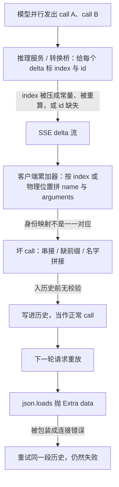

## 1. 问题现象 (Problem Symptoms)

结论先行：**流式 tool call 是客户端边收边拼出来的，拼的依据是 `index`（有时还有 `id`）。只要这个身份键和「一次调用」不是一一对应，拼出来的 call 在写进历史之前就已经是坏的。** 坏有两种形状：多个调用共用一个 `index`，`arguments` 被拼成串接的 `{...}{...}`（工具名也可能被拼在一起）；或者同一个调用的片段被劈进两个位置，`arguments` 丢掉前缀。坏 call 通常不会当场报错，而是作为一条正常的 assistant 消息进入历史，下一轮请求把它原样重放，才被代理或 provider 的 `json.loads` 以 `Extra data` 拒绝；有的路径还把这个解析错误报成连接错误。

接上一篇：[compaction 篇](posts/compaction_drops_pinned_instructions.md) 的结尾预告过，「下一篇 #3：有些 call 在进入历史之前就已经坏了」，本文就是这一篇。这是专题 **Agent Session-State Integrity** 的 #3（组装不变量）。三篇各守一条不变量：#1 [配对](posts/orphan_tool_call_session_wedge.md)（每个 call 都有对应的 output），#2 [语义](posts/compaction_drops_pinned_instructions.md)（压缩不能把约束改写掉），#3 就是本篇：**进历史的每个 call，本身必须是组装正确的。**

与相邻文划界（本文不复述它们的机制）：

| 文章 | 层 | 问的是 / 和本文的交点 |
| --- | --- | --- |
| [一次中断，整个会话永久 400](posts/orphan_tool_call_session_wedge.md) | 会话转录的**结构配对** | 那篇：call 和 output 缺了一半。本文：call 和 output 也许配齐了，但 call **本身**是拼坏的。那篇讲的流式 salvage 是「流被截断后留下不完整的 call」；本文的流是完整的，错在客户端按身份键组装的那一步。交点只有一句：坏 call 也要配 output（§3.3） |
| [Compaction 之后 Agent 忘了「先给我看计划」](posts/compaction_drops_pinned_instructions.md) | 压缩边界上的**语义保真** | 那篇：摘要把意思改写了，历史合法但被「解读」过。本文：没有任何改写，是字节层面在组装时就错了，与压缩无关 |
| [静默截断](posts/silent_tool_result_truncation.md) | 工具**结果**进模型之前被裁 | 方向相反：本文是模型发出的**调用参数**在进工具之前被拼坏 |
| [MCP 工具设计：合法但错误的调用](posts/mcp_tool_design_valid_but_wrong.md) | 参数合法但语义错 | 本文的参数因传输 / 组装层而**不合法**，或者张冠李戴 |
| [一个 429 打出成倍的上游请求](posts/layered_retry_amplification.md) | 重试所有权与错误分类 | 解析错误被包装成连接错误之后会被重试，重试只会重放同一段坏历史；只在 §3.4 一句互链 |
| **本文**（Session-State Integrity #3） | 流式响应 → tool call 组装层 | 一个 call 在进入历史之前，身份和参数有没有被拼对 |

下面三个现象都来自公开的 issue / PR，各发生在组装链上的不同一层。**根因里凡是「报告者推断」或「PR 作者的分析」，都不等于维护者确认**，我会逐条标出。

### 现象 A：消费方的累加器，把同一个调用的两个片段当成了两个条目

openai-python 的 [#3201](https://github.com/openai/openai-python/issues/3201) 和 [#3203](https://github.com/openai/openai-python/issues/3203)。报告者看到的流里，首个 chunk 的 `tool_calls` 有两条 `index: 0`：一条带 `id` 和工具名，另一条带 `arguments` 的第一段（#3203 的复现注释把它描述为「工具名 + 第一段参数在同一个 SSE 事件里」）。**这两条 `index: 0` 是同一个调用的片段，不是两个并行调用**，所以这里没有「身份冲突」，问题完全出在累加器。

issue 里贴出的累加逻辑（`accumulate_delta`）遇到首个 `tool_calls` 值时整体照搬：`if key not in acc: acc[key] = delta_value`。于是两条 `index: 0` 成了列表里的两个物理元素；之后的片段按 `index` 只合进第一个，第二个条目里的前缀被留在原地。最终 `arguments` 缺掉开头、无法解析。#3203 的最小复现把 `{"city"` 和 `: "London"}` 分在两处，拼出来的是 `: "London"}`。PR [#3425](https://github.com/openai/openai-python/pull/3425) 的描述给出的根因与 issue 一致。

- 环境：#3201 的报告者用 Kimi 2.6，跑在 vLLM 上并开了 speculative decoding；#3203 的报告者同样是在 vLLM 开启 speculative decoding 时观察到。**只能写成这两位报告者的观察，不能据此说 vLLM 普遍如此。**
- 状态：#3201 由已合并的 PR #3425 修复并关闭（2026-09-10 UTC）；#3203 的报告者在 2026-05-12 自行关闭，并把补充信息并入 #3201。
- 范围：这一例只涉及 Python SDK 的累加器。其他语言的 SDK 是否有同样的问题，我们没有核实，本文不下结论。

### 现象 B：生产方的桥接 / 转换层，把不同调用发成了同一个 index

**B1：LiteLLM [#21331](https://github.com/BerriAI/litellm/issues/21331)。** Responses API → Chat Completions 的流式桥，把所有并行调用都发成 `index=0`，而各调用的 `id` 是不同的（issue 里是 `call_abc` / `call_def`）。issue 的说法是：按 `index` 累加的消费者会把两个调用合成一个畸形调用。修复 PR [#21337](https://github.com/BerriAI/litellm/pull/21337) 在三个事件处理分支里改读 Responses 流自带的 `output_index`，不再硬编码 0。**注意这个 PR 合入的是 staging 分支**（`litellm_oss_staging_02_27_2026`，2026-02-27 UTC），issue 随后关闭；我们没有核它之后进入了哪个发行版。

**B2：LiteLLM [#33678](https://github.com/BerriAI/litellm/issues/33678)。** `ollama_chat` 的流式输出里，每个调用的 `index` 都是 0。报告者的说明是：Ollama 一个 chunk 发一个调用，正确的序号在 `function.index`（先 0 后 1），LiteLLM 丢掉它之后自己重算；报告者对根因的分析是 `Delta` 按 chunk 构造、计数器每个 chunk 都重置（**这是报告者的分析**）。客户端按 `index` 累加，得到 `{"path": "a.rs"}{"path": "b.rs"}`，写进历史成为 `tool_calls[0].function.arguments`；下一轮代理在 `transform_request` 里对它裸调 `json.loads`，抛出 `Extra data`，被报成 `litellm.APIConnectionError`。报告者特别指出两点：错误出现在**造成损坏的那一轮之后一轮**；它读起来像网络问题，其实是 `json.JSONDecodeError`。

- 状态：**#33678 仍然 open**（带 stale 标签），关联的修复 PR [#37792](https://github.com/BerriAI/litellm/pull/37792) 也仍然 open。**不能写成「已修复」。**
- #21337 是桥接层专用的修复，报告者在 #33678 里明说它不覆盖 `ollama_chat`。

### 现象 C：坏 arguments 被持久化，之后每一轮都重放

unsloth Studio 的 [#9807](https://github.com/unslothai/unsloth/issues/9807)，修复 PR [#10059](https://github.com/unslothai/unsloth/pull/10059)。报告者通过自定义的 OpenAI 兼容 provider，连到藏在 LiteLLM 代理后面的 vLLM。一次要求「做几次网页搜索」的对话里，后端流式发出多个并行调用，Studio 存下来的却是**一个** tool-call 部件，它的 `arguments` 是好几个 JSON 文档串在一起。下一轮 Studio 把它原样重放，后端 `json.loads` 抛 `Extra data: line 1 column 51 (char 50)`，返回 HTTP 400，这个线程里所有带工具的请求从此都失败，只能新开会话。

- 报告者对代码路径的描述：`chat-adapter.ts` 里 slot 的身份取自 delta 的 `id`，没有 `id` 时回落到 `index`；片段按字符串拼接；解析失败时整串被塞进 `args._raw`，回放时又原样发出。
- 报告者还验证了：对同一个后端发非流式请求，返回的是干净的、各自独立的调用。所以串接只出现在客户端的累加层。
- PR 描述补充了触发形态：服务端用**不带 `id`、按 `index` 的 delta** 流式发并行调用，多个调用复用了同一个 slot；工具名也被拼成了 `web_fetchweb_searchweb_fetch`，匹配不到任何已启用的工具，于是**静默不执行**（这一句出自 PR 描述，不在 issue 正文）。issue 本身没有指出是哪一层发出了不带 `id` 的 delta；PR 的复现也是把 issue 里的流重放一遍，没有接真实的 vLLM 或 LiteLLM 端点（PR 自述）。
- 报告者另外注明：同一端点上的 gpt-oss-120b 能容忍这种历史，所以那个 400 里有后端严格性的成分；但被转发出去的坏字符串是客户端的产物。
- 状态：PR #10059 已合并（2026-08-31 UTC），关闭 #9807。它的修法是启发式的，见 §3.5。

三个现象的共同形状：坏发生在**写进历史之前**，症状却出现在**下一轮**（#33678 和 #9807 的报告里都明说了这一点）；表面错误往往是 `Extra data`、连接错误，或者某个工具莫名其妙没执行。于是值班的人最常见的三个误判是：「模型吐了坏 JSON」「后端 / 网络问题」「再加一层 JSON repair」。



---

## 2. 根因分析 (Root Cause Analysis)

以下是**我们的分析**，从上面三组公开报告归纳而来，不是任何一家的官方实现原理。

**`index` 不是调用的身份，只是「这个片段属于哪个调用」的位置提示。** 按 issue 里描述的 Chat Completions 风格的流，`id` 和工具名通常只出现在某个调用的第一个 delta 里，后面的 delta 只带 `index` 和 `arguments` 片段（#3201 里的数据形态，以及 #21331 的期望行为）。所以生产方必须保证 `index` 稳定且唯一，消费方必须靠 `index` 把片段路由回同一个调用。任何一层违反这条约定，都不会报错，只是 `arguments` 悄悄变了形。

| 失效点 | 身份键 | 怎么坍缩 | 拼出的坏形状 | 来源 |
| --- | --- | --- | --- | --- |
| 消费方：累加器 | `index`（被当作列表下标） | 首个 delta 整体照搬，同 `index` 的两个条目没合并。**一对多**：一个调用被劈成两个条目 | 缺前缀的 `arguments`，如 `: "London"}` | openai-python #3201 / #3203 → PR #3425 |
| 生产方：桥接 / 转换层 | 源协议里本来就有的唯一身份（`output_index` / `function.index`） | 硬编码常量，或按 chunk 重新计数。**多对一**：多个调用共用一个 `index` | 串接的 `{...}{...}` | LiteLLM #21331 → PR #21337；#33678 |
| 消费方：无 `id` 的流 | slot（没有 `id` 时回落到 `index`） | 不带 `id` 的 delta 复用同一个 slot。**多对一** | 串接的 `arguments` + 拼在一起的工具名 | unsloth #9807 → PR #10059 |

这张表有三点要说清：

1. **名字叫 index collision，但并不都是碰撞。** B 和 C 是多个调用坍缩成一个（碰撞）；A 反过来，是一个调用被劈开。两个方向的共同点只有一个：身份键和调用之间不再是一一映射。
2. **JSON repair 只救得了其中一种形状。** 在 `}{` 的边界切开，能救串接；救不了 A 的缺前缀形态：前缀在另一个条目里，拼好的字符串上根本看不出它在哪。「模型吐了坏 JSON」这个判断因此也是错的：模型发出的流是对的，坏的是我们对流的组装。
3. **三层都有一个共同的缺口：没有人在进历史之前看一眼这个 call。** 累加器的职责是「拼」，没有人负责「验」。历史写入把 assistant 消息当作可信产物（#9807 里解析失败就存 `_raw` 并原样回放，就是这条路径）。所以拼错一次，错误就被持久化，之后每一轮都在重放；最后报错的往往是另一个组件（代理 / provider），而且被归成了连接错误。

---

## 3. 机制要点：身份、冲突检测、入历史前校验 (Mechanism)

先给出范围：下面的做法是**设计建议**。3.1 和 3.5 有公开的修复可对照；3.2、3.3 是我们的主张，不是任何 SDK 的现有行为；每条都会写明边界。

### 3.1 身份从源头来：生产方映射、不重算；累加器按逻辑 `index` 合并，首片也不例外

- **生产方：从源协议的唯一身份映射，不要常量，也不要按 chunk 重算。** PR #21337 改读 Responses 流的 `output_index`。#33678 的报告者建议直接取 Ollama 自己在 `function.index` 里给的值（这是报告者的建议，PR #37792 仍 open，未合入）。
- **消费方：对首个 delta 也走同一条合并路径，而不是整体照搬。** PR #3425 就是这样改的：让带 `index` 的列表在首片也走合并循环，同时改了 chat completion 快照初始化路径和 assistant 流式累加器，因为它们共用同样的提前返回。
- **回归用例用录制的真实 SSE**，包括「首片有多条同 `index`」和「每个字符一个 delta」，不要只用单个 chunk 里手写的 JSON。

边界：这一条只保证 `index` 与调用一致的流是对的，管不了 `index` 本身就错了的流（那是 3.2）。

### 3.2 身份冲突当协议错误检出（本文主张）

规则只有一条：在同一个 `index` 上，后到的条目，

- 不带 `id`：视为同一调用的片段（现象 A 的合法形态，不能报错）；
- 带的 `id` 和这个 slot 已有的 `id` 不同：**身份冲突**，不能合并。

冲突之后的处理：有 `id` 就按 `id` 拆开（#21331 的报告者自己的 workaround 就是用 `id` 建一个虚拟 index）；冲突之后又到达不带 `id` 的片段、无法判断属于哪一个时，**整轮报 `stream_protocol_error`，不要猜**。

边界和代价：

- **不带 `id` 的流（现象 C）这条规则看不见。** 没有 `id`，就没有冲突可检。这正是 §3.3 要补的盲区。
- **`id` 相同、内容却像两个文档，也不要拆。** PR #10059 的描述里专门强调了这一点：稳定 `id` 的 delta 里即使有两个 JSON 文档，仍算**一个**畸形的 provider call，因为拆开它会执行模型从没要求过的工具。这种情况交给 §3.3 的校验去拒绝，不在组装时「推断」。

### 3.3 执行前逐个 call 校验；不可解析的 call 不执行，也不以正常 call 的形态进历史（本文主张）

每个 call 在执行**和**写入历史之前，各做三项检查：

1. `arguments` 能解析成**单个** JSON 对象（不是一串对象，也不是半截）；
2. 工具名在已注册的工具表里；
3. 通过该工具的 schema。

任何一项失败：

- **不执行。** 工具名对不上也要显式报错，不能像 C 里那样静默不执行。
- **坏字符串不以正常 call 的形态进历史。** 原始字符串只写进审计日志；历史里该 call 的 `arguments` 用空对象占位，并带一个内部状态标记（发给 provider 时不带这个字段）。
- **配对保持合法：为这个 call 回填一条结构化错误 output。** 这就是和 [配对篇](posts/orphan_tool_call_session_wedge.md) 的唯一交点：坏 call 也是 call，也要有 output，否则会把一个组装错误升级成永久 400。
- 模型下一轮看到错误 output，可以重发这个调用。

一个取舍要说明：同一轮里其他校验通过的兄弟 call，要不要继续执行？并行调用往往彼此相关，只执行一半，可能比一个都不执行更糟。**我们默认整轮不执行，给通过的 call 也回填「同轮有无效 call，本调用未执行，请重发」**；如果你的工具彼此完全独立，可以放宽，但要明确选择，而不是由实现细节决定。

### 3.4 错误分类：解析 / 协议错误单独归类，不并入连接错误

- 解析错误发生在**本地**，本该被 §3.3 在发送前拦下。万一漏过去，在下一轮被代理或 provider 拒绝时，要归类为「历史损坏，不可重试」，而不是连接错误：重试只会把同一段坏历史再发一遍。#33678 里它被报成了 `APIConnectionError`，就是这个归类缺失。这一类的重试语义见 [一个 429 打出成倍的上游请求](posts/layered_retry_amplification.md) 里的 STOP 类，这里不展开。
- **指标：** 按 provider / 路由统计 `tool_args_parse_fail_rate` 和 `stream_protocol_error` 的计数。
- **差分检查：** 同一个 prompt，分别走流式和非流式，比较组装出的 call。#9807 的报告者就是这样把问题定位到客户端的：非流式返回干净的调用，说明后端没问题。

### 3.5 启发式切分只当兜底，不当修复（tradeoff）

unsloth PR #10059 的修法是：在顶层 JSON 对象边界切分 `arguments`，只对不带 `id` 的 delta 生效；文本不是一串完整的对象时原样返回；带 `id` 的流保持不变。它让 #9807 的四个调用变回了四个。PR 自己写明了已知限制：

- 工具名的后缀在参数闭合**之后**才到达时（例如先来 `web`，后来 `_search`），线上看起来和「下一个调用开始报名字」无法区分，会多开出一个名为 `_search` 的调用；
- 相邻的顶层数组仍算一个调用。

我们对它的评价（**这是我们的看法**）：它救得了串接形态，救不了现象 A 的缺前缀形态；更根本的是，切分是从字节里**推断**调用，而不是从协议里**读出**调用，推断错了会去执行模型没要求过的工具（PR 自己也因此对稳定 `id` 的情况选择不拆）。如果必须兼容不带 `id` 的后端：只对不带 `id` 的流启用；切出来的每一段都要**单独**通过 §3.3 的校验；并记一个 `heuristic_split` 指标，让它的使用量可见。代价是多了一条要跟着各家流格式维护的规则。**它不能替代 §3.1–§3.3。**

---

## 4. 同一个会话 `sess_RFX-552`：怎么接、错在哪、改完怎么走

业务线固定为一个代码重构会话 `sess_RFX-552`：模型每轮可以并行读多个文件，经代理转到自托管的模型。下面的场景和代码都是我们构造的**示意**，不是任何真实事故，也不是任何开源项目的实现。我们在这个会话里录下了三段流，用作回归语料；后面每个版本都对这三段流各跑一遍：

| 录制流 | 轮次 | 形态 | 对应 §1 |
| --- | --- | --- | --- |
| S1 | 第 5 轮，并行读 `a.rs`、`b.rs` | 桥接层让两个调用都用 `index: 0`，`id` 各不相同（`call_a1` / `call_b2`） | 现象 B |
| S2 | 第 9 轮，读 `c.rs`（单个调用） | 换到另一个推理后端后，首个 chunk 里有两条 `index: 0`：一条带 `id` 和工具名，一条带 `arguments` 的第一段 | 现象 A |
| S3 | 第 12 轮，并行读 `d.rs`、`e.rs` | 不带 `id`、按 `index` 的 delta，两个调用共用同一个 slot | 现象 C |

S2 特意用单个调用：A 的公开复现都是单个调用，并行时叠加出什么后果，那两个 issue 没有展开，我们不推断。

### 4.1 BAD v1：按位置合并，入历史前什么都不看

```python
# 示意：sess_RFX-552 v1 —— 首片整体照搬，其后把 index 当列表下标；不校验
def accumulate(acc, delta_calls):
    if "calls" not in acc:
        acc["calls"] = delta_calls                  # 首片整体照搬：同 index 的多个条目不会合并
        return
    for dc in delta_calls:
        slot = acc["calls"][dc["index"]]            # 之后 index 直接当列表下标
        fn = slot.setdefault("function", {})
        fn["arguments"] = fn.get("arguments", "") + dc["function"].get("arguments", "")

def on_stream_end(session, acc):
    session.history.append(assistant_msg(tool_calls=acc["calls"]))   # 直接入历史
    run_tools(acc["calls"])                         # 解析失败的 call 只记一行 debug 日志就跳过
```

- S1：两个调用都落进 slot 0，`arguments` 变成 `{"path":"a.rs"}{"path":"b.rs"}`，`b.rs` 消失；
- S2：首片的两个条目成了两个物理元素，后面的片段只合进第一个，`arguments` 缺掉前缀，是 `: "c.rs"}` 这样的残片；
- S3：同一个 slot 里串着两个对象。

三种都照常写进了历史。下一轮请求，代理对历史里的 `arguments` 调 `json.loads`：S1 和 S3 是 `Extra data`，S2 在第一个字符就解析不了（`Expecting value`）。错误被包装成连接错误，外层重试把同一段历史再发一遍，会话报废。值班的人第一反应是「模型又吐坏 JSON」「代理连后端有问题」，然后加重试、加 JSON repair。

修复方向：最顺手的补丁是 JSON repair / 切分，见 v2。为什么它只是兜底，见 §3.5。

### 4.2 BAD v2：加一段 `}{` 切分

v2 只改了一处：流结束时，如果 `arguments` 是多个顶层 JSON 对象，就切成多个 call。

```python
# 示意：v2 —— 相对 v1 只加了这一行：入历史前把串接的对象切开
def on_stream_end(session, acc):
    calls = [c for call in acc["calls"] for c in split_top_level_objects(call)]   # 新增（§3.5）
    session.history.append(assistant_msg(tool_calls=calls))
    run_tools(calls)
```

S1 和 S3 看起来修好了：两个对象被切成了 `a.rs` 和 `b.rs`（`d.rs` 和 `e.rs`）两个 call。S2 没有：`: "c.rs"}` 不是一串完整的对象，切分函数原样返回，坏 call 照旧进历史，下一轮还是失败。更麻烦的是，v2 让 S1、S3 的现象消失了，团队会以为问题已经解决；直到第 9 轮换了推理后端，`sess_RFX-552` 才再次报废。这个版本还留下一个隐患：被切出来的 call，是从字节里推断出来的，而不是协议告诉我们的。

修复方向：问题在身份层，不在字节层，见 v3。

### 4.3 BAD v3：把「在字节里猜边界」换成「在流里认身份」

v3 只做一件事：撤掉 v2 的切分，换成 §3.1 和 §3.2 的身份规则，首片也走合并；同一个 `index` 上出现不同 `id` 就按 `id` 拆开。

```python
# 示意：v3 —— 相对 v2：去掉切分，改为按逻辑 index 合并（首片同样走这个循环）并检测 id 冲突
def accumulate(acc, delta_calls):
    for dc in delta_calls:                           # 首片不再整体照搬（§3.1）
        slot, cid = acc.by_index.get(dc["index"]), dc.get("id")
        if slot is None or (cid and slot.id and cid != slot.id):
            slot = acc.open_slot(dc["index"], cid)   # 同 index 不同 id：身份冲突，按 id 拆开（§3.2）
        elif acc.ambiguous(dc["index"]) and not cid:
            raise StreamProtocolError("冲突之后到达的无 id 片段，无法归属")
        slot.append(dc)
```

S1 按 `id` 拆成了 `a.rs` 和 `b.rs`；S2 的两个 `index: 0` 条目被合并成一个调用，`arguments` 完整。但是 S3 又坏了：这一版故意去掉了切分，而不带 `id` 的流在身份层面看不出任何冲突，两个调用被合进一个 slot，串接的 `arguments` 进了历史，下一轮 `Extra data`。

这一步暴露的是身份层的盲区：**没有 `id` 就没有冲突可检，而且没有任何一层在入历史之前看过 `arguments`。**

修复方向：入历史前校验，并把解析错误单独归类，见 GOOD。

### 4.4 GOOD：v3 加上入历史前逐个校验

GOOD 沿用 v3 的累加器，新增的是 `on_stream_end` 里的校验和分类。

```python
# 示意：sess_RFX-552 GOOD —— 在 v3 基础上新增：入历史前逐个校验（§3.3、§3.4）
def on_stream_end(session, acc):
    errs = {c.id: validate_call(c, registry) for c in acc.calls}   # 单个 JSON 对象 + 工具名在注册表 + 过 schema
    if any(errs.values()):
        metrics.inc("tool_args_parse_fail", route=acc.route)        # §3.4
        audit.log(raw=acc.raw_calls, errs=errs)                     # 原始字符串只进审计日志
        session.history.append(assistant_msg(
            tool_calls=[sanitize(c, errs[c.id]) for c in acc.calls]))   # 坏 call 的 arguments 以 {} 占位
        for c in acc.calls:                                         # 配对保持合法（配对篇）
            session.history.append(tool_output(c.id, error_text(errs[c.id] or "SIBLING_INVALID")))
        return RetryTurn(kind="protocol_error")                     # 让模型重发；不当作连接错误重试
    session.history.append(assistant_msg(tool_calls=acc.calls))
    run_tools(acc.calls)
```

S1、S2 通过校验，照常执行。S3 的串接 `arguments` 在「必须是单个 JSON 对象」这一项失败：不执行；历史里没有任何不可解析的字符串；每个 call 都有 output，配对合法；下一轮请求是 200；模型看到错误后重发，可能一次发一个。代价也要写明：和 unsloth 的切分相比，我们多花了一轮采样，换来的是**不会执行任何从字节里推断出来的调用**。

v1 → GOOD 的每处改动回扣 §3，下面是版本 × 录制流的结果：

| 版本 | 改动 | S1（B） | S2（A） | S3（C） | 对应 §3 |
| --- | --- | --- | --- | --- | --- |
| v1 | 按位置合并，不校验 | 串接，入历史，下轮 `Extra data` | 缺前缀，入历史，下轮解析失败 | 串接，入历史，下轮 `Extra data` | 基线 |
| v1 → v2 | 加 `}{` 切分 | 切开 | **缺前缀，入历史** | 切开（靠启发式） | §3.5（兜底，不是修复） |
| v2 → v3 | 去掉切分；首片也合并；同 `index` 不同 `id` 按 `id` 拆 | 按 `id` 拆开 | 合并成一个 call | **串接，入历史** | §3.1 + §3.2 |
| v3 → GOOD | 入历史前逐个校验；解析错误单独归类，不当连接错误重试 | 通过 | 通过 | 拒绝执行，配错误 output，下轮 200 | §3.3 + §3.4 |

一句话回顾这条线：v1 的问题是**身份键没有一一映射**，v2 是**从字节里猜调用**，v3 是**身份层的盲区**，GOOD 让每个 call 在进历史之前先被验过。

---

## 5. 发版前清单：对准可注入的失败点 (Pre-Ship Checklist)

不要靠「并行调用在 demo 里能跑」判断。下面五个注入点各对应 §3 的一条，都可以在 CI 里用录制的 SSE 回放来跑。

**注入 1：回放一段录制的 SSE，首个 chunk 含两条 `index: 0`（一条带 `id` 和工具名，一条带 `arguments` 首段）（对应 §3.1）**

- [ ] 组装出的 `arguments` 与同一请求的非流式结果**逐字节一致**
- [ ] 条目数等于调用数，不出现只带 `arguments` 的孤立条目
- [ ] 同一段流改成「每个字符一个 delta」再回放，结果相同

**注入 2：桥接层把两个并行调用都标成 `index: 0`，`id` 不同（对应 §3.2）**

- [ ] 检出身份冲突：按 `id` 拆开，或整轮报 `stream_protocol_error`；**绝不产出 `}{` 串接的单个 call**
- [ ] 冲突之后到达、无法归属的无 `id` 片段，报错而不是猜
- [ ] 同一个 `id` 下的串接内容**不被拆开**，交给注入 3 去拒绝

**注入 3：不带 `id`、按 `index` 的 delta，`arguments` 是两个 JSON 文档；或任一 `arguments` 不可解析（对应 §3.3 / §3.4）**

- [ ] 不执行这个 call
- [ ] 历史里没有不可解析的 `arguments` 字符串；该 call 配有结构化错误 output
- [ ] 下一轮请求正常，不出现 `Extra data`，也不进连接错误的重试

**注入 4：工具名被拼在一起或不在注册表（如 `web_fetchweb_searchweb_fetch`）（对应 §3.3）**

- [ ] 返回显式的错误 output，**不静默跳过**
- [ ] 同轮其他 call 的处理符合你明确选定的策略（默认整轮不执行并回填）

**注入 5：同一 prompt 的流式 vs 非流式差分，以及按路由的监控（对应 §3.4）**

- [ ] 流式组装出的工具名和 `arguments` 与非流式一致；不一致时能定位到是哪个路由
- [ ] 各 provider 路由有 `tool_args_parse_fail_rate` 告警，且 `stream_protocol_error` 与连接错误分开计数

**发版评审口头否决**

- [ ] 「模型吐了坏 JSON，加一层 JSON repair」
- [ ] 把 `}{` 切分当作修复（它最多是 §3.5 的兜底，且切出的每段要单独过校验）
- [ ] 累加器只按物理位置或只按 `index` 合并，不看 `id`，首片整体照搬
- [ ] 解析失败的 `arguments` 回落成 `_raw` 之类的字段并原样存进历史、原样回放
- [ ] 把解析 / 协议错误归成连接错误并重试
- [ ] 工具名匹配不上就静默跳过
- [ ] 因为「非流式正常」，就断定问题在后端，不去查流式组装

---

## 6. 小结 (Takeaways)

**看到 `Extra data`，或者某个工具莫名其妙没执行，先别怪模型吐了坏 JSON。问三件事：`index` 是否和一次调用一一对应（生产方和消费方各查一遍）；这个 call 在进历史之前有没有被验过；解析错误是不是被归成了连接错误。**

- 根因：流式 tool call 靠 `index`（有时还有 `id`）把片段归到调用上，任何一层让这个映射不再一一对应，`arguments` 就悄悄变形；多对一拼成串接，一对多丢掉前缀。三层都没有人在入历史前看一眼这个 call（§1–§2）。
- 修法：生产方映射源协议的身份，累加器首片也按逻辑 `index` 合并；同 `index` 不同 `id` 当协议错误；每个 call 在执行和入历史前校验，失败不执行、配错误 output；解析错误单独归类；启发式切分只当兜底（§3）。
- `sess_RFX-552` 从 v1 → v2 → v3 → GOOD，每次只改一处，分别回扣 §3.5 / §3.1–§3.2 / §3.3–§3.4（§4）；发版靠五个注入点把关（§5）。
- 证据边界：现象 A 只涉及 Python SDK 的累加器，我们没有核其他语言的 SDK；B 里 LiteLLM #21337 合入的是 staging 分支，#33678 和它的关联 PR #37792 都还是 open；C 的修复是启发式，PR 自述了已知限制，不当范本。「同 `index` 不同 `id` 即冲突」「默认整轮不执行」是本文的主张，不是任何 SDK 的现有行为。多数根因来自报告者或 PR 作者的分析，不是维护者确认。

系列位置：**Agent Session-State Integrity** 专题 #3，管进入历史之前的**组装**不变量。至此同一专题有三条不变量：#1 [配对](posts/orphan_tool_call_session_wedge.md)、#2 [语义](posts/compaction_drops_pinned_instructions.md)、#3 组装；它们共享一个前提：进历史的东西，要在进之前就被验过。相邻的参考：结果方向的内容保真见 [静默截断](posts/silent_tool_result_truncation.md)，参数合法但语义错见 [MCP 工具设计](posts/mcp_tool_design_valid_but_wrong.md)，解析错误被当成连接错误重试见 [一个 429 打出成倍的上游请求](posts/layered_retry_amplification.md)。

---

## 参考 (References)

1. openai-python — [Issue #3201：Streaming tool_call deltas with duplicate indexes in first chunk are accumulated incorrectly](https://github.com/openai/openai-python/issues/3201)（closed completed，2026-09-10 UTC，由 PR #3425 修复；报告者环境 Kimi 2.6 + vLLM + speculative decoding）。
2. openai-python — [Issue #3203：`accumulate_delta` drops tool_call fragments when one chunk has multiple entries at the same `index`](https://github.com/openai/openai-python/issues/3203)（报告者 2026-05-12 自行关闭并并入 #3201；vLLM + speculative decoding 下的观察）。
3. openai-python — [PR #3425：Fix streaming delta merge for duplicate tool call indexes](https://github.com/openai/openai-python/pull/3425)（merged 2026-09-10 UTC；Fixes #3201；只覆盖 Python SDK）。
4. LiteLLM — [Issue #21331：Responses API streaming bridge emits all parallel tool calls on index=0 in Chat Completions output](https://github.com/BerriAI/litellm/issues/21331)（closed）。
5. LiteLLM — [PR #21337：fix(responses): use output_index for parallel tool call streaming indices](https://github.com/BerriAI/litellm/pull/21337)（merged 2026-02-27 UTC，**合入的是 staging 分支** `litellm_oss_staging_02_27_2026`；Fixes #21331）。
6. LiteLLM — [Issue #33678：ollama_chat streaming emits index=0 for every tool call, merging parallel tool calls into malformed JSON](https://github.com/BerriAI/litellm/issues/33678)（**open**，带 stale 标签；根因分析为报告者所作）与 [PR #37792：fix(ollama): fix streaming tool call finish_reason, arguments format, and parallel index](https://github.com/BerriAI/litellm/pull/37792)（**open**，Fixes #33678）。
7. unsloth — [Issue #9807：Studio concatenates parallel tool-call arguments into malformed function.arguments, then replays it and the thread 400s](https://github.com/unslothai/unsloth/issues/9807)（closed）。
8. unsloth — [PR #10059：Studio: split parallel tool-call arguments at JSON object boundaries](https://github.com/unslothai/unsloth/pull/10059)（merged 2026-08-31 UTC；Fixes #9807；启发式切分，PR 自述已知限制；工具名拼接与「服务端复用 slot」的描述出自 PR 描述）。
9. 本站 — [一次中断，整个会话永久 400：tool_use / tool_result 配对不变量要在写入侧闭合](posts/orphan_tool_call_session_wedge.md)（系列 #1，结构配对，划界）。
10. 本站 — [Compaction 之后 Agent 忘了「先给我看计划」：被摘要掉的不是历史，是约束](posts/compaction_drops_pinned_instructions.md)（系列 #2，语义保真，本文承接其结尾预告）。
11. 本站 — [静默截断：工具「成功返回」了半截，模型却自信答完](posts/silent_tool_result_truncation.md)（结果方向的内容保真，划界）。
12. 本站 — [MCP 工具设计：为什么 Agent 总发出「合法但错误」的调用](posts/mcp_tool_design_valid_but_wrong.md)（参数合法但语义错，划界）。
13. 本站 — [一个 429 打出成倍的上游请求：Agent 重试叠在 SDK 自动重试上，调用链没有唯一 retry owner](posts/layered_retry_amplification.md)（解析错误被当成连接错误后的重试，划界）。
