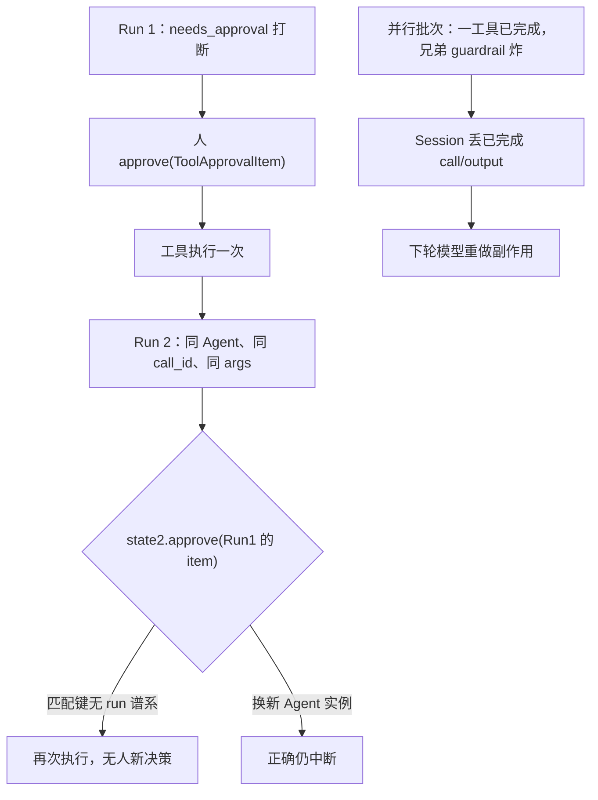

## 1. 问题现象 (Problem Symptoms)

结论先行：**`needs_approval=True` 的工具审批，在 OpenAI Agents Python 的 `RunState` 里是按 `(agent, invocation type, call_id, arguments fingerprint)` 匹配的——没有 run 谱系。** 于是 Run 1 里人点过同意的那张 `ToolApprovalItem`，可以原样喂进 Run 2 的 `state2.approve(...)`：同 Agent 实例、同 `call_id`、同参数指纹时，受保护工具再次执行，本 run 无人点同意。误判路径通常是「模型乱调 / Session 坏了 / 用户点过所以安全」；真正坏的是**审批决策身份跨 run 可转让**。

本文是专题 **Agent Session-State Integrity** 的 #5（审批 / 中断键空间）。前四篇各守一条：#1 [配对](posts/orphan_tool_call_session_wedge.md)（call↔output 结构）、#2 [语义](posts/compaction_drops_pinned_instructions.md)（压缩不能丢约束）、#3 [组装](posts/streaming_tool_call_index_collision.md)（流式身份键）、#4 [重放](posts/tool_call_id_rewrite_cross_provider.md)（跨 provider 改写后键仍要对上）。本篇问的是：**中断与审批这对门控，键里有没有「是哪一次 run 发出的承诺」——以及中断路径上已提交的副作用会不会从历史上消失。**

与相邻文划界（本文不复述它们的机制）：

| 文章 | 层 | 问的是 / 和本文的交点 |
| --- | --- | --- |
| [一次中断，整个会话永久 400](posts/orphan_tool_call_session_wedge.md)（#1） | 会话转录结构配对 | 那篇：缺 output → 永久 400。本文 #4125 旁支的 orphan 可被 `drop_orphan_function_calls` 剥掉继续跑；重点是**审批承诺与副作用是否提交**，不重讲 400 |
| [换了个模型，会话就 400 了](posts/tool_call_id_rewrite_cross_provider.md)（#4） | 跨 provider 的 id 改写 | 那篇：历史重放时键被翻译层改坏。本文：审批对象在 run 之间被**原样复用** |
| [子代理一派生，父会话的权限没跟过去](posts/subagent_delegation_envelope.md) | 父→子权限包络 | 那篇：约束是否下传。本文：同会话内审批票据是否跨 run 复用 |
| [Agent 写操作的幂等](posts/agent_write_idempotency.md) | 超时后敢不敢重试 | 本文把业务幂等键当审批泄漏时的兜底，不重讲幂等协议 |
| [Checkpoint 不等于 Durable Execution](posts/durable_agent_execution.md) | 进程死后门控与副作用 | #5413 评论提到 resume 与 run id 设计张力，只点一句：同 run 恢复 ≠ 跨 run 转让 |
| **本文**（Session-State Integrity #5） | Host HITL / RunState 审批键 | 审批是否绑 run 谱系；并行异常是否丢掉已完成 call/output |

证据范围先说清：机制主线来自 openai/openai-agents-python 公开 issue / PR——[#5413](https://github.com/openai/openai-agents-python/issues/5413)（**仍 open**；ScriptedModel 离线复现多条独立评论仍成立）、[#5327](https://github.com/openai/openai-agents-python/issues/5327)（closed completed 2026-10-14，经已合 [#5332](https://github.com/openai/openai-agents-python/pull/5332)；进 **v0.24.0+**，**勿写「仍必现」**）、[#4125](https://github.com/openai/openai-agents-python/issues/4125)（closed completed，经已合 [#4126](https://github.com/openai/openai-agents-python/pull/4126)，0.19.x+；**历史旁支**）。**只谈 Python SDK 的 RunState，不推断 JS SDK。** 真实模型是否复用 `call_id` 未测——报告与复现均为 ScriptedModel。

三个现象必须分开看：**审批票据有没有跨 run、并行批次有没有丢已完成项、恢复审批后 call/output 是否同生共死。**

### 现象 A：Run 1 的同意，在 Run 2 里直接放行

值班写法「看起来合理」：第一次打断 → 人批 → 执行；第二次同工具再打断时，手里还捏着上次的 `ToolApprovalItem`，顺手 `state2.approve(old_item)`。

公开同构：[#5413](https://github.com/openai/openai-agents-python/issues/5413)（**open**；测于 v0.23.1 / `main`）。issue 正文的 ScriptedModel 复现形状：

```python
# 出处：openai-agents-python #5413 正文（示意结构与原文一致）
# Run 1: request approval for write_marker(path="A"), approve it
result1 = await Runner.run(agent, "do it", context=ctx1)
state1 = result1.to_state()
state1.approve(result1.interruptions[0])  # approve args=A
result1b = await Runner.run(agent, state1)  # executes args=A ✓

# Run 2: NEW run, same agent, same tool, same call_id, same args
result2 = await Runner.run(agent, "do it again", context=ctx2)
state2 = result2.to_state()
state2.approve(old_approval_item)  # ← passes the OLD approval item
result2b = await Runner.run(agent, state2)  # executes AGAIN ✓ ← bug
```

独立复现评论（`main`@`0dc4cf1`，对应评论所述 v0.24.0 一带）给出：`after run 2: ['A', 'A']`。边界也钉死了：**改参数则正确拒绝**；**不喂任何 approve 则仍中断**——坏的只是跨 run 转让审批对象本身。

### 现象 B：并行工具里兄弟 guardrail 炸掉，已成功的副作用从 Session 消失

同 turn 并行 `create_ticket` + `send_email`：`create_ticket` 已成功；`send_email` 的 input guardrail 触发 → Session 只剩 `user`，下轮模型再开一张票。报告称 gpt-5-mini 上 10/10 重复建单。

公开同构：[#5327](https://github.com/openai/openai-agents-python/issues/5327)（closed completed 2026-10-14，closer `jbeckwith-oai`；fix PR [#5332](https://github.com/openai/openai-agents-python/pull/5332) merged 2026-10-14，标题 *preserve completed tool outputs when a sibling fails*）。**该修复已进 v0.24.0（2026-10-15 release notes 列 #5332）——写 v0.24.0+ 现状时不得写「仍必现」。** 本现象用来讲「中断 / 异常路径上已提交副作用与历史必须同生共死」，不是声称当前 release 必复现。

### 现象 C：人已 approve 的工具跑完，output guardrail 绊倒 → streamed 路径留下无 output 的 call

恢复审批回合上，`tool_use_behavior='stop_on_first_tool'`，output guardrail 绊倒：非 streamed 路径保留 `['user','function_call','function_call_output']`；`run_streamed` 曾留下 `['user','function_call']` 无 output。

公开同构：[#4125](https://github.com/openai/openai-agents-python/issues/4125)（closed completed；label `feature:sessions`；披露作者为 AI agent，机制以 issue 正文与 repro 为准）→ fix PR [#4126](https://github.com/openai/openai-agents-python/pull/4126)（merged；0.19.x milestone）。**0.19.x+ 已修，本文只作历史旁支**：说明「审批后的 call 与 output 必须同事务写入」这一设计选择，不写成当前必现。



---

## 2. 根因分析 (Root Cause Analysis)

三个现象的共同误判是：把「HITL 已经接上」叠成一句「危险工具不会在无人同意时跑」。它们其实是**审批决策身份**与**中断路径上的历史提交**两处不同的键 / 事务失败。

| 视角 | 正常时应对齐到 | 漏了会怎样 |
| --- | --- | --- |
| 谱系 | 批准绑定 issuing run（或 execution generation） | 现象 A：跨 run 转让 |
| pending 集合 | 只接受**当前** `get_interruptions()` 里的 item | 现象 A 旁路：陈旧 item 静默记账，预授权未来同 id |
| Agent 身份巧合 | 换新 `Agent` 实例则 match 失败 | 模块级单例 Agent（常见写法）反而中招 |
| 批次 / 恢复事务 | 已完成 call/output 与审批后结果同生共死 | 现象 B / C：副作用已发生，历史看不见或只剩半对 |

（以下是**我们的分析**，从公开报告归纳，不是 SDK 官方实现原理文档。）

根因可以拆成四条——审批键与提交边界必须同时满足它们：

1. **谱系（对应 A）。** `_approval_items_match`（`src/agents/run_state.py`，评论钉到的匹配维）只比 `(agent, invocation type, call_id, arguments fingerprint)`。`get_interruptions()` 还返回 `dataclasses.replace` 的**脱离副本**，对象身份无法区分「当前 pending」与「上一次 run 的 item」。跨 run 重放 `ToolApprovalItem` 因此与「本 run 合法副本」不可区分（#5413）。
2. **pending 集合（对应 A 旁路）。** 评论实测：`approve()` 对「当前并不在 `get_interruptions()` 里」的陈旧 item 仍可静默记账；随后模型再发出同 id 时直接执行——预授权了未来的调用。
3. **Agent 身份巧合防护（对应 A 边界）。** 换新 `Agent` 实例则 `candidate.agent is not approval_item.agent`，match 失败、正确中断。模块级单例 / 长生命周期 Agent（文档与示例常见形状）反而中招；「每请求新建 Agent」是偶然防护，不是设计保证。
4. **与会话完整性联动（对应 B / C）。** 并行批次异常不得丢掉已完成的 call/output（#5327 → #5332）；审批后的 tool output 与 call 必须同生共死（#4125 → #4126）。否则人批过一次，历史却让模型以为「没做完」或「没结果」——下一轮重做副作用。

一句话：**审批是「对哪一次执行承诺」的能力，不是「对这个 call_id 形状的永久通行证」。**

---

## 3. 机制 / 解法要点 (Mechanism / Solutions)

### 3.1 审批记录带 run id（或 generation），`approve` / `reject` 校验谱系

SDK 侧尚未合入官方 fix（#5413 仍 open）。设计方向（issue 评论与正文建议，**不是已发布行为**）：给 `ToolApprovalItem` 盖 issuing run 戳；`approve` / `reject` 校验戳；序列化一并带走；旧状态缺戳时显式策略（拒绝或仅允许同序列化恢复路径）。

应用层在 SDK 修好前可落地的最小护栏（评论中的 app-side guard，示意）：

- 自建表键：`(run_id, call_id, args_digest)`；
- **只**批准取自「正在 resume 的那份 state」的 `result.interruptions` / `state.get_interruptions()`；
- **永不**持久化 `ToolApprovalItem` 对象再喂进另一次 `Runner.run`；
- 工具真正执行前把行标成已消费（先于副作用），避免崩溃后二次支付。

与 [durable 篇](posts/durable_agent_execution.md) 的张力只点一句：同一次 run 崩溃后 resume，往往**应该**保留未消费的批准；跨 run 转让则必须拒绝——键至少是 run id，更稳的是 run id + execution generation（#5413 评论里的设计问题，未定案）。

### 3.2 只接受当前 pending；拒绝预授权未来 call

即使加上 run id，仍要：`approve(item)` 在 item 不在当前 `get_interruptions()` 时**报错 / 拒绝**，而不是静默写入 `_approvals`。否则「先记账、后出现同 id」仍是预授权。

Host 侧检查清单：

- `approve` / `reject` 前断言 item 的 call_id 属于当前 interruptions；
- 审计日志区分 `approved_current_interruption` vs `rejected_stale_or_foreign_item`；
- 禁止 UI / 队列把「历史同意按钮」的 payload 直接当 `ToolApprovalItem` 反序列化进新 run。

### 3.3 并行批次异常：先落盘已完成 call/output 再抛

#5332（**已合，v0.24.0+**）的方向：同 turn 一批工具里，兄弟失败 / guardrail 绊倒时，**已接受的 call/output 对**仍写入 Session / `run_data` / `to_input_list()` / `to_state()`；run 仍上报失败；被拒的 input / 未完成项不发布。升级到 v0.24.0+ 后，应用仍应保留业务幂等——PR 正文写明：保留历史**不保证**跨崩溃 / 持久化失败 / 模型新发调用的 exactly-once。

对仍停在 <0.24.0 的部署：不要假设 Session 在 `ToolInputGuardrailTripwireTriggered` 后仍含已完成兄弟项；应用层可在 `except` 里把已观察到的成功副作用写入外部账本，供下一 turn 提示模型「已创建票 T-1」。

### 3.4 审批后的 call 与 output 同事务；副作用另加业务幂等键

#4126（**0.19.x+ 已合**）的方向：streamed 恢复路径上，显式批准过的 function tool 的 call/output **在 output guardrail 之前**持久化，与 `Runner.run` 对齐，避免 orphan call、也避免「人批过的副作用从历史上消失」。

无论 SDK 版本如何，危险写工具仍应带稳定业务幂等键（交叉：[写操作幂等](posts/agent_write_idempotency.md)）——审批层正确 ≠ 可删工具层。审批泄漏或历史丢失时，幂等键是最后一道收敛。

指标建议（**本文主张**）：按工具统计 `approval_stale_item_accepted`、`needs_approval_exec_without_fresh_decision`、并行失败后 `completed_sibling_missing_from_session`。

---

## 4. 同一条业务链：怎么接、错在哪、改完怎么走

贯穿 ID：退款单 **`RF-3390`**。工具 `issue_refund`（`needs_approval=True`）；同 turn 还可能并行 `create_credit_memo` + `send_refund_email`。Host 用模块级单例 `Agent`（常见写法）。以下代码均为**示意**，不是 SDK 源码摘录；复现形状对齐 #5413 / #5327 公开报告。

### 4.1 BAD v1：跨 run 转让审批 → 再次打款（现象 A）

客服在 Run 1 批准退 $50；会话重放 / 负载均衡开出 Run 2，模型复用同一 `call_id` 与参数，旧 item 被 `approve`。

```python
# 示意：RF-3390 v1 —— 跨 run 喂旧 ToolApprovalItem（现象 A）
agent = Agent(name="refund", tools=[issue_refund], model=...)  # 模块级单例

r1 = await Runner.run(agent, "退 RF-3390 的 $50")
item1 = r1.interruptions[0]
r1.to_state().approve(item1)
await Runner.run(agent, r1.to_state())          # 执行一次 ✓

r2 = await Runner.run(agent, "请再确认退款")    # 新 run
r2.to_state().approve(item1)                    # ← Run1 的 item
await Runner.run(agent, r2.to_state())          # 再次执行 ← 无人新决策
# 对照 #5413 复现评论：after run 2: ['A', 'A'] 一类双执行
```

`RF-3390` 被打款两次。改参数会失败关闭；换新 `Agent` 实例会正确中断——但单例路径是默认。

修复方向：§3.1 谱系 + §3.2 只批当前 pending。

### 4.2 BAD v2：并行 credit memo 已生成，email guardrail 绊倒 → 历史丢失（现象 B）

同 turn 并行 `create_credit_memo` + `send_refund_email`；email 的 input guardrail 触发。

```python
# 示意：RF-3390 v2 —— 兄弟失败丢掉已完成项（现象 B；#5327 在修复前的形状）
# create_credit_memo 已成功返回；send_refund_email guardrail 抛
# Session ≈ ['user']  # 已完成的 memo call/output 不见了
# 下一轮模型再开一张 credit memo
```

外部账本已有 memo，模型视野里没有 → 重复开票。**注意：v0.24.0+ 经 #5332 后，client-managed 路径应保留已完成对；不要把「仍必现」写成当前 release 现状。** 本 v2 描述的是修复前的失败面，以及升级前的应用层风险。

修复方向：§3.3 批次先落盘；外部账本 + 幂等键。

### 4.3 BAD v3：陈旧 item 预授权 + 审批后历史半对（现象 A 旁路 / C）

```python
# 示意：RF-3390 v3 —— 对非 pending 的旧 item 调用 approve（#5413 评论实测）
# Run2 当前 pending 的是另一笔 call；仍 state2.approve(item_from_run1)
# → 静默记账；稍后模型再发同 id → 无新决策即执行

# 历史旁支（#4125，0.19.x 前 streamed）：人已 approve 的工具跑完，
# output guardrail 绊倒 → session 曾为 ['user','function_call'] 无 output
```

预授权让「看起来没打断」的路径直接打款；半对则让审计 / 自定义 session 回调看到「批过但没结果」。

修复方向：§3.2 + §3.4。

### 4.4 GOOD：Run 2 必须新中断、新人批；自建表按 run 消费一次；批次保留；业务键幂等

```python
# 示意：RF-3390 GOOD
# 应用层审批表（非 SDK API）
approvals: dict[tuple[str, str, str], str]  # (run_id, call_id, args_digest) -> status

def approve_current_only(state, run_id: str, item):
    pending = {i.call_id for i in state.get_interruptions()}
    if item.call_id not in pending:
        raise PermissionError("stale_or_foreign_approval_item")  # §3.2
    key = (run_id, item.call_id, args_digest(item))
    if approvals.get(key) == "consumed":
        raise PermissionError("approval_already_consumed")
    state.approve(item)  # 仍只用「本 state 的 interruptions」取出的 item
    approvals[key] = "approved"

def before_side_effect(run_id, call_id, args, refund_id="RF-3390"):
    key = (run_id, call_id, args_digest_raw(args))
    approvals[key] = "consumed"           # §3.1：执行前消费
    return issue_refund(
        ...,
        idempotency_key=f"{refund_id}:{call_id}",  # §3.4
    )

# Run2：必须出现新的 interruption；UI 只展示 state2.get_interruptions()
# 并行失败：依赖 v0.24.0+ #5332 保留已完成对；外部仍写 memo 账本
# streamed 恢复：依赖 0.19.x+ #4126；call/output 同事务
```

v1 → GOOD 的每处改动回扣 §3：

| 版本 | 失败表现 | 键 / 事务做错了什么 | 改动 | 对应 §3 |
| --- | --- | --- | --- | --- |
| v1 → v2 | 跨 run 再打款 | 无 run 谱系；复用旧 item | 自建 `(run_id, call_id, args)`；只批当前 interruptions | §3.1 / §3.2 |
| v2 → v3 | 重复 credit memo | 并行异常丢已完成历史 | 升到 v0.24.0+；外部账本 | §3.3 |
| v3 → GOOD | 预授权 / 半对 | 陈旧 approve；审批后 output 未同事务 | 拒绝非 pending；依赖 #4126 路径；业务幂等键 | §3.2 / §3.4 |
| GOOD | 防止退化 | — | 指标：无新决策执行次数、stale approve 拒绝次数 | §3.1–§3.4 |

一句话回顾：v1 是**把通行证借给下一次 run**；v2 是**副作用已发生但历史假装没发生**；v3 是**先记账再出现同 id**；GOOD 让「谱系 / pending / 批次事务 / 幂等」对齐。

---

## 5. 发版前清单：对准可注入的失败点 (Pre-Ship Checklist)

不要靠「点一次同意看起来绿了」判断。先问一句：**这次执行，批准是不是「当前这次 run 的当前 pending」发出的？** 下面三个注入点对应条目 §5，可用 ScriptedModel / 自建假模型在 CI 里跑（不是攻击脚本）。

**注入 1：Run 1 批准并执行后，Run 2 同 Agent、同 call_id、同 args，喂入 Run 1 的 approval item（对应 §3.1 / 现象 A）**

- [ ] 期望：`approve` 拒绝，**或**仍中断等待新决策
- [ ] 期望：受保护工具执行次数不增加（对照 #5413 的 `['A','A']` 失败形）
- [ ] 对照：换新 `Agent` 实例时，未修 SDK 也可能「碰巧」中断——**不得**把碰巧当成修复

**注入 2：对「当前 pending 不是该 call」的陈旧 item 调用 `approve`（对应 §3.2）**

- [ ] 期望：报错 / 拒绝，且不能预授权随后出现的同 id 调用
- [ ] 审计能区分 stale reject 与正常 approve

**注入 3：并行两工具，后完成的那个触发 guardrail 异常（对应 §3.3 / 现象 B）**

- [ ] 在 **<0.24.0**：记录基线（Session 可能只剩 user）并确认外部账本 / 告警
- [ ] 在 **v0.24.0+**：期望 Session / `run_data` 仍含先完成那对 call+output；下轮模型看得见
- [ ] 无论版本：写工具带业务幂等键；重复调用收敛到同一业务结果

### 否决项（有一条不通过就不要发）

- [ ] 禁止把 #5413 写成「已修复」——issue **仍 open**，无官方 fix
- [ ] 禁止对 v0.24.0+ 写 #5327「仍必现」——#5332 已合且进该 release
- [ ] 禁止把 #4125 写成当前必现——#4126 已合（0.19.x+）；只作历史旁支
- [ ] 禁止推断「JS SDK 也有同样 bug」——只谈 Python RunState
- [ ] 禁止把 Tracekit / agent-approval-gate 等第三方写成 SDK 方案——只可作「应用层自建表」类比
- [ ] 禁止把 ScriptedModel 复现写成「真实模型会复用 call_id」——真实路径未测
- [ ] 禁止用「用户以前点过同意」替代本 run 的显式决策

---

## 6. 小结 (Takeaways)

1. **审批键没有 run 谱系时，`ToolApprovalItem` 会变成跨 run 通行证。** 匹配维是 `(agent, call_id, args…)`；同单例 Agent 下，Run1 的 item 可以放行 Run2 的同形调用（#5413，**仍 open**）。
2. **只批当前 pending，并拒绝预授权。** 对非 interruptions 成员的 `approve` 不应静默成功；应用层用 `(run_id, call_id, args_digest)` 表一次性消费。
3. **中断路径上的历史事务与审批承诺同级重要。** 并行兄弟失败曾丢掉已完成 call/output（#5327，**v0.24.0+ 已修**）；审批后 streamed 半对是历史旁支（#4125 / #4126）。
4. **证据状态要写清：** #5413 未修；#5327/#5332 进 v0.24.0+；#4125/#4126 在 0.19.x+。不能把「有评论建议」读成「SDK 已保证」。

系列位置：Agent Session-State Integrity #5（审批 / 中断键空间），承接 [#4 tool call id 改写](posts/tool_call_id_rewrite_cross_provider.md)。Ready 池备份：`mcp-list-changed-reload-blocks-receive-loop`（list_changed 在 receive 回调里 await 重载 → 本轮 call 假失败）。

### 参考 (References)

1. [openai/openai-agents-python#5413](https://github.com/openai/openai-agents-python/issues/5413) — Approval decision transfers across runs when call ID is reused（**open**；主证据；多条 ScriptedModel 离线复现评论）
2. [openai/openai-agents-python#5327](https://github.com/openai/openai-agents-python/issues/5327) — Finished tool call is dropped when a parallel tool's guardrail trips（closed completed 2026-10-14）
3. [openai/openai-agents-python#5332](https://github.com/openai/openai-agents-python/pull/5332) — fix: preserve completed tool outputs when a sibling fails（merged 2026-10-14；**v0.24.0** release notes 收录）
4. [openai/openai-agents-python#4125](https://github.com/openai/openai-agents-python/issues/4125) — Output guardrail trip leaves orphaned tool call on streamed resume（closed completed；历史旁支）
5. [openai/openai-agents-python#4126](https://github.com/openai/openai-agents-python/pull/4126) — fix: preserve approved tool output on streamed resume（merged；0.19.x）
6. [OpenAI Agents Python — Guardrails](https://openai.github.io/openai-agents-python/guardrails/) — 文档旁证：output guardrail 绊倒时保留 already-completed tool items（#5327 所引方向）
7. 站内：[orphan 篇](posts/orphan_tool_call_session_wedge.md) · [tool-call-id 改写篇](posts/tool_call_id_rewrite_cross_provider.md) · [写操作幂等](posts/agent_write_idempotency.md) · [durable execution](posts/durable_agent_execution.md) · [subagent envelope](posts/subagent_delegation_envelope.md)
