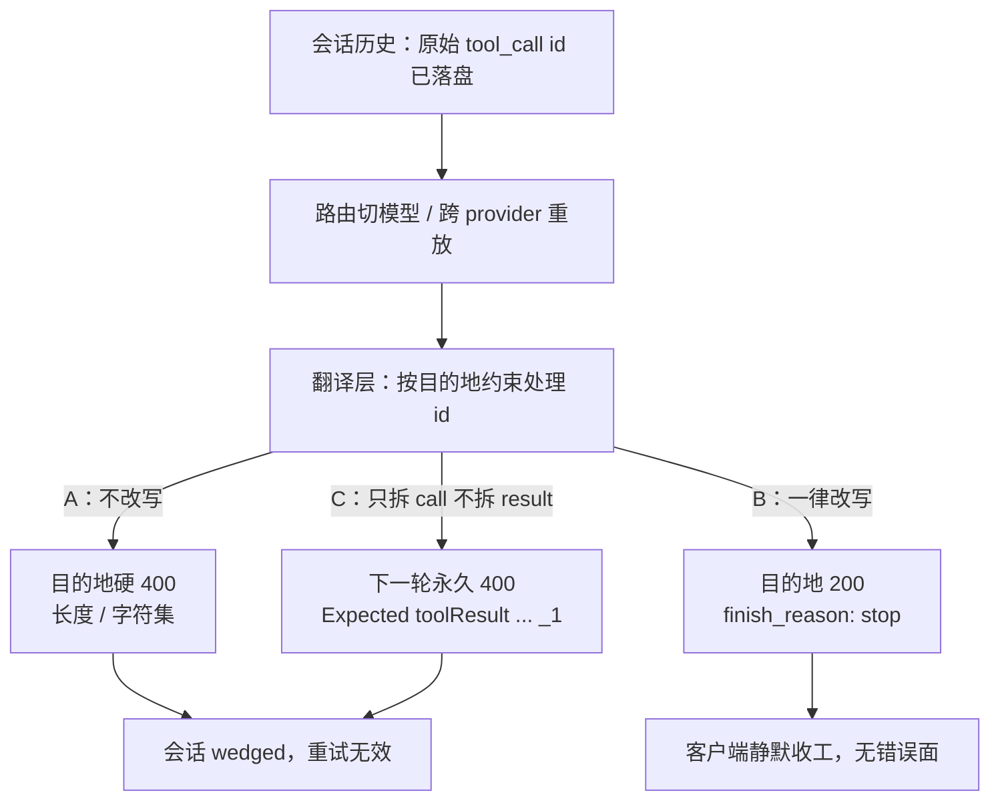

## 1. 问题现象 (Problem Symptoms)

结论先行：**工具调用历史每一轮都会整段重放；会话中途切模型、或经代理转到另一家 provider 时，翻译层必须让 `tool_use.id` / `tool_call_id` 满足目的地约束——但改写本身有三种独立的坏法。** 不改写 → 目的地硬 400，之后每一轮同样失败；一律改写 → 模型侧静默 `finish_reason: stop`，客户端看不到错误；只改 call 不改 result（结构不对称）→ 永久 400，重试无效。真正要修的是**配对键在翻译层的改写规则**，不是「换回原模型就好」。

本文是专题 **Agent Session-State Integrity** 的 #4（重放不变量）。前三篇各守一条：#1 [配对](posts/orphan_tool_call_session_wedge.md)（每个 call 都有对应 output）、#2 [语义](posts/compaction_drops_pinned_instructions.md)（压缩不能把约束改写掉）、#3 [组装](posts/streaming_tool_call_index_collision.md)（进历史之前 call 本身必须拼对）。本篇问的是：**两半都在、call 也已组装好，但键在跨 provider 出站翻译之后是否仍相等、仍唯一、仍是目的地模型认得的格式。**

与相邻文划界（本文不复述它们的机制）：

| 文章 | 层 | 问的是 / 和本文的交点 |
| --- | --- | --- |
| [一次中断，整个会话永久 400](posts/orphan_tool_call_session_wedge.md)（#1） | 会话转录的**结构配对** | 那篇：写入侧只留下半对。本文：两半都在，翻译层改写后配不上了。#26060 是翻译层自己造出的 orphan，只一句互链那篇的发送前 validator |
| [Compaction 之后 Agent 忘了「先给我看计划」](posts/compaction_drops_pinned_instructions.md)（#2） | 压缩边界上的**语义保真** | 那篇：摘要把意思改写了。本文：字节层面的 id 键被改写，与压缩无关 |
| [流式 tool call 的身份键坍缩](posts/streaming_tool_call_index_collision.md)（#3） | 流式响应 → tool call **组装** | 那篇：一轮流式 delta 组装时身份键坍缩，**在进历史之前**就已经坏了。本文：已组装好的 id 在**跨 provider 重放**时被改写。#26060 的拆分就是那篇讨论过的 JSON 切分启发式，本文只讲它造成的 id 不对称，不重讲切分 |
| [一个 429 打出成倍的上游请求](posts/layered_retry_amplification.md) | 重试所有权与错误分类 | 这类 400 属 STOP 类、重试无效，一句互链 |
| [MCP Server 实例复用](posts/mcp_server_instance_reuse_cross_client_leak.md) | MCP JSON-RPC 请求 id 路由 | 那篇是 MCP 层的请求 id；本文是 LLM 消息历史里的 tool call id，不是同一层 |
| **本文**（Session-State Integrity #4） | Host / 代理的**消息格式翻译层** | 出站改写是否按目的地、是否单射、call 与 result 是否同源 |

证据范围先说清：机制主线来自 LiteLLM 公开 issue / PR——[#34239](https://github.com/BerriAI/litellm/issues/34239)（closed completed，经已合 [#40872](https://github.com/BerriAI/litellm/pull/40872)）、[#34522](https://github.com/BerriAI/litellm/issues/34522) / [#32214](https://github.com/BerriAI/litellm/issues/32214)（均 open；fix PR [#34523](https://github.com/BerriAI/litellm/pull/34523) / [#40132](https://github.com/BerriAI/litellm/pull/40132) 均 open 未合）、[#26060](https://github.com/BerriAI/litellm/issues/26060)（closed **not_planned**，未修复；fix PR [#31258](https://github.com/BerriAI/litellm/pull/31258) open）。引入 Anthropic 路径 sanitize 的 [#31094](https://github.com/BerriAI/litellm/pull/31094) 合入的是 `litellm_internal_staging`（见 §3）。**只讲 LiteLLM 的实现，不推断其他代理 / SDK。** 「Kimi K2 解析器靠 id 格式推序号」是 #34522 / PR #34523 引 vLLM 博客与 sglang#10600 的说法，本轮未核这两个外部来源，写成「报告称」。

三个现象必须分开看：**翻译层对 id 做了什么**——不改、一律改、还是只改了一侧——决定你面对的是哪一类坏。

### 现象 A：不改写 → 目的地硬 400，会话之后每一轮同样失败

会话里已经存着一个长 id，或带 `|` 等目的地不允许的字符；路由切到 Bedrock 时，翻译层把 `tool_call.id` / `tool_call_id` **原样**塞进 `toolUse.toolUseId` / `toolResult.toolUseId`。Bedrock Converse 校验失败，返回 400。

LiteLLM [#34239](https://github.com/BerriAI/litellm/issues/34239)（closed completed 2026-09-15，经已合 [PR #40872](https://github.com/BerriAI/litellm/pull/40872)）：`bedrock/zai.glm-5` 多轮工具调用时，模型自己生成的长 id 超过 64 字符 → `Member must have length less than or equal to 64`，整个工具循环中断。PR #40872 的复现更直白：OpenCode 会话里存着一个 82 字符、带 `|` 的 id（形如 `opencode|call|9f2c…`），会话切到 Bedrock 模型后，每一轮都报字符集与长度错误；修复后 200，会话继续。

错误串里 Bedrock 实际要求的字符集是 `[a-zA-Z0-9_.:-]+`、长度 ≤64（以 PR #40872 / #34239 里逐字出现的错误串为准；#34239 issue 正文自己猜的 `[a-zA-Z0-9_-]+` 与错误串不同，**以错误串为准**）。这类 400 属 [layered-retry 篇](posts/layered_retry_amplification.md) 说的 STOP 类：重试只会重放同一段历史，无效。

### 现象 B：一律改写 → 静默 `finish_reason: stop`，客户端看不到错误

为过 Anthropic 的 id 校验，翻译层把 `functions.Bash:0` 一类 id 无条件改成 `functions_Bash_0`，**却不管目的地是不是 Anthropic**。请求本身 200；模型侧不再发出结构化 tool call，返回 `finish_reason: stop`；Claude Code 一类客户端中途结束任务，任何地方都没有报错。

LiteLLM [#34522](https://github.com/BerriAI/litellm/issues/34522)（**open**；fix PR [#34523](https://github.com/BerriAI/litellm/pull/34523) **open 未合**）与 [#32214](https://github.com/BerriAI/litellm/issues/32214)（**open**；fix PR [#40132](https://github.com/BerriAI/litellm/pull/40132) **open 未合**）：`normalize_anthropic_tool_use_id()` / `sanitize_tool_use_ids_in_anthropic_messages` 把含 `.` / `:` 的 id 换成 `_`。报告称 Kimi K2 的 vLLM / SGLang 解析器与 chat template 依赖原格式 `functions.{name}:{index}` 从历史里推下一个工具调用序号；改写后工具调用被当纯文本返回。#32214 报告者称在约第 5～6 轮工具调用时出现（**报告者观察**），回滚到 v1.90.3、或把两个 sanitize 调用点改成 no-op 后恢复。

引入这个改写的 [PR #31094](https://github.com/BerriAI/litellm/pull/31094)（merged 2026-06-24 into **`litellm_internal_staging`**），目的正是让 kimi → Anthropic 的跨 provider 重放不再因 `functions.Bash:0` 这类 id 400——**同一个改写，对 Anthropic 目的地是修复，对 vLLM 目的地是回归。** #32214 报告者称它随 v1.91.0 发布；本轮只核到 PR 合入 staging，**未独立核发行版通道**。

症状是：**请求成功了，工具循环却静默停了**——不要和现象 A 的硬 400、现象 C 的永久 400 混成同一种失败。

### 现象 C：结构改写不对称 → 永久 400，重试无效

翻译层为兼容串接 JSON，把**一个** OpenAI `tool_call` 拆成 N 个 Bedrock `toolUse`（`<id>`、`<id>_1`、`<id>_2` …），而 `toolResult` 仍按原 `tool_call_id` 只发**一个**。下一轮 Bedrock 报：

```text
Expected toolResult blocks at messages.N.content for the following Ids: tooluse_<orig_id>_1
```

会话历史永久不对称，之后每一轮同样 400。

LiteLLM [#26060](https://github.com/BerriAI/litellm/issues/26060)（2026-07-26 被 github-actions[bot] 以 **not_planned** 关闭，**未修复**；fix PR [#31258](https://github.com/BerriAI/litellm/pull/31258) **open 未合**）。报告环境 litellm 1.82.2 + openai-agents 0.12.4 + Bedrock 上的 Claude Opus 4.6。这是翻译层自己造出的 orphan——两半「看起来都写了」，但键集合对不上；发送前 validator（见 [orphan 篇](posts/orphan_tool_call_session_wedge.md)）本应拦下。



---

## 2. 根因分析 (Root Cause Analysis)

三个现象的共同误判是：把「模型不兼容」「换回原模型就好」「provider 抖动」叠成一句「切模型出了问题」。它们其实是翻译层对**同一根配对键**的三种不同处理失败。

| 视角 | 正常时应对齐到 | 漏了会怎样 |
| --- | --- | --- |
| 目的地合法 | 出站 id 满足目的地长度 / 字符集 | 现象 A：硬 400 |
| 模型状态保留 | 目的地不要求改时，id 字节不变 | 现象 B：解析器丢序号 → 静默 stop |
| 结构对称 | 拆了 N 个 call 就有 N 个 result | 现象 C：永久 400（自造 orphan） |

（以下是**我们的分析**，从公开报告归纳，不是 LiteLLM 官方实现原理文档。）

根因可以拆成四条性质——改写函数必须同时满足它们：

1. **目的地合法（对应 A）。** 历史每轮重放，所以改写不是一次性迁移，而是**每轮出站都要重新算**。不合法才改；合法就原样转发。不改非法 id → 硬 400（#34239）。
2. **单射（对应 A 的隐性翻车与 B 的截断风险）。** 只做字符替换 / 截断会让 `call|x` 与 `call_x`、只在截断位置之后不同的两个 id 撞成一个。PR #40872 对每个**被改写**的 id 追加原 id sha256 的前 8 位 hex，并在构造 `toolUse` 和 `toolResult` 的同一处应用（包括拆分后带 `_{idx}` 的 id），两侧仍能对上；它取代的 PR #34292 先拼 id 再截断，拆分后缀会把 id 推回 64 以上、截断后的 id 也可能碰撞。
3. **按目的地门控、不改模型自己的状态（对应 B）。** id 对某些模型不是不透明字符串——报告称 Kimi K2 的格式承载序号。sanitize（PR #31094）对所有后端无条件执行 → 对 Anthropic 是修复，对 vLLM 是回归。两个 open 的修复 PR（#34523 按目的地是否 Anthropic 家族、#40132 按 `api_base` 是否 api.anthropic.com）都在补这道门，**均未合**。
4. **结构改写要对称（对应 C）。** 只拆 call 不拆 result，等于翻译层自己造了 orphan（#26060）。要么不做结构改写；必须拆时 result 同步拆（#31258 的方向，未合）。

一句话：配对键的改写必须是「**按目的地选择、确定性、单射、两侧同源**」的同一个函数——不是「出站时随便 normalize 一下」。

---

## 3. 机制 / 解法要点 (Mechanism / Solutions)

### 3.1 目的地合法：不合法才改，合法原样转发

出站前按**当前**目的地的约束校验 id。Bedrock Converse：≤64 且 `[a-zA-Z0-9_.:-]+`（错误串原文）。Anthropic 家族：报告称 `^[a-zA-Z0-9_-]+$`（出自 #32214 / #34522 正文，本轮未查厂商文档）。目的地接受原 id → 字节不变；不接受 → 进入 §3.2 的确定性改写。

PR #40872 的修复落在 Bedrock 边界：`_sanitize_bedrock_tool_use_id` 替换非法字符并封顶 64；**响应侧不做反向映射**（PR 原文：Bedrock 会为新 tool call 铸造自己的 id，客户端看不到被改写的 id）。历史里应继续保存**原始** id（**本文主张**），线上 id 每次出站现算，不回写历史——否则下一次再切 provider，会被二次改写。

### 3.2 单射：被改写的 id 追加原 id 哈希后缀

改写函数必须确定性，且不同原 id 不得撞车。PR #40872 的做法：

- 非法字符替换 + 长度封顶；
- 凡是动过的 id，追加 `_` + 原 id sha256 前 8 hex，使 `call|x` vs `call_x`、只在截断点之后不同的 id 仍可区分；
- **同一处**作用于 `toolUse` 与 `toolResult`（含拆分后的 `_{idx}` 后缀），保证配对。

哈希后缀在 #40872 里是 **Bedrock-only**（PR 原文：Anthropic sanitizer 仍只替换字符、不截断）。「截断后碰撞」由 PR #40872 / #34292 的描述支撑；本文不对 Bedrock 收到重复 id 时的行为下断言。

### 3.3 按目的地门控：Anthropic 约束只施加给 Anthropic 家族目的地

`sanitize_tool_use_ids_in_anthropic_messages` / `normalize_anthropic_tool_use_id` 不能对所有 `/v1/messages` 后端无条件执行。两个未合 PR 的方向（供对照，不是已发布保证）：

- [#34523](https://github.com/BerriAI/litellm/pull/34523)：按目的地是否 Anthropic 家族决定是否保留 `functions.{name}:{index}`；
- [#40132](https://github.com/BerriAI/litellm/pull/40132)：`custom_llm_provider: anthropic` 但 `api_base` 不是 api.anthropic.com 时跳过改写。

Host / 自建翻译层的落地：**按目的地选改写函数**；发给 Kimi / vLLM 的请求 id 字节不变；只有真正打到 Anthropic 家族 API 时才做 Anthropic 字符集 sanitize。

### 3.4 结构对称 + 出站 validator

不做「一个 call → N 个 toolUse」的结构改写，除非 result 侧同步复制。#31258 的方向是 `_duplicate_bedrock_tool_result_for_splits`——**未合，不能写成已修**。

出站前 validator（与 [orphan 篇](posts/orphan_tool_call_session_wedge.md) 发送前校验同族）：

- call id 在本轮出站集合里**唯一**；
- 每个 result 的 id 都能在 call 集合里找到；
- 长度与字符集满足**当前目的地**。

不满足 → **本地报错，不发出去**；不要把确定性失败交给上游 400 再重试。

指标建议（**本文主张**）：按目的地统计 id 改写次数与改写后的碰撞数；碰撞数 >0 告警。

---

## 4. 同一条业务链：怎么接、错在哪、改完怎么走

贯穿 ID：运维排障会话 **`case_OPS-4410`**。前几轮跑在自托管 vLLM 的 Kimi K2 上（id 形如 `functions.read_log:0`）；客户端存下的历史里还有更早一段由另一个客户端生成的 82 字符、带 `|` 的 id。第 6 轮因上下文变长，路由把 `case_OPS-4410` 切到 Bedrock 上的模型。（会话切换路线是**设计示例**，用来串起三种改写失败，不是某一笔真实事故复盘。）

### 4.1 BAD v1：不改写 → Bedrock 硬 400（现象 A）

翻译层原样转发历史里的长 id / `|` id。

```python
# 示意：case_OPS-4410 v1 —— 原样转发（现象 A）
def translate_outbound(messages, dest: str):
    # 未按目的地校验 / 改写 tool_call.id 与 tool_call_id
    return to_provider_shape(messages, dest)

# 路由切到 Bedrock 后：
# BedrockException: Member must have length less than or equal to 64
# / Member must satisfy regular expression pattern: [a-zA-Z0-9_.:-]+
```

`case_OPS-4410` 之后每一轮同样 400，只能新开会话。这是确定性失败，加重试只会烧配额（见 [layered-retry 篇](posts/layered_retry_amplification.md)）。

修复方向：§3.1 目的地合法。

### 4.2 BAD v2：一律改写 → 切回 Kimi 时静默 stop；截断还可能撞车（现象 B）

补丁改成「出站一律把 `[^a-zA-Z0-9_-]` 换成 `_`、超长截断到 64」——Bedrock 那一轮过了。路由又切回 Kimi 后端时：

```python
# 示意：case_OPS-4410 v2 —— 无条件 sanitize（现象 B）
def sanitize_all(id: str) -> str:
    return re.sub(r"[^a-zA-Z0-9_-]", "_", id)[:64]

# functions.read_log:0 → functions_read_log_0
# 报告称 Kimi 解析器丢序号 → finish_reason: stop，无 tool_calls
```

Agent 静默收工，客户端无错误面。同时两个只在第 64 位之后不同的旧 id 被截成同一个，线上两次调用再也分不清各自的结果（回扣 §3.2 单射；碰撞风险来自 #40872 / #34292 对截断的描述）。

修复方向：§3.3 按目的地门控 + §3.2 单射（哈希后缀，而非裸截断）。

### 4.3 BAD v3：结构改写不对称 → 永久 400（现象 C）

另一条「修复」路径：为兼容串接 JSON，出站时把一个参数串接的 call 拆成 N 个 `toolUse`，result 仍只发一个。

```python
# 示意：case_OPS-4410 v3 —— 只拆 call（现象 C）
def split_tool_use(tool_call):
    objs = split_concatenated_json(tool_call.arguments)
    return [
        ToolUse(id=tool_call.id if i == 0 else f"{tool_call.id}_{i}", input=o)
        for i, o in enumerate(objs)
    ]

def emit_tool_result(tool_call_id, content):
    # 仍只按原 id 发一个 —— 与 #26060 同构
    return [ToolResult(toolUseId=tool_call_id, content=content)]
```

下一轮：`Expected toolResult blocks ... for the following Ids: tooluse_<orig_id>_1`。历史永久不对称，重试无效。

修复方向：§3.4 结构对称；或干脆不拆。

### 4.4 GOOD：历史存原 id；出站按目的地现算；call/result 同源；validator 拒发

```python
# 示意：case_OPS-4410 GOOD
def rewrite_for_dest(raw_id: str, dest: DestPolicy) -> str:
    if dest.accepts(raw_id):          # §3.1 / §3.3：合法则字节不变
        return raw_id
    cleaned = dest.replace_illegal(raw_id)
    truncated = cleaned[: dest.max_len - 9]  # 预留 _ + 8 hex
    # §3.2：被改写才追加原 id 哈希，保证单射
    return f"{truncated}_{sha256(raw_id.encode()).hexdigest()[:8]}"

def translate_outbound(messages, dest: DestPolicy):
    wire = []
    for m in messages:
        # 历史侧始终保留 raw_id，不回写（本文主张）
        call_id = rewrite_for_dest(m.raw_call_id, dest)
        result_id = rewrite_for_dest(m.raw_result_id, dest)  # 同一函数
        wire.append(m.with_wire_ids(call_id, result_id))
    # §3.4：不对称 / 不唯一 / 不合法 → 本地拒发
    validate_pairing_and_dest(wire, dest)
    return wire
```

发给 Kimi 的请求：`functions.read_log:0` 字节不变。发给 Bedrock 的请求：长 id / `|` id 被确定性改写且 call 与 result 相等、≤64、字符集合法。必须拆分串接参数时，每个拆出的 `toolUse` 都有对应 `toolResult`，否则 validator 拒发。

v1 → GOOD 的每处改动回扣 §3：

| 版本 | 失败表现 | 翻译层对 id 做了什么 | 改动 | 对应 §3 |
| --- | --- | --- | --- | --- |
| v1 → v2 | Bedrock 硬 400；会话 wedged | **不改写** | 按目的地校验；不合法才改写 | §3.1 |
| v2 → v3 | 切回 Kimi 静默 stop；截断可能撞车 | **一律改写**（无门控、裸截断） | 按目的地门控；被改写 id 加哈希后缀 | §3.3 / §3.2 |
| v3 → GOOD | 拆 call 不拆 result → 永久 400 | **结构不对称** | 不拆，或 result 同步拆；出站 validator | §3.4 |
| GOOD | 防止退化 | 按目的地、单射、两侧同源 | 改写次数 / 碰撞数指标 | §3.4 |

一句话回顾：v1 是**该改没改**，v2 是**不该改也改了（还改丢了单射）**，v3 是**改了一半**；GOOD 让「目的地合法 / 模型状态 / 结构对称」三个视角对齐，并把非法出站拦在本地。

---

## 5. 发版前清单：对准可注入的失败点 (Pre-Ship Checklist)

不要靠「切一次模型看起来正常」判断。先问一句：**这次出站，翻译层对 tool call id 做了什么？** 不改 → 测现象 A；一律改 → 测现象 B；动了 call 的结构 → 测现象 C。下面三个注入点对应条目 §5，可在 CI 里用自己的代理 / 翻译层跑（不是攻击脚本）。

**注入 1：历史里放一个 82 字符、含 `|` 的 call id 及其 result，路由到 Bedrock（对应 §3.1 / §3.2 / 现象 A）**

- [ ] 期望 HTTP 200（或至少不因 toolUseId 校验 400）
- [ ] 线上 call id 与 result id **相等**、≤64 字符、字符集合法
- [ ] 历史存储里的原始 id **未被回写**成改写后的值

**注入 2：历史里同时放两个只在截断位置之后不同的 id（或 `call|x` 与 `call_x`）（对应 §3.2）**

- [ ] 改写后仍是两个**不同** id
- [ ] validator 对改写后的 id 集合做唯一性断言；碰撞数指标为 0

**注入 3：Kimi 格式 id `functions.X:0` 重放给非 Anthropic 目的地；另测拆分一个参数串接的 call（对应 §3.3 / §3.4 / 现象 B、C）**

- [ ] 前者：线上 id **字节不变**；不得出现 `finish_reason: stop` 且无 tool_calls 的静默收工（对照 #34522 / #32214 报告形状）
- [ ] 后者：要么不拆，要么每个拆出的 `toolUse` 都有 `toolResult`；否则本地拒发、不进 400 重试循环

### 否决项（有一条不通过就不要发）

- [ ] 禁止把「切回原模型就好了」写成修复——那是绕过，不是改写规则
- [ ] 禁止把 #34522 / #32214 / #26060 写成「已修复」（fix PR 均未合；#26060 为 not_planned 关闭）
- [ ] 禁止把 PR #31094 写成「已合入 main / 已在发行版保证」——API 显示 base 为 `litellm_internal_staging`；随 v1.91.0 发布是 #32214 报告者说法，未核
- [ ] 禁止把「Kimi 解析器靠 id 格式推序号」写成已核事实——写成「报告称」，并标明未核 vLLM 博客 / sglang#10600
- [ ] 禁止用 #34239 issue 正文自猜的字符集顶替错误串里的 `[a-zA-Z0-9_.:-]+`
- [ ] 禁止把本地 validator 拒发写成「取消已传播」或其它专题的术语；本篇只谈 id 改写
- [ ] 禁止推断「其他代理 / SDK 也有同样 bug」——只讲 LiteLLM 公开报告

---

## 6. 小结 (Takeaways)

1. **跨 provider 重放时，tool call id 的改写有三种独立坏法**：不改 → 硬 400；一律改 → 静默 stop；结构不对称 → 永久 400。不要叠成一句「切模型坏了」。
2. **改写函数的四个性质**：目的地合法、确定性单射、按目的地门控、call/result 同源。缺任何一条都会在历史重放里变成确定性或静默失败。
3. **历史存原始 id，线上按目的地现算，不回写**（本文主张）。出站 validator 把不唯一 / 不配对 / 不合法拦在本地。
4. **证据状态要写清**：#34239 经 #40872 已修；#34522 / #32214 / #26060 的修复均未合；#31094 合入 staging。不能把「有 fix PR」读成「生产已修复」。

系列位置：Agent Session-State Integrity #4（重放不变量），承接 [#3 流式组装](posts/streaming_tool_call_index_collision.md)。下一坑预告：ready 池里的 `mcp-output-schema-validation-swallows-tool-errors`——工具报了错，模型却只看到 -32602。

### 参考 (References)

1. [BerriAI/litellm#34239](https://github.com/BerriAI/litellm/issues/34239) — Bedrock toolUseId 超长 / 非法字符 → 400（closed completed；经 PR #40872）
2. [BerriAI/litellm#40872](https://github.com/BerriAI/litellm/pull/40872) — Bedrock sanitize + 哈希后缀；merged 2026-09-15 into main；Fixes #34239
3. [BerriAI/litellm#34522](https://github.com/BerriAI/litellm/issues/34522) — 无条件改写 Kimi id → 静默 stop（**open**；fix PR [#34523](https://github.com/BerriAI/litellm/pull/34523) open）
4. [BerriAI/litellm#32214](https://github.com/BerriAI/litellm/issues/32214) — 同一改写在 v1.91.0 的回归报告（**open**；fix PR [#40132](https://github.com/BerriAI/litellm/pull/40132) open）
5. [BerriAI/litellm#31094](https://github.com/BerriAI/litellm/pull/31094) — 引入 `/v1/messages` id sanitize（merged into **`litellm_internal_staging`**）
6. [BerriAI/litellm#26060](https://github.com/BerriAI/litellm/issues/26060) — 拆 toolUse 不拆 toolResult → 永久 400（closed **not_planned**，未修复；fix PR [#31258](https://github.com/BerriAI/litellm/pull/31258) open）
7. 旁证：[BerriAI/litellm#27078](https://github.com/BerriAI/litellm/issues/27078) — `call_{name}` 生成的 id 不唯一（closed not_planned）
8. 站内：[orphan 篇](posts/orphan_tool_call_session_wedge.md) · [compaction 篇](posts/compaction_drops_pinned_instructions.md) · [streaming 篇](posts/streaming_tool_call_index_collision.md) · [layered-retry 篇](posts/layered_retry_amplification.md) · [MCP 实例复用](posts/mcp_server_instance_reuse_cross_client_leak.md)
